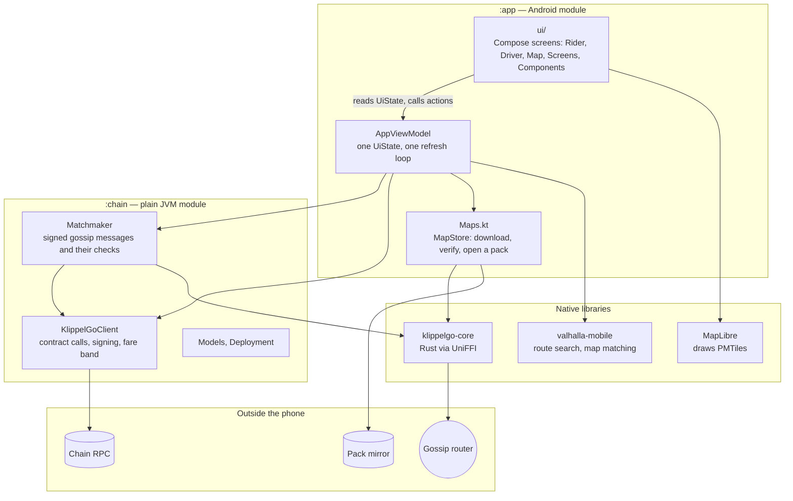
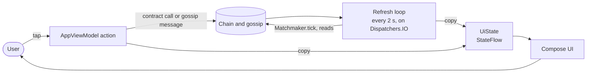
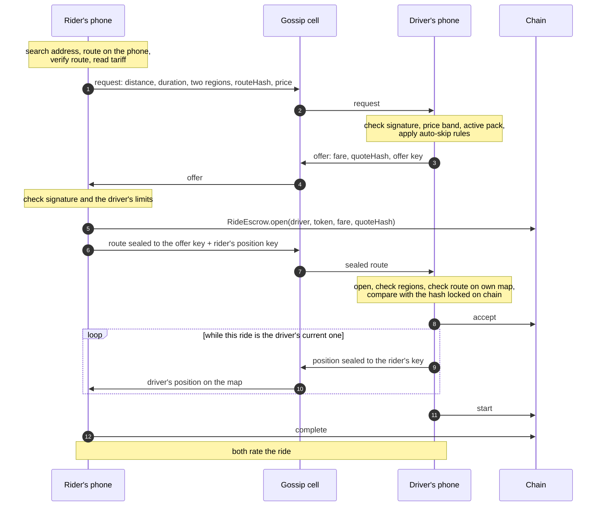

# Apps: architecture overview

The app is the whole product a rider or driver touches, and it is also the "server": it searches addresses,
computes routes, matches with other phones, checks what they claim, and talks to the chain. The Android app
exists; the iOS app is not created yet and will share the same Rust core.

Related: [security.md](security.md), [scalability.md](scalability.md), the
[core overview](../../core/docs/overview.md), the [contracts overview](../../contracts/docs/overview.md), and
how to build and run in [android/README.md](../android/README.md).

## Layers

| Piece | Path | Responsibility |
| --- | --- | --- |
| UI | [`app/…/ui/`](../android/app/src/main/kotlin/org/klippelgo/app/ui) | Composables that draw a `UiState` and call the view model. No chain, gossip or file access |
| `AppViewModel` | [`AppViewModel.kt`](../android/app/src/main/kotlin/org/klippelgo/app/AppViewModel.kt) | The only holder of state. Runs the refresh loop, owns the gossip node's lifetime, turns user actions into calls |
| `MapStore` | [`Maps.kt`](../android/app/src/main/kotlin/org/klippelgo/app/Maps.kt) | Finds the region's active pack on chain, downloads it, verifies it, opens it |
| `Matchmaker` | [`Matchmaker.kt`](../android/chain/src/main/kotlin/org/klippelgo/chain/Matchmaker.kt) | Every gossip message: building, signing, validating, expiring |
| `KlippelGoClient` | [`KlippelGoClient.kt`](../android/chain/src/main/kotlin/org/klippelgo/chain/KlippelGoClient.kt) | Every contract read and write, account signatures, the fare band rules |
| Core | [`core/`](../../core/docs/overview.md) | Hashes, route checks, sealing, the gossip transport, address search |
| Tags | [`ui/tags/Tags.kt`](../android/app/src/main/kotlin/org/klippelgo/app/ui/tags/Tags.kt) | The name of every piece of UI a person reads or touches. The end-to-end tests compile this same file |
| UI agent | [`app/src/androidTest/…/UiAgent.kt`](../android/app/src/androidTest/kotlin/org/klippelgo/app/agent/UiAgent.kt) | Test APK only. Reads the screen and injects touches for the [end-to-end tests](../../tests/README.md) |

The `:chain` module has no Android dependency. That is deliberate: `TwoPhonesRideTest` plays a whole ride
between two in-process "phones" against a local chain and a real gossip node, on the JVM
(`make android-test-chain`).

## One state, one loop

Beside the refresh loop below runs a small one, every second, that reads nothing from the chain: on a started
ride it sends the driver's position, or on the rider's phone takes in the positions that arrived and moves
the car on the map. Which ride it is about is what the last refresh said.

The UI never keeps a second copy of anything on chain or on gossip. It renders `UiState`; the loop rebuilds
the parts that come from outside. An action that changes the chain does the call, then lets the next refresh
show the result.

## A ride, end to end

The pickup pin starts where the rider's phone is, when the rider allows reading it and the place is inside
the map pack, and follows the phone until the rider moves the home map under the pin, picks a pickup by name
on the ask screen from the pack's own search, or starts asking for a ride. After a ride it follows again, so
the next one starts where the last one ended. Without the permission it starts in the middle of the map. Once a destination is picked the trip is drawn on a map there, and stays drawn while offers come
in. A request commits to its route, so its pickup cannot be edited in place: moving the pickup of a request
that is out asks the rider first, then withdraws it and asks again for the route from the new pickup, at the
price the fare guide recommends for that route. The new route is measured before anything is withdrawn. If
asking again then fails, no request is out and the error is shown.

If the chosen driver declines (`cancel` on an Open ride), the rider's phone gets the refund and announces the
same trip again, skipping that driver. A driver already on a ride can take the next one; the waiting rider
sees that the driver is finishing another ride and gets no position until theirs is the current one.

## What is stored on the phone

| What | Where | Notes |
| --- | --- | --- |
| Role, RPC address, name, account choice, auto-skip settings | `SharedPreferences("klippelgo")` | |
| The quote behind each ride this phone asked for | `filesDir/rides/<rideId>.quote.json` | The rider's evidence |
| Routes revealed to this driver, and each rider's position key | `filesDir/rides/<quoteHash>.route.json`, `.riderkey` | So a ride survives the app closing |
| Map packs | App storage, one directory per pack id | Verified on download and on open |
| Open requests, offers, offer secrets, the rider's key for the driver's position | Memory only, in `Matchmaker` | Gone when the app closes; requests expire by themselves. A rider who restarts the app mid-ride gets no more positions for that ride |

## Structure and patterns

These are the rules new app code follows. The skill that applies them is
[`change-app`](../../.claude/skills/change-app/SKILL.md).

**Where code goes**

| If the code… | It belongs in |
| --- | --- |
| Draws something or reacts to a tap | `ui/`, as a composable taking `UiState` and callbacks |
| Holds or derives state, or sequences calls | `AppViewModel` |
| Builds, signs or validates a gossip message | `Matchmaker` |
| Reads or writes a contract, or encodes something the contracts hash | `KlippelGoClient` |
| Must give the same answer on iOS, or on a juror's machine | The Rust core, not Kotlin |
| Downloads, verifies or opens map data | `MapStore` |

**Patterns**

1. **One `UiState`.** Immutable, updated with `copy`, exposed as a `StateFlow`. A new thing the UI shows is a
   new field with a doc comment saying which role it is for.
2. **Composables are stateless about the world.** They may hold view state (a text field, a sheet's position)
   and nothing else.
3. **Nothing blocks the main thread.** Chain, gossip, files and routing run on `Dispatchers.IO`.
4. **Validation happens where a message enters**, in `Matchmaker.receive…`, before anything is stored. The
   view model and the UI only ever see messages that passed. See [security.md](security.md).
5. **Protocol rules are read, not copied.** Tariff, limits, fees, bonds and policies come from the contracts
   at run time. The app has no constant for a value governance can change.
6. **Money is a `Coin` amount in base units**, formatted at the edge. Never a float.
7. **Coordinates are E7 integers** from the map to the core and back.
8. **Every user-facing string is a resource in three languages**: `values/` (Portuguese, the default),
   `values-en/`, `values-es/`. No literal text in a composable.
9. **The same account in both modes.** A phone has one account whether it is riding or driving; switching mode
   never switches account.
10. **Leave the screen before replacing the app on an emulator** (`KEYCODE_HOME`): the emulator's graphics can
    crash when the app is killed with the map showing. The scripts do it.
11. **Every piece a person reads or touches has a tag** from `Tags.kt`, as `<component>.<element>`. A whole
    screen's tag is on its outermost box. A tag that says a state carries it in the name
    (`on-the-way.status.Accepted`), so tests do not depend on the language. `Tags.kt` stays plain Kotlin: the
    test harness compiles it. A native Android view takes no tag from Compose; tag the box around it.

**Changing the app**

1. Put the code where the table says. If it must match iOS or a juror, change the core instead
   ([core overview](../../core/docs/overview.md)).
2. A new or changed gossip message: bump its domain version, validate every field on receipt, add it to the
   message table in [security.md](security.md), and cover it in `TwoPhonesRideTest`.
3. Add strings in all three languages.
4. Tag what a person can read or touch, and give it a function in the component's driver
   (`tests/harness/drivers`). A new flow gets a test in `tests/integrity`; a new check on what comes from
   outside gets one in `tests/security` ([tests/README.md](../../tests/README.md)).
5. `make android-test-chain`, then `make e2e`, which builds the app, installs it on an emulator and uses it
   as a person would. To watch two apps ride together: `make android-two-phones` or `make android-four-phones`.
6. Update these docs when a layer, a flow, a stored file or a guarantee changed.

**Tooling**: Kotlin 2.3, Compose, compileSdk 36, JDK 17. Chain access through web3j. The Rust core is built for
Android by Gradle through `cargo-ndk`.
