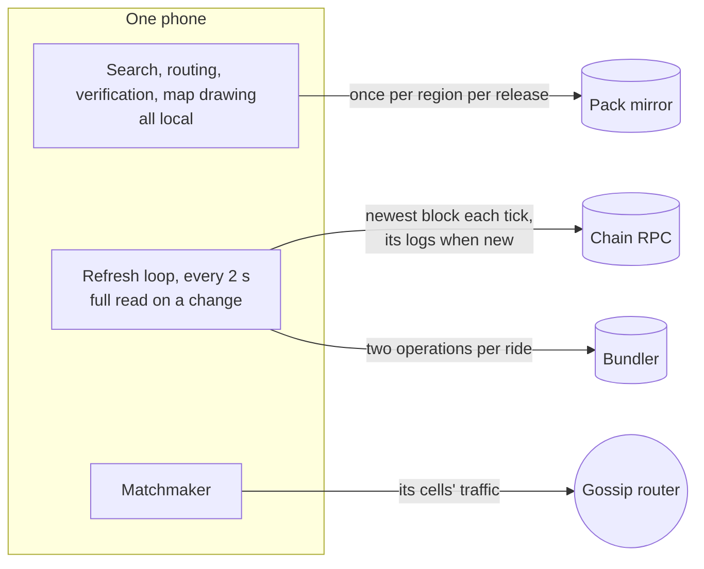
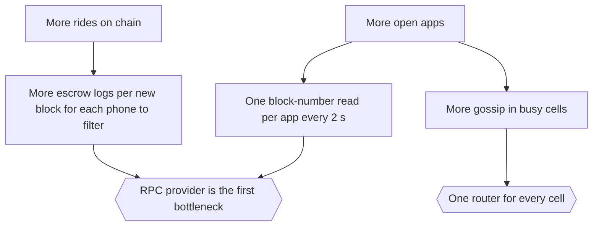

# Apps: scalability

Each phone does its own work, so most of KlippelGo scales by adding phones. What this page tracks is the work
one phone does as its surroundings get busier, and the four outside services a phone still depends on.

Related: [overview.md](overview.md), [core scalability](../../core/docs/scalability.md),
[contracts scalability](../../contracts/docs/scalability.md).

## What a phone depends on

| Dependency | Load per phone | Grows with |
| --- | --- | --- |
| Chain RPC | While the app is on screen, or a ride is under way: the newest block every 2 s; when it is new, one batch of four log queries over the new blocks; a full read (about ten requests, the rides and ratings in one batch each) when those show something about this account, after each action, and every 30 s. A few more reads before each operation (nonce, block, balances, allowance). Nothing while the app is off screen with no ride | Number of open apps |
| Bundler | Two operations per ride per side (the rider's `open` and `complete`, the driver's `accept` and `start`), each an estimate, a send and a receipt polled every half second | Rides |
| Gossip router | The messages of the cells the phone hears: a driver's own and the eight around it, a rider's only those of their own requests and rides | How busy those cells are |
| Pack mirror | One download per region per release, resumable, only changed files | Releases |
| Everything else | The phone's own CPU, storage and battery | Nothing shared |

## Work on the phone

| Task | Cost | Bounded by |
| --- | --- | --- |
| Address search | SQLite full-text and R-tree lookup, debounced 150 ms | Region size |
| Route | One Valhalla search plus one verification | Trip length |
| Checking a revealed route (driver) | One verification | Trip length |
| Gossip intake | Parse, a few cached chain lookups and one signature recovery per new message, and one `isValidSignature` read per certificate not seen before | 200 requests, 50 offers per request; certificate lookups four a minute per session key, answers kept up to 4 096 |
| Drawing | PMTiles read from disk | Screen |
| Storage | One pack per region in use; older packs of the region are deleted on update | Region size |

## What limits growth today

| # | Limit | Where it is | Lever |
| --- | --- | --- | --- |
| S5 | **Caps instead of ranking.** Beyond 200 requests or 50 offers, new ones are dropped rather than the least relevant | `Matchmaker` | With real cells the caps are rarely reached; then prefer nearer and newer |
| S6 | **Re-announcing while open.** A phone with an open request publishes at most every 2.5 s; sealed routes are the largest messages | `Matchmaker.tick` | Send route and positions over a direct channel; back off announcements |
| S7 | **Foreground only.** Gossip and position sharing stop when Android suspends the app | App lifecycle | A foreground service while online or on a ride |
| S8 | **A position a second per started ride.** It is published to the whole cell, four times the rate on the way to a pickup; phones it is not for drop it before any signature work, but it takes room in their 4096-message inbox between refreshes. The driver's phone asks for a fix every second while it moves, whenever the driver screen is open | `AppViewModel.positions`, `startLocation` | Send positions over a direct channel; ask for fast fixes only on a started ride |
| S9 | **App size.** The debug APK is 123 MB with two architectures, mostly native libraries | Build | Per-ABI splits, release shrinking |
| S10 | **First scans from the deploy block.** A new phone, or a rider waiting for a driver it never looked at, reads every 2 000-block range since `deployBlock` one after another before it shows those rides | `KlippelGoClient.scan` | Scan backwards from the head and stop at the account's first ride, or start from a checkpoint the app ships |

None of these is a redesign. S5 and S6 are the next steps already listed for gossip in
[core scalability](../../core/docs/scalability.md).

## Reading the chain

The refresh loop runs every 2 s. Each time it takes in gossip, which needs no chain, and asks
`KlippelGoClient.changedSince` whether anything this screen shows happened since the block the last full read
started at: one `eth_blockNumber`, and only when there is a new block, one JSON-RPC batch of four `eth_getLogs` over
the new blocks (the escrow's events, money arriving in this account, governance changes to policies, tariff and
packs, the registry's events about this account). The escrow's events are filtered on the phone: a change is an
event about a ride the screen shows that can still change, or about another unfinished ride of the driver a waiting
rider is behind, a ride opened naming this account or that driver, money held for this account, or a change to the
escrow's settings. The 16 blocks before the new ones are read again each time, and an event counts once, so one
a lagging node left out is still seen. A full read follows such a change, every action, coming back on screen, a failed check, and in
any case 30 s after the last one, which is when a rating someone else gave, for one, reaches the screen.

| Read | How |
| --- | --- |
| Rides of an account (`RideOpened`) and drivers (`Registered`) | `KlippelGoClient.scan`: from the deployment's `deployBlock`, in ranges of 2 000 blocks, then only the blocks after the last one read, the last 64 again in case of a reorganisation. What it found is kept in `SharedPreferences` per account, with a block and its hash to tell after a restart whether the chain is still the same one |
| Rides on screen, and every unfinished ride of a driver | `KlippelGoClient.rides`: those in a final state from memory, the rest in one batch |
| Ratings, drivers' roles and reputations | One batch each; a ride once rated is not asked again |

What is left grows with the escrow's use, not with this phone's: every phone downloads every escrow event of the
blocks it checks to filter them. At ten thousand rides a day that is about one event per block.

A scan's first run is slow on a long chain (S10). The scans keep
every ride id of this account, and of the driver a rider waits for until they stop waiting: a driver's grows with
their rides and with rides anyone opens naming them (P12).

## Depending on fewer shared services

The RPC provider is the one service whose failure stops a phone, and the one that sees its IP address with its
account; the bundler's failure stops its writes, and it sees the same. The app already takes the RPC address as
a setting, and finds the bundler on port 4337 of the same host. Scaling here means many providers rather than a
bigger one: a community list, the user's own node, or a light client. The mirror and the router are already
replaceable by anyone, since neither is trusted ([security.md](security.md)).

## Adding a city

Build and publish a pack, activate it through governance, serve it from any mirror. The app needs no release:
it asks `MapRegistry` for the region's latest pack. Today the region is the constant `PILOT_REGION`; choosing
it from the phone's location is the only app change a second city needs.

## iOS

The iOS app will reuse the core through UniFFI, so search, routing checks, hashing, sealing and gossip behave
identically. What must be rewritten is what is Kotlin today: `Matchmaker` and `KlippelGoClient`. Before iOS
starts, moving message validation from `Matchmaker` into the core would give both platforms one
implementation of the checks in [security.md](security.md).

## Measured

[`tests/performance`](../../tests/performance) times what a person waits for, on the real app, and fails when a
figure passes its ceiling ([tests/README.md](../../tests/README.md)). Every run adds to
`tests/.run/report/performance.json`. These are from an x86 emulator on a developer's computer, with a local
chain mining every two seconds, on the Cascavel pack (7 MB), on 2026-10-11. They say where the time goes, not
what a phone will do.

| What | Measured | Ceiling |
| --- | --- | --- |
| Cold start to the first screen | 1.3 s | 6 s |
| Map pack downloaded from the mirror, verified and opened | 3.6 s | 90 s |
| Reopening the app to a usable map (pack checked against the chain again) | 4.8 s | 20 s |
| Address search, typed text to first result | 0.25 s | 3 s |
| Route found by Valhalla and measured by the verifier | 0.36 s | 5 s |
| A rider's request reaching a driver's screen | 2.0 s | 15 s |
| A driver's offer reaching the rider's screen | 1.0 s | 10 s |
| Locking the fare, tap to the ride on screen | 4.5 s | 30 s |
| Driver's screen with 150 open requests: passing to the next one | 0.6 s | 5 s |
| Memory with the map open | 265 MB | 900 MB |
| Memory added by 150 open requests | 31 MB | 300 MB |

What moves a ride along is the two-second check for a new block and the block time, not the phone's own work.
These figures were measured before the check replaced reading everything every 2 s.

## Not measured yet

RPC calls per hour with the change check, battery drain while online, time to route on low-end devices, and gossip throughput per
cell beyond 150 open requests. Measure before choosing among the levers above.
