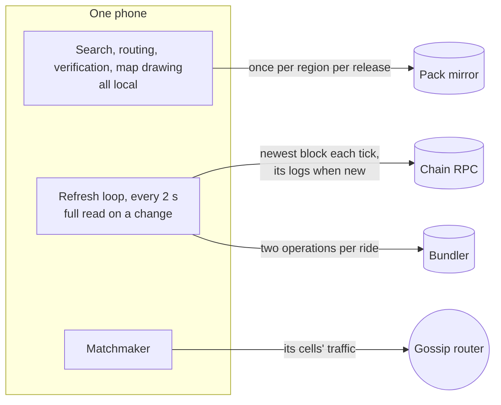
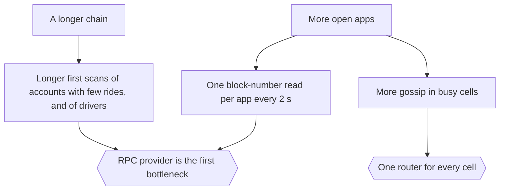

# Apps: scalability

Each phone does its own work, so most of KlippelGo scales by adding phones. What this page tracks is the work
one phone does as its surroundings get busier, and the four outside services a phone still depends on.

Related: [overview.md](overview.md), [core scalability](../../core/docs/scalability.md),
[contracts scalability](../../contracts/docs/scalability.md).

## What a phone depends on

| Dependency | Load per phone | Grows with |
| --- | --- | --- |
| Chain RPC | While the app is on screen, a driver is online, or a ride is under way: the newest block every 2 s; when it is new, one batch of seven log queries over the new blocks, which return only events about this phone's rides and account; a full read (about ten requests, the rides and ratings in one batch each, plus two or three for the release's status, and for each earlier release's escrow in the deployment file one batch (what it owes in each coin, and each of this account's rides there not yet seen settled) and its incremental log scans) when those show something about this account, after each action, and every 30 s. A few more reads before each operation (nonce, block, balances, allowance). Nothing while the app is off screen with no ride and not online | Number of open apps |
| Second RPC provider | Only with one set: at each full read, its newest block before the read, then its chain id, newest block and the block read, and about four batches of reads at that block: the rides, balances and fees on screen, the rates, permission, busy rides and pack root, and the release registry. The main provider pays only the block's hash and the tariff and tax read again. While it is behind a block a change was seen in, the app reads in full every 2 s, against both, until it catches up or is 30 blocks behind | Number of open apps that set one |
| Bundler | Two operations per ride per side (the rider's `open` and `complete`, the driver's `accept` and `start`), each an estimate, a send and a receipt polled every half second | Rides |
| Gossip router | The messages of the cells the phone hears: a driver's own and the eight around it, a rider's only those of their own requests. A rider also receives their own ride's positions, a driver sends them. Every phone hears the router join and leave each ride's topic, about 9 MB an hour at the target | How busy those cells are |
| Pack mirror | One download per region per release, resumable, only changed files | Releases |
| Everything else | The phone's own CPU, storage and battery | Nothing shared |

## Work on the phone

| Task | Cost | Bounded by |
| --- | --- | --- |
| Address search | SQLite full-text and R-tree lookup, debounced 150 ms | Region size |
| Route | One Valhalla search plus one verification | Trip length |
| Checking a revealed route (driver) | One verification | Trip length |
| Gossip intake | Parse, cached lookups and one signature recovery per new message; one `isValidSignature` read per certificate not seen before, and one per account or pack not known in the last five minutes, made outside the matchmaker's lock. A driver's phone checks no other driver's offers | 200 requests, 50 offers per request; 64 reads per tick for requests and offers and 16 for the parties of held requests; certificate lookups four a minute per session key, answers kept up to 4 096; permissions of 1 024 riders and 1 024 drivers, 64 packs |
| Drawing | PMTiles read from disk | Screen |
| Storage | One pack per region in use; older packs of the region are deleted on update | Region size |

## What limits growth today

| # | Limit | Where it is | Lever |
| --- | --- | --- | --- |
| S10 | **Some first scans still go back to the deploy block.** A new phone reads an account's rides newest first and stops at the tenth, but an account with fewer than ten rides on this release, a new one included, is read back to `deployBlock`. Registered drivers are read back to `dataDeployBlock`, which stays where the data contracts were deployed as releases follow, and each earlier release's escrow back to its own deploy block. Each is 2 000 blocks a query and 20 queries a request, about 400 requests for a year of 2 s blocks | `KlippelGoClient.scan` | Start from a checkpoint the app ships; stop an account's scan at the block it was created in |

None of these is a redesign.

## Off screen

While a driver is online, on a ride they accepted, or a rider has a ride that is not in dispute, `OnDutyService` keeps the process and the CPU running, with a
notification, so gossip, the refresh loop and the driver's position go on with the screen off. Off screen an online
driver's phone also reads the chain, for a ride opened naming them. The service asks for the location type, or
data sync for a rider who refused location. Android starts one only from the foreground: a ride that begins off
screen for someone not online waits until they next open the app. Swiping the app away ends it all, service
included. The app does not yet alert a driver off screen when a request arrives.

## Location

A driver's phone asks for a fix a second while the car moves on a started ride, and one every four seconds otherwise,
which is the rate positions go to a pickup. The change follows the refresh that saw the ride start.

## Announcing

Gossip keeps no history, so a message is said again for peers who missed it or came later. Those are fewer the
older the message is, so each gap is twice the last (`Cadence`), from 2.5 s up to a ceiling. The loop runs every
2 s, so a gap in practice ends at the next tick after it.

| Message | Widest gap | Stops |
| --- | --- | --- |
| Request | 5 s | At the close |
| Offer | 5 s | At the close, or 15 s after the rider was last heard |
| Close | 10 s | 15 s after closing, when phones that missed it have dropped the request anyway. A replay of the request heard by the rider's phone says it again |
| Sealed route | 60 s | At the driver's first position, whose signature and sealing show the route arrived, or when the request expires. Not at the accept: the driver can accept without the route (P14) |

A driver's phone holds a request while it is open: it forgets one at the close, or 15 s after last hearing it,
unless it quoted it, when it keeps it for the route until it expires. So 200 is reached only by traffic, not by
the past. When it is reached, the list gives up its farthest request, in bands of about 2 km from the phone, and
of those the one first heard longest ago; a newcomer farther than that is dropped before any signature or chain read.
Fifty offers are ranked differently: by the policy and the fare, after the signature ([security.md](security.md), P5).

## Reading the chain

The refresh loop runs every 2 s. Each time it takes in gossip, which needs no chain, and asks
`KlippelGoClient.changedSince` whether anything this screen shows happened since the block the last full read
started at: one `eth_blockNumber`, and only when there is a new block, one JSON-RPC batch of seven `eth_getLogs`
over the new blocks. Four are on the escrow and the node chooses their events by indexed topic: rides opened naming
this account or the driver a waiting rider is behind (as rider, then as driver), any event of a ride the screen
shows that can still change or that driver is busy with (a hundred ride ids a query), and payments held for anyone
together with changes to the escrow's settings, both rare. The other three are money arriving in this account,
governance changes to policies, tariff, packs and releases, and the registry's events about this account. What
comes back is checked again on the phone, so a node that ignores the topics costs bandwidth, not a full read every
tick. A node that refuses lists of topics fails every check, and the phone then reads in full every 2 s. The 16 blocks before the new ones are read again each time, and an event counts once, so one a lagging node
left out is still seen. A full read follows such a change, every action, coming back on screen, a failed check, and
in any case 30 s after the last one, which is when a rating someone else gave, for one, reaches the screen. A driver
accepting another ride before the waiting rider's own is accepted is also seen then.

| Read | How |
| --- | --- |
| Rides of an account (`RideOpened`), drivers (`Registered`), this account's rides on earlier escrows | `KlippelGoClient.scan`: the blocks after the last one read, the last 64 again in case of a reorganisation, then older blocks newest first, in ranges of 2 000 blocks sent 20 to a request. An account's rides stop at the ten newest; the others go back to their start block (S10). What it found and how far back it read is kept in `SharedPreferences` per account, with a block and its hash to tell after a restart whether the chain is still the same one |
| The rides a driver is busy with | `KlippelGoClient.underWay`: the escrow's `onTripOf` and `pickupOf` for that driver in one batch, then those rides |
| Everything a full read reads from contracts, with a second provider set | At one block both providers have (`KlippelGoClient.at`), so the second can be asked about the same state (A18 in [security.md](security.md)). With none, at the newest block, as each read reaches the node |
| Rides on screen | `KlippelGoClient.rides`: those in a final state from memory, the rest in one batch |
| Ratings, drivers' roles and reputations | One batch each; a ride once rated is not asked again |

What a phone downloads in its checks grows with its own rides, not with the escrow's use. A scan's first run can
still be slow on a long chain (S10). A scan keeps every ride id it found of this account: a driver's grows with
their rides and with rides anyone opens naming them (P12).

## Depending on fewer shared services

The RPC provider is the one service whose failure stops a phone, and the one that sees its IP address with its
account; the bundler's failure stops its writes, and it sees the same. The app already takes the RPC address as
a setting, and finds the bundler on port 4337 of the same host. Scaling here means many providers rather than a
bigger one: a community list, the user's own node, or a light client. The mirror and the router are already
replaceable by anyone, since neither is trusted ([security.md](security.md)).

## Adding a city

Build and publish a pack, activate it through governance, serve it from any mirror. The app needs no release:
it asks `MapRegistry` for the region's latest pack. Today the region is the constant `PILOT_REGION`; choosing
it from the phone's location is the only app change a second city needs.

## iOS

The iOS app will reuse the core through UniFFI, so search, routing checks, hashing, sealing and gossip behave
identically. What must be rewritten is what is Kotlin today: `Matchmaker` and `KlippelGoClient`. Before iOS
starts, moving message validation from `Matchmaker` into the core would give both platforms one
implementation of the checks in [security.md](security.md).

## Measured

[`tests/performance`](../../tests/performance) times what a person waits for, on the real app, and fails when a
figure passes its ceiling ([tests/README.md](../../tests/README.md)). Every run adds to
`tests/.run/report/performance.json`. These are from an x86 emulator on a developer's computer, with a local
chain mining every two seconds, on the Cascavel pack (7 MB), on 2026-10-11. They say where the time goes, not
what a phone will do.

| What | Measured | Ceiling |
| --- | --- | --- |
| Cold start to the first screen | 1.3 s | 6 s |
| Map pack downloaded from the mirror, verified and opened | 3.6 s | 90 s |
| Reopening the app to a usable map (pack checked against the chain again) | 4.8 s | 20 s |
| Address search, typed text to first result | 0.25 s | 3 s |
| Route found by Valhalla and measured by the verifier | 0.36 s | 5 s |
| A rider's request reaching a driver's screen | 2.0 s | 15 s |
| A driver's offer reaching the rider's screen | 1.0 s | 10 s |
| Locking the fare, tap to the ride on screen | 4.5 s | 30 s |
| Driver's screen with 150 open requests: passing to the next one | 0.6 s | 5 s |
| Memory with the map open | 265 MB | 900 MB |
| Memory added by 150 open requests | 31 MB | 300 MB |

What moves a ride along is the two-second check for a new block and the block time, not the phone's own work.

### Gossip intake under a flood

`MatchmakerLoadTest` (`:chain`, run with `KLIPPELGO_BENCH=1`) puts one phone's matchmaker behind a gossip router of
its own and a proxy that counts its chain requests, ticks it every 2 s as the app does, and publishes offers for a
rider's request: three each from two of the testnet's real drivers, announced again every 2.5 s as their phones do,
and three each from throwaway accounts nobody registered. Those go out once, all at the start ("at once"), at a rate
for 20 s ("per second"), or again every tick for 20 s ("every tick"). Meanwhile it asks the matchmaker what the screen
shows every 5 ms and times the answer. Measured on 2026-11-07 against the local chain, before (the matchmaker of the
previous commit: reads under the lock, the fee read for every offer, offers' certificates outside the budget, every
phone checking every offer) and after:

| Phone | Throwaway accounts | Chain requests | Longest tick | Screen waited at most | Real drivers' offers held after |
| --- | --- | --- | --- | --- | --- |
| Rider | none | 9 → 6 | 0.40 s → 0.28 s | 0.40 s → 0.07 s | 0.4 s → 0.3 s |
| Driver | none | 9 → 0 | 0.34 s → 0.01 s | 0.32 s → 0.00 s | 0.3 s → 2.0 s |
| Rider | 100, at once | 611 → 104 | 23.2 s → 2.9 s | 23.2 s → 0.09 s | 26.8 s → 6.9 s |
| Driver | 100, at once | 618 → 0 | 27.5 s → 0.16 s | 27.2 s → 0.00 s | 29.5 s → 6.0 s |
| Rider | 400, at once | 2 422 → 128 | 88.3 s → 3.0 s | 88.3 s → 0.22 s | 106.7 s → 5.8 s |
| Driver | 400, at once | 2 422 → 0 | 94.7 s → 0.27 s | 94.7 s → 0.00 s | 13.5 s → 6.0 s |
| Rider | 50 per second (200 → 700 sent) | 1 215 → 458 | 26.6 s → 2.9 s | 26.6 s → 0.08 s | 0.5 s → 0.5 s |
| Rider | 200 per second (800 → 2 400 sent) | 2 743 → 452 | 103.8 s → 3.1 s | 103.8 s → 0.26 s | 18.3 s → 11.1 s |
| Rider | 100, every tick | 1 315 → 408 | 39.8 s → 3.4 s | 39.8 s → 0.10 s | 44.5 s → 14.1 s |
| Rider | 400, every tick | 4 837 → 519 | 175.8 s → 3.3 s | 175.8 s → 0.44 s | 213.2 s → 25.0 s |

Before, every forged offer cost two reads, made while the screen waited, so a flood froze the screen for as long as
the reads took and the real offers came after them. After, the reads stop at the budget and are made with the lock
free, and a driver's phone reads nothing for others' offers. What the budget costs is the wait for an honest
newcomer in a flood: some ticks, 6 s for forgeries sent once and up to 25 s for 400 accounts whose forgeries are sent
again every tick, which wait as long as it does. In the rate rows the before code ticked so slowly that the run sent
it only a third of what it sent after. In the driver rows the last column is the time on the rider's phone that ran
alongside, whose requests are not counted: it says the flood reached the rider too, not how the driver's phone did.

## At a hundred thousand drivers

[`core/bench`](../../core/bench/README.md) models what 100 000 drivers and 1 000 000 riders put on each shared
service and on each phone, and measures the gossip part through the real router. Its findings for the app: in
the busiest cell a driver's phone would receive about 52 gossip messages a second, 255 MB an hour, a thirtieth of
its inbox, hold about 33 requests of its 200, and poll 0.2 MB an hour of escrow events; RPC nodes would answer
about 330 000 requests a second, mostly the seven log queries of each check. `make bench-model` reruns the model at any scale. Past GossipSub's mesh a
message arrives by lazy gossip: requests reach 97% of drivers with 46 phones on a cell, but take 15 s at p95 where they
take 2 s inside the mesh, and a busy cell at the target has about 6 000 phones (K11 in
[core security](../../core/docs/security.md)).

Not measured yet: battery drain while online and time to route on low-end devices.
