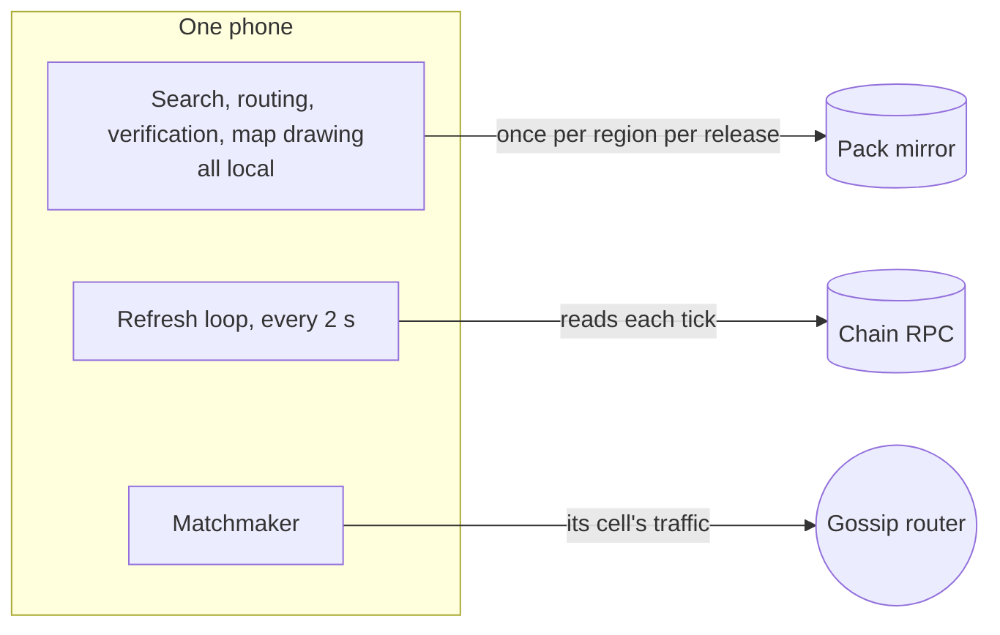
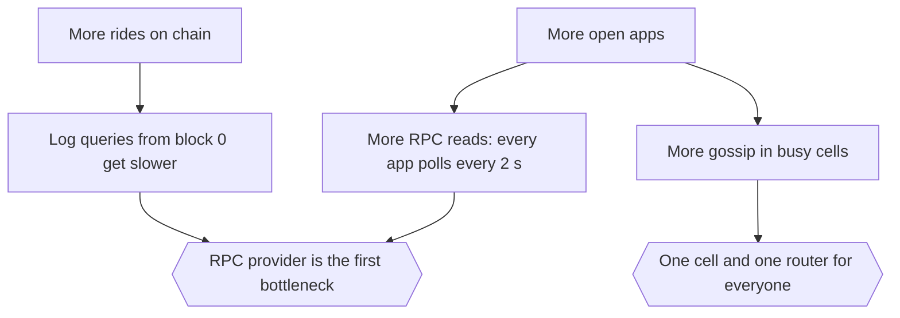

# Apps: scalability

Each phone does its own work, so most of KlippelGo scales by adding phones. What this page tracks is the work
one phone does as its surroundings get busier, and the three outside services a phone still depends on.

Related: [overview.md](overview.md), [core scalability](../../core/docs/scalability.md),
[contracts scalability](../../contracts/docs/scalability.md).

## What a phone depends on

| Dependency | Load per phone | Grows with |
| --- | --- | --- |
| Chain RPC | A handful of reads every 2 s while the app is open, plus four transactions per ride | Number of open apps |
| Gossip router | The messages of the phone's cell | How busy the cell is |
| Pack mirror | One download per region per release, resumable, only changed files | Releases |
| Everything else | The phone's own CPU, storage and battery | Nothing shared |

## Work on the phone

| Task | Cost | Bounded by |
| --- | --- | --- |
| Address search | SQLite full-text and R-tree lookup, debounced 150 ms | Region size |
| Route | One Valhalla search plus one verification | Trip length |
| Checking a revealed route (driver) | One verification | Trip length |
| Gossip intake | Parse, a few cached chain lookups and one signature recovery per new message | 200 requests, 50 offers per request |
| Drawing | PMTiles read from disk | Screen |
| Storage | One pack per region in use; older packs of the region are deleted on update | Region size |

## What limits growth today

| # | Limit | Where it is | Lever |
| --- | --- | --- | --- |
| S1 | **Polling.** The refresh loop reads the chain every 2 s whether or not anything changed | `AppViewModel` refresh loop | Subscribe to the escrow's events for this account and refresh on an event; poll slowly as a fallback; stop while the app is in the background |
| S2 | **Log scans from the first block.** Rides are found by filtering `RideOpened` from `EARLIEST` each time. Topics are indexed, but public RPCs cap block ranges and the scan grows with chain history | `KlippelGoClient.rideIds` | Keep the last scanned block and known ride ids on the phone; query only new blocks |
| S3 | **One read per ride.** Each ride on screen is fetched separately every refresh. Finding a driver's current ride reads every unfinished ride naming them; finished ones are remembered | `KlippelGoClient.ride`, `underWay` | Batch with multicall; cache rides in a final state for the screen too |
| S4 | **One cell.** Every phone is on `DEV_CELL`, so everyone receives everyone's requests | `Matchmaker.DEV_CELL` | Cells from location, as designed: a phone then sees only its neighbourhood |
| S5 | **Caps instead of ranking.** Beyond 200 requests or 50 offers, new ones are dropped rather than the least relevant | `Matchmaker` | With real cells the caps are rarely reached; then prefer nearer and newer |
| S6 | **Re-announcing while open.** A phone with an open request publishes at most every 2.5 s; sealed routes are the largest messages | `Matchmaker.tick` | Send route and positions over a direct channel; back off announcements |
| S7 | **Foreground only.** Gossip and position sharing stop when Android suspends the app | App lifecycle | A foreground service while online or on a ride |
| S8 | **A position a second per started ride.** It is published to the whole cell, four times the rate on the way to a pickup; phones it is not for drop it before any signature work, but it takes room in their 4096-message inbox between refreshes. The driver's phone asks for a fix every second while it moves, whenever the driver screen is open | `AppViewModel.positions`, `startLocation` | Send positions over a direct channel; ask for fast fixes only on a started ride |
| S9 | **App size.** The debug APK is 123 MB with two architectures, mostly native libraries | Build | Per-ABI splits, release shrinking |

None of these is a redesign. S1 to S3 are client changes behind `KlippelGoClient`; S4 to S6 are the next steps
already listed for gossip in [core scalability](../../core/docs/scalability.md).

## Depending on fewer shared services

The RPC provider is the one service whose failure stops a phone, and the one that sees its IP address with its
account. The app already takes the RPC address as a setting. Scaling here means many providers rather than a
bigger one: a community list, the user's own node, or a light client. The mirror and the router are already
replaceable by anyone, since neither is trusted ([security.md](security.md)).

## Adding a city

Build and publish a pack, activate it through governance, serve it from any mirror. The app needs no release:
it asks `MapRegistry` for the region's latest pack. Today the region is the constant `PILOT_REGION`; choosing
it from the phone's location is the only app change a second city needs.

## iOS

The iOS app will reuse the core through UniFFI, so search, routing checks, hashing, sealing and gossip behave
identically. What must be rewritten is what is Kotlin today: `Matchmaker` and `KlippelGoClient`. Before iOS
starts, moving message validation from `Matchmaker` into the core would give both platforms one
implementation of the checks in [security.md](security.md).

## Measured

[`tests/performance`](../../tests/performance) times what a person waits for, on the real app, and fails when a
figure passes its ceiling ([tests/README.md](../../tests/README.md)). Every run adds to
`tests/.run/report/performance.json`. These are from an x86 emulator on a developer's computer, with a local
chain mining every two seconds, on the Cascavel pack (7 MB), on 2026-10-11. They say where the time goes, not
what a phone will do.

| What | Measured | Ceiling |
| --- | --- | --- |
| Cold start to the first screen | 1.3 s | 6 s |
| Map pack downloaded from the mirror, verified and opened | 3.6 s | 90 s |
| Reopening the app to a usable map (pack checked against the chain again) | 4.8 s | 20 s |
| Address search, typed text to first result | 0.25 s | 3 s |
| Route found by Valhalla and measured by the verifier | 0.36 s | 5 s |
| A rider's request reaching a driver's screen | 2.0 s | 15 s |
| A driver's offer reaching the rider's screen | 1.0 s | 10 s |
| Locking the fare, tap to the ride on screen | 4.5 s | 30 s |
| Driver's screen with 150 open requests: passing to the next one | 0.6 s | 5 s |
| Memory with the map open | 265 MB | 900 MB |
| Memory added by 150 open requests | 31 MB | 300 MB |

What moves a ride along is the two-second refresh (S1) and the block time, not the phone's own work.

## Not measured yet

RPC calls per refresh, battery drain while online, time to route on low-end devices, and gossip throughput per
cell beyond 150 open requests. Measure before choosing among the levers above.
