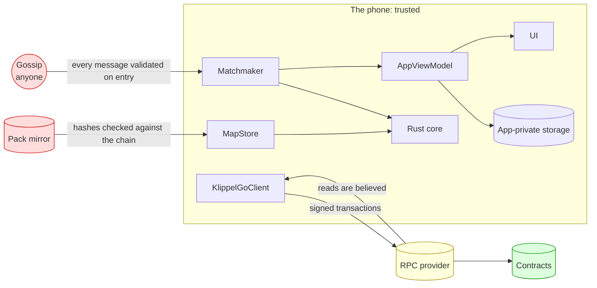
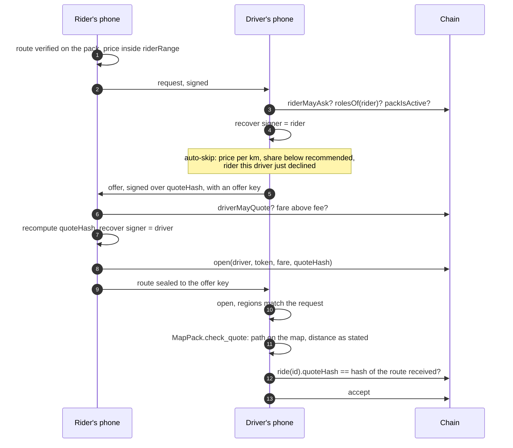
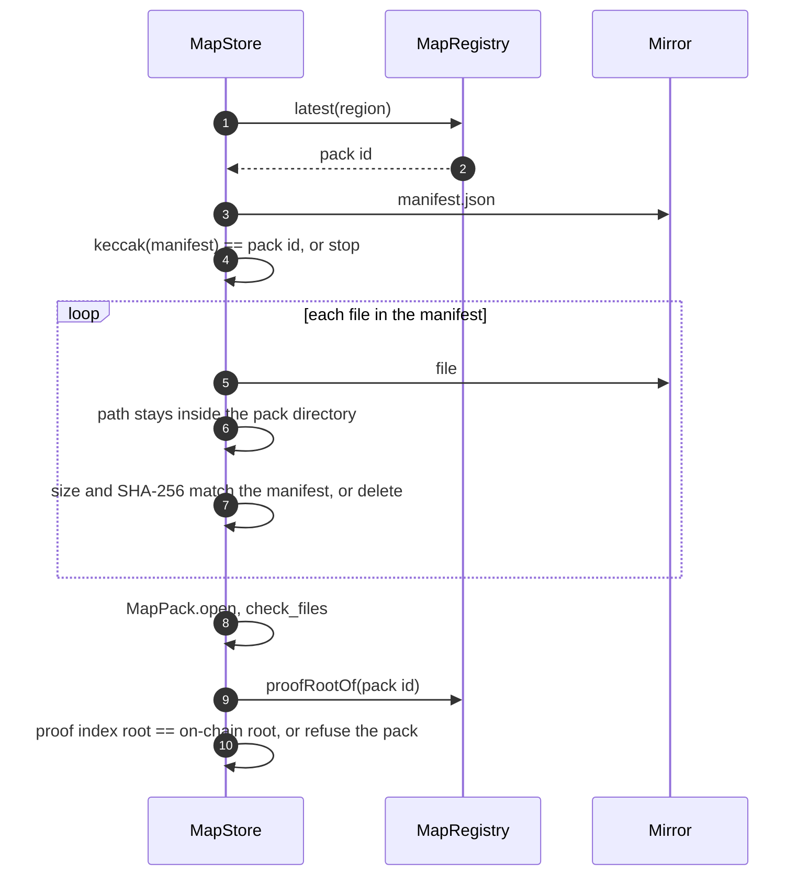

# Apps: security

The app is where an attacker actually meets KlippelGo: it takes messages from strangers, downloads map data
from a mirror, holds the keys, and shows the user what to believe. The numbered invariants (`A1` to `A14`) are
what the [security reviewer](../../.claude/agents/security-reviewer.md) checks a change against.

Related: [overview.md](overview.md), [core security](../../core/docs/security.md),
[contract security](../../contracts/docs/security.md).

## What the app must protect

| Asset | Threat |
| --- | --- |
| The account key | Theft means the user's funds, stake and reputation |
| Where the user is and where they go | Any peer in the cell, the router, the mirror, the RPC provider |
| The user's money | Being shown a wrong price, a wrong route or a wrong counterparty and locking funds on it |
| The user's attention | Fake requests and offers that waste a driver's or rider's time |

## Trust boundaries

Gossip and mirrors are hostile by assumption. The RPC provider is the weak point: the app believes what it
reads from it (see limit P3).

## Gossip messages and their checks

Every message is JSON, signed by the account it speaks for over a hash that starts with a versioned domain
tag. `Matchmaker` drops a message that fails any check, silently, before storing anything.

| Message | Signed by | Domain | Checks on receipt |
| --- | --- | --- | --- |
| `request` | Rider | `KlippelGo request v3` | Not expired and expiring within an hour; under the cap of 200 requests; token is a known coin; positive fare, distance and duration; both region cells valid; price inside the fare guide's range for the stated trip; signature recovers the rider; signer has the rider role on chain; the map pack is active in `MapRegistry` |
| `offer` | Driver | `KlippelGo offer v2` | For a known request; sequence number newer than the driver's last; under 50 offers per request; expires before the request does; fare within the driver's floor and ceiling; fare above the token's fee; signature recovers the driver over the quote hash recomputed locally |
| `close` | Rider | `KlippelGo close v1` | For a known request; signature recovers that request's rider |
| `route` | Rider | `KlippelGo sealed route v2` | Addressed to this account; for a known request this phone quoted; signature recovers the request's rider over the sealed bytes and the rider's position key; opens with this phone's offer secret for one of its own quote hashes; the route starts and ends in the regions the request showed |
| `position` | Driver | `KlippelGo sealed position v1` | For a ride this phone locked; signature recovers that ride's driver; opens with this phone's key for that quote; stamped by the driver later than every position before it, so a replayed one is dropped. How fresh it is counts from when it arrived, not from the driver's clock |

The request id is the hash of all its fields and a random nonce, and the quote hash names the chain, the
escrow, the route hash, the fare, the token, both parties and the expiry. A message copied to another chain,
escrow, request or price fails its signature check.

## Matching, with the checks in place

The driver accepts only after step 12: the route exists on their own copy of the map, is as long as the rider
said, and is the one whose hash holds the money.

## The map pack

## Who learns what, and when

| Moment | Everyone in the cell | The chosen driver | The rider | The chain |
| --- | --- | --- | --- | --- |
| Request | Distance, duration, price, two regions of about 1 km, rider's address | same | | nothing |
| Offer | Driver's address and fare | | | nothing |
| Lock | That a sealed route went to that driver | The exact route | | Both addresses, token, fare, quote hash |
| Driver on another ride | That the driver is sending positions for some other ride | | "Yours is next", no position | |
| Driver on this ride | That the driver is sending positions for this ride: the message names the quote hash, which is on chain. Not where the driver is | | Driver's position, every few seconds | |
| Arrival | | | | Receipt hash |

The driver's position is sealed to a key the rider sent inside the signed `route` message, and the driver's
phone sends it only for the ride it is on now: of all the rides it accepted and has not finished, the one
that started, or else the one locked first. A ride in dispute is frozen and takes no turn, so the next rider's
turn comes while it is judged.
That is read from every ride naming the driver, not from the newest few, because anyone can open a ride naming
a driver and a short window could be filled to hide the real one.

## Invariants

- **A1. Nothing from gossip is stored or shown before its signature and limits are checked.** Validation
  lives in `Matchmaker.receive…`; nothing else parses gossip.
- **A2. Every signed structure has its own domain tag and version.** A changed field means a new version.
- **A3. The quote hash is always recomputed locally** from the request and the offer's fields, never taken
  from the message.
- **A4. A rider locks only what was verified.** The route passed the verifier on an active pack; the price is
  inside `riderRange`; the offer is inside the driver's limits and unexpired.
- **A5. A driver accepts only a route they checked** on their own pack, in the announced regions, matching
  the quote hash locked in the escrow.
- **A6. Prices outside the band are ignored on both sides.** The band is read from `FareGuide`, never
  hard-coded.
- **A7. A pack is used only if the chain vouches for it**: manifest hash is the on-chain id, files match the
  manifest, proof root matches `MapRegistry`, and the pack is active.
- **A8. Downloaded paths cannot escape the pack directory.**
- **A9. Exact places leave the phone only sealed to one counterparty.** In the clear: geohash cells only.
- **A10. A driver's position goes only to the rider of the ride under way**, and stops when that ride ends.
- **A11. Memory taken by strangers is bounded**: caps on requests and on offers per request, and requests
  expire. Limit P13 lists what is not bounded yet.
- **A12. Secrets stay in app-private storage or memory.** Offer secrets are memory only. Nothing secret is
  logged, put in an intent, or written to shared storage. `allowBackup` is off.
- **A13. Cleartext traffic is allowed only to loopback and the emulator's host alias.**
- **A14. Money shown is money locked.** The amounts on the confirmation screen are computed from the same
  values passed to `open`, including fee and bonds read from the chain.

## Known limits

Real today. A change touching one should close it or leave it no worse, and say which.

| # | Limit | Consequence | What closes it |
| --- | --- | --- | --- |
| P1 | **Accounts are anvil's public test keys** (`DevAccount`) | No real key protection exists yet. Never usable outside a local testnet | Hardware-backed P-256 keys (StrongBox, Secure Enclave) behind ERC-4337 smart accounts |
| P2 | `MainActivity` is exported and reads `role`, `rpc` and `pair` extras | Another app on the device could start KlippelGo with a role, a test account and an RPC it controls, and the RPC is saved, so it outlasts that launch | Accept the extras only in debug builds |
| P3 | The app believes its RPC provider | A lying RPC can show a fake tariff, pack root, ride state or balance. A ride once reported finished is remembered as finished until the app restarts | Light-client proofs or several independent RPCs; at minimum a user-chosen RPC |
| P4 | In `receiveOffer`, the token's fee is read from the chain (`tokenConfig`) before the signature is checked. A request signed by any throwaway key costs one `rolesOf` read | A flood of offers for a known request, or of requests from fresh keys, makes each phone do RPC calls | Check the signature first; cache the fee like the tariff |
| P5 | Offers are stored from any key, 50 per request, and an expired offer keeps its slot | Fifty throwaway keys can fill a request's slots so real drivers' offers are dropped until the request expires. The rider's screen hides offers from accounts that cannot accept, so no funds are at risk | Check `canAcceptRides(driver)` on receipt, cached; drop expired offers |
| P6 | The account key signs every gossip message | Heavy use of the wallet key; no way to revoke a session | Session certificates |
| P7 | Everyone uses one cell (`DEV_CELL`) | No geographic privacy or sharding yet | Cells from the phone's location |
| P8 | Routes, quotes and rider keys on disk are not encrypted beyond Android's app sandbox | A rooted or seized phone reveals past rides | Encrypted database, retention limit |
| P9 | Pickup proof and trip receipt are stand-in hashes; GPS logging is not wired | The trip itself is unproven on the app today | The ride channel, then `TripLog` and receipts from the core |
| P10 | The rider's address and price are visible to the cell, linked to a region | A watcher can profile an address's trips by region | Fresh accounts per ride; encrypted offers |
| P11 | A position is whatever the driver's phone says, and it counts as fresh from when it arrives | A driver can report a place they are not at. A relay that holds the messages back and releases them in order makes old positions look current. A driver whose clock steps backwards mid-ride stops being shown | It is for display. Never use it as evidence: that is what the signed trip log is for. A per-ride counter instead of a clock, and an estimate of the clock offset, would close the last two |
| P12 | Anyone with the rider role can open rides naming any driver, and cancel them later at no cost | Each one left Open costs that driver's phone, and the phones of riders waiting for that driver, one chain read per refresh; a few hundred slow the refresh enough that positions stop looking fresh. The driver's screen shows the newest ten rides, so ten junk rides hide a real rider's Open ride, and older junk cannot be declined from the app | Find accepted rides from `RideAccepted` logs in one query; show the driver the oldest Open rides; a cost for opening |
| P13 | The matchmaker's caches of "is a rider" and "pack is active" answers are never pruned, and a "no" is kept until the app restarts | Memory grows with distinct signers seen; an account that registers after its first request is ignored by phones that saw it | Bound and expire both caches |
| P14 | The driver's Accept button does not require the revealed route to have been checked | A5 holds by what the screen shows the driver ("rota conferida no seu mapa"), not by code: a driver can accept a ride whose route never arrived or failed the check | Enable Accept only once the route passed `check_quote` against the locked hash |
| P15 | The rider's "driver is busy" notice starts from "nobody ahead" until the first successful read | A waiting rider whose first read fails sees no notice for a moment. No position is shown or sent | Keep the count unknown until read, and show neither state meanwhile |

## How it is tested

`TwoPhonesRideTest` plays a ride between two clients over a real gossip node and chain, and asserts what each
side learned. A new check on a message needs a case there that sends the bad message and shows it is dropped. That is
still owed for most rows of the message table: the test covers the honest path, and the replay rule for
positions has no case yet.
UI flows are checked by hand on emulators (`make android-two-phones`, `make android-four-phones`).
