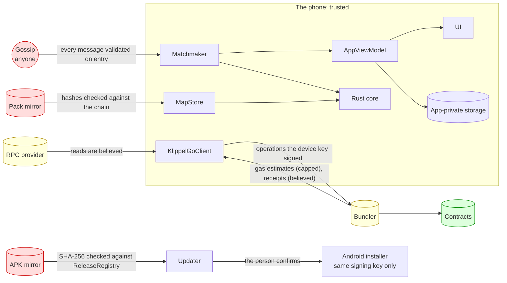
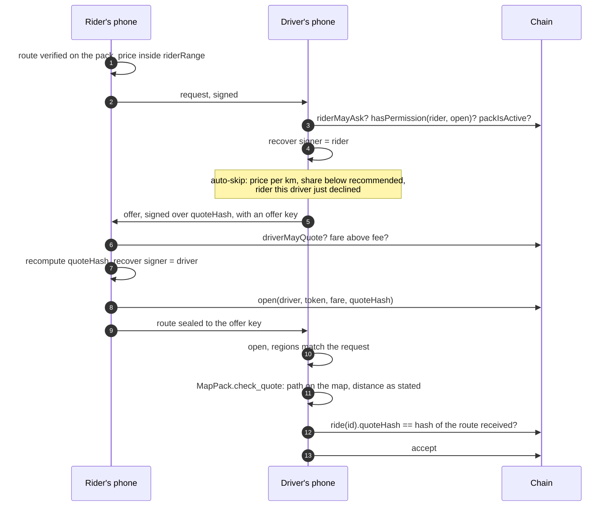
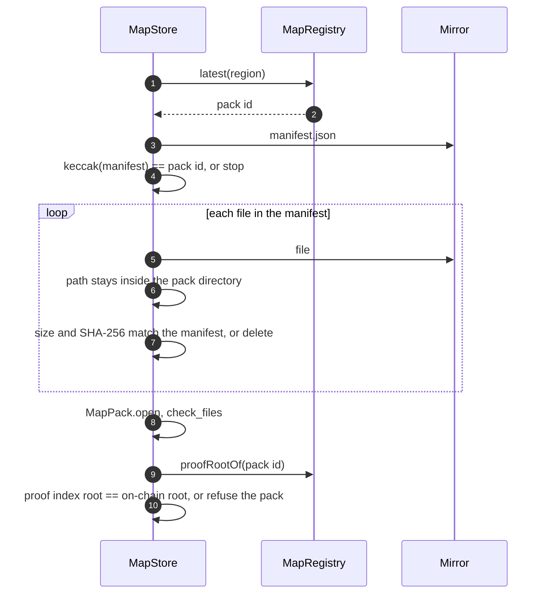

# Apps: security

The app is where an attacker actually meets KlippelGo: it takes messages from strangers, downloads map data
from a mirror, holds the keys, and shows the user what to believe. The numbered invariants (`A1` to `A19`) are
what the [security reviewer](../../.claude/agents/security-reviewer.md) checks a change against.

Related: [overview.md](overview.md), [core security](../../core/docs/security.md),
[contract security](../../contracts/docs/security.md).

## What the app must protect

| Asset | Threat |
| --- | --- |
| The account key | Theft means the user's funds, stake and reputation. It is a P-256 key in the phone's chip (StrongBox or the TEE, `KeystoreDeviceKey`), never exportable. It asks for no user check (P20). An account can have one such key per device of the person's; changing them takes a majority, or the guardian after two days (A19) |
| Past rides on the phone | Each ride's quote, route and the rider's position key, which say where the person went. Sealed under a key in the chip, kept 30 days from last use (A12) |
| The session key | Theft lets someone speak for the account on gossip until its certificate expires (a day). It moves no money |
| Where the user is and where they go | Any peer in the cell, the router, the mirror, the RPC provider |
| The user's money | Being shown a wrong price, a wrong route or a wrong counterparty and locking funds on it |
| The user's attention | Fake requests and offers that waste a driver's or rider's time |

## Trust boundaries

Gossip and mirrors are hostile by assumption. The RPC provider is the weak point: the app
believes what it reads from it, checked against a second provider when one is set (A18, limit P3). The bundler takes the account's signed operations to the chain; it cannot change
one, and the phone never takes from it the account's address or an operation's hash (A15), but it is believed
for the gas an operation needs, which the phone caps, and for the receipt the phone reads a ride's id from. Its
address comes from the RPC address, so P3 covers it too.

## Gossip messages and their checks

Every message is JSON, signed over a hash that starts with a versioned domain tag. The signer is the account's
session key: a secp256k1 key the phone keeps in app-private storage, rotated before a day is out. Each message
carries the session key's certificate, which the account's own key signed: this session key speaks for this
account until then (`KlippelGo session v1`, with the chain and both addresses). A peer recovers the session key
from the signature, checks that the certificate names that key and the account the message claims, and asks the
account on chain whether its keys signed the certificate (ERC-1271 `isValidSignature`); the answer is kept for
the certificate's life. "Signature recovers X" below means all of that, for account X. `Matchmaker` drops a
message that fails any check, silently, before storing anything. Every check that needs no read of its own comes
first, under the matchmaker's lock (the tariff, tax and fee are kept, and read again there at most every 10 to 30 s);
what the chain must still say (a certificate not yet confirmed, a rider's or a driver's permission, a pack) is asked
outside it, once per tick for all the messages that need it: eight drawn at random from all that wait, then those that
waited longest (a fact unseen for 15 s is forgotten, and up to 4 096 are remembered, newcomers not added once full),
the rest in random order, within 64 reads per tick for requests and offers and 16 more for the closes, routes and positions of requests
this phone holds. A certificate the client already refused a moment ago, or whose session key's lookups are used up,
costs none of them. A message whose answer did not come is dropped and taken when it is announced again. One tick
runs at a time, however many of the app's loops call it.

| Message | Signed by | Domain | Checks on receipt |
| --- | --- | --- | --- |
| `request` | Rider | `KlippelGo request v4` | Heard in the gossip cell its pickup region lies in, and in no other; not a request this phone saw closed; not expired and expiring within an hour; at the cap of 200 requests, no farther than the farthest one held; token is a known coin; positive fare, distance and duration; both region cells valid; price inside the fare guide's range for the stated trip; signature recovers the rider; signer passes the policy on `RideEscrow.open` on chain (the rider role, and not blocked by governance), asked again every five minutes, for up to 1 024 riders; the map pack is active in `MapRegistry`, asked again every five minutes, for up to 64 packs |
| `offer` | Driver | `KlippelGo offer v3` | For this phone's own request (a driver's phone takes in no other driver's offers); sequence number newer than the driver's last, and newer than that of an offer of theirs given up for room; expires before the request does; fare within the driver's floor and ceiling; fare above the token's fee (kept like the tariff) plus the tax on it; signature recovers the driver over the quote hash recomputed locally; the driver passes the policy on `RideEscrow.accept` (role, stake, score, credential), asked again every five minutes, for up to 1 024 drivers; at 50 offers a request it takes an expired offer's slot, or if cheaper the dearest offer's, whose sequence number is kept (the newest 4 096), and is dropped otherwise |
| `close` | Rider | `KlippelGo close v2` | For a known request; signature recovers that request's rider. The request is then forgotten, unless it is this phone's or it quoted it, and its id remembered until it expires (the newest 2 048) |
| `route` | Rider | `KlippelGo sealed route v3` | Addressed to this account; for a known request this phone quoted; signature recovers the request's rider over the sealed bytes and the rider's position key; opens with this phone's offer secret for one of its own quote hashes; the route starts and ends in the regions the request showed |
| `position` | Driver | `KlippelGo sealed position v2` | Heard on the ride's own topic, and named for that ride; for a ride this phone locked; signature recovers that ride's driver; opens with this phone's key for that quote; stamped by the driver later than every position before it, so a replayed one is dropped. How fresh it is counts from when it arrived, not from the driver's clock |

The request id is the hash of all its fields and a random nonce, and the quote hash names the chain, the
escrow, the route hash, the fare, the token, both parties and the expiry. A message copied to another chain,
escrow, request or price fails its signature check.

## Matching, with the checks in place

The driver accepts only after step 12: the route exists on their own copy of the map, is as long as the rider
said, and is the one whose hash holds the money.

## The map pack

## Who learns what, and when

| Moment | Everyone in the cell | The chosen driver | The rider | The chain |
| --- | --- | --- | --- | --- |
| Request | Distance, duration, price, two regions of about 1 km, rider's address | same | | nothing |
| Offer | Driver's address and fare | | | nothing |
| Lock | That a sealed route went to that driver | The exact route | | Both addresses, token, fare, quote hash |
| Driver on another ride | Nothing | | "Yours is next", no position | |
| Driver on this ride | Nothing, unless they join the ride's topic, `/klippelgo/ride/1/<quote hash>`, which anyone can from the hash on chain: then, as the router does, that the driver is sending positions for this ride, not where the driver is | | Driver's position, every few seconds, and every second once the ride has started | |
| Arrival | | | | Receipt hash |

A driver's phone subscribes to the cell it is in and the eight around it, chosen from the cell and not from
where in it the phone is: the router and the phone's peers learn which 5 km cell an online driver is in, and
when they cross into another, and nothing finer. A rider's phone subscribes to the cell of each request it has
out, so they learn the 5 km cell of that pickup, and to the topic of each ride it watches, so the router learns which
phone is the rider of that ride and, from who publishes there, which is the driver.

Every signed message also carries its session key's certificate: the account, the session key's address and
when it expires. Nothing there was not already learnable from the signature, but it means every message an
account sends in a day names the same session key.

The chain shows, for anyone, how many keys an account has, each key's public half, the changes proposed to them,
and the guardian's address: who protects whom is public, and so is that a person has several devices. The join
screen's log reads ask the RPC about this phone's key.

The RPC provider sees the phone's IP address with its account and the ids of the rides it reads. With a second
provider set (A18), that one learns the same every full read, and for a waiting rider their driver's address.

The driver's position is sealed to a key the rider sent inside the signed `route` message, and the driver's
phone sends it only for the ride it is on now: of all the rides it accepted and has not finished, the one
that started, or else the one locked first. A ride in dispute is frozen and takes no turn, so the next rider's
turn comes while it is judged.
That is read from the escrow's own record of the driver's rides, `pickupOf` and `onTripOf` (C22), which no
number of rides opened naming the driver can displace.

## Invariants

- **A1. Nothing from gossip is stored or shown before its signature and limits are checked.** Validation
  lives in `Matchmaker.receive…`; nothing else parses gossip.
- **A2. Every signed structure has its own domain tag and version.** A changed field means a new version.
- **A3. The quote hash is always recomputed locally** from the request and the offer's fields, never taken
  from the message.
- **A4. A rider locks only what was verified.** The route passed the verifier on an active pack; the price is
  inside `riderRange`; the offer is inside the driver's limits and unexpired. The offer is for the request
  this phone has out now: `acceptOffer` refuses unless the route and salt it holds hash to the request's
  route hash, and the offer names that request, so an offer for a request since replaced (another price,
  another pickup) cannot be locked against the new route.
- **A5. A driver accepts only a route they checked** on their own pack, in the announced regions, matching
  the quote hash locked in the escrow, and only for the ride the quote names: the ride's fare, coin, rider and
  driver must be the quote's own (`CheckedQuote` gives them), since anyone can open a ride with a quote hash
  they saw on gossip.
- **A6. Prices outside the band are ignored on both sides.** The band is read from `FareGuide`, never
  hard-coded, and read again when the last read is half a minute old, so a tariff Finanças changes reaches a
  running phone without a restart. A read that fails keeps the last tariff for another half minute.
- **A7. A pack is used only if the chain vouches for it**: manifest hash is the on-chain id, files match the
  manifest, proof root matches `MapRegistry`, and the pack is active.
- **A8. Downloaded paths cannot escape the pack directory.**
- **A9. Exact places leave the phone only sealed to one counterparty.** In the clear: geohash cells only.
  A rider's phone reads its own position only to put the pickup pin there. It is never sent as a position;
  it leaves as any pickup does, inside the sealed route.
- **A10. A driver's position goes only to the rider of the ride under way**, and stops when that ride ends.
  It goes out from a loop of its own, at most every four seconds on the way to the pickup and every second once
  the ride has started, on what the last full read took from the chain: that is believed for six seconds from
  when it was read, or from the last check of the new blocks that found no event about the rides on screen, so
  sending stops within that of the ride ending, and as soon as a full read or a check is seen to fail or the
  driver signs out. Each check reads the 16 blocks before the new ones again, so an event a lagging node left out,
  or a short reorganisation added, still ends the belief at a later check. A full read made at a block before the
  newest one a check found something in (a node behind the others answered it, or it was pinned there, A18) does
  not renew the belief, and another full read follows at the next tick, so sending pauses until a read catches up.
  Only a chain that went backwards, one whose block 64 below that change has another hash or none, clears it.
- **A11. Memory taken by strangers is bounded**: caps on requests and on offers per request, topic names of a
  fixed length and a router's topics capped (K12), and requests expire. At a cap, something is given up only for a newcomer whose signature and limits passed (A1), and never
  this phone's own request, a request it quoted, or its own quote. What the chain said of riders, drivers and packs
  is kept for 1 024, 1 024 and 64 of them, five minutes each.
- **A12. Secrets stay in app-private storage or memory.** Offer secrets are memory only. Nothing secret is
  logged, put in an intent, or written to shared storage. `allowBackup` is off. The account's key never leaves
  the phone's chip; the session key is in app-private preferences. Each ride's quote, route and the rider's
  position key are sealed (`SealedFiles`: AES-256-GCM under a key made in the Android Keystore, the file's name
  bound as associated data) and deleted 30 days after they were last written or read, so a ride still in use
  keeps them; files an earlier version wrote in the
  clear are sealed by the data step to schema 2 before anything reads them; if the Keystore fails there, the step is
  tried again at each start, and until then those old files stay in the clear, unread, and are deleted after 30 days. The files' key needs no screen unlock,
  so a driver's phone reads a route with the screen off. The one plain copy is a debug build's that signs with one of the
  local testnet's seeded keys, which are public, for `klippelgo drive` (`files/debug-routes/`).
- **A15. Every write is the account's own operation, its hash is the phone's, and its cost is bounded.** The
  phone computes the account's address from its key and the operation's hash (EIP-712, as the EntryPoint does)
  itself, never from the node or the bundler, except for an account it joined, whose address the person picked
  among those the node named (A19, P26), and signs only that hash: a lying RPC or bundler cannot get a
  signature for another operation, nor have reais sent to an address the key does not own. Before signing, it
  refuses gas limits above fixed ceilings (per kind of gas), a fee per gas above 1 000 gwei, and any operation
  that could cost more than R$ 5,00 at the worst, at the rate it reads from `FareGuide`: a bundler cannot make
  one operation take the account's balance. A lying RPC can lower that rate (P3); the gas ceilings still bound
  the operation. It gives the paymaster's check at least 80 000 gas whatever the bundler estimates, since that
  check's cost depends on what is cold when the bundle runs; the EntryPoint charges verification gas as used, so
  the floor costs nothing unless spent, and the R$ 5,00 worst case includes it.
- **A13. Cleartext traffic is allowed only to loopback and the emulator's host alias.**
- **A16. A revoked release starts nothing, and nothing else stops the app.** When the release registry says this
  build's release is revoked, the view model refuses to ask for a ride, change its price, take an offer, quote
  and accept, and shows why (the guard is in `announce`, which every request goes through, and in each action
  that quotes, locks or accepts); a ride under way still finishes and money owed is still withdrawn. While a
  ride of the account is unfinished, the app offers no update, since the new release's app could not finish it
  (P25). A release the
  registry does not name, names with other code contracts than this build's, or that cannot be read, counts as
  unknown and changes nothing, so neither the RPC nor the registry is a switch that turns the app off.
- **A17. Only an APK the release registry names is handed to the installer.** `Updater` keeps a download only if
  its SHA-256 is one `ReleaseRegistry.isApk` names for that release; anything else is deleted unread. A download
  is capped at 400 MB, lives in `cacheDir/updates/`, the only folder the FileProvider shares, and Android
  installs it only after the person confirms and only if it is signed with the app's own key. With a second
  provider set (A18), that provider must name it too; one that cannot be asked installs nothing.
- **A18. With a second provider set, what a full read gave the app must be told by both, or nothing new starts.**
  With `checkRpc` set, a full read is pinned to one block (`KlippelGoClient.at`, `pinFor`): the second provider's
  newest block when it is up to 30 blocks behind the main one's, so the main one cannot name a block the second does
  not have yet, and the main one's otherwise, so the second cannot wind the screen back by naming an old head. The
  second's head is never used below a block an earlier full read was pinned to. It can still hold reads on one block
  for up to 30 blocks; a read made before a block the change check found something in does not renew what the app
  believes of the ride under way (A10), so a ride that ended there stops getting the driver's position within
  seconds, as when the chain cannot be read. The
  tariff, the tax and each coin's fee and bonds are read again inside it, and only there: the app prices, checks
  offers and locks fares on those, however old, until the next full read. `crossCheck` then asks the second provider about
  that block, and compares each answer with the value the app holds and uses, never with the main provider asked
  again: the chain id and the block's hash; the rides on screen, this account's balances, each coin's fee and
  bonds; the tax and the tariff; this release's status and the latest one's; for a driver, the permission to
  accept; the rides the driver, or the rider's driver, is busy with (`onTripOf`, `pickupOf`); and the proof root of
  the map pack open. A ride a later block ended is not given to a read pinned before it. Any difference is a
  disagreement: the app shows `ProvidersNotice` and the guard of A16 refuses every new ride until a full read
  finds them agreeing. A second provider that does not answer, is a few blocks behind, or has another hash for the
  block once, is unknown and refuses nothing, and so is a full read that failed (a disagreement stands through it);
  after three such reads in a row the app says, quietly, that it is not checking. More than 30 blocks behind, another hash twice in a row, or a main provider that cannot give its own
  block's hash, is a disagreement. Writes are never pinned. The second provider is `checkRpc`, set on the
  create-account screen (an `http://` or `https://` address), or else the build's `CHECK_RPC`; with neither, nothing
  is pinned and nothing is checked. It learns what the main provider does from these reads: the phone's IP
  address, the account, the ids of its rides on screen, and for a waiting rider their driver's address.
- **A14. Money shown is money locked.** The amounts on the confirmation screen are computed from the same
  values passed to `open`, including fee, bonds and the tax rate read from the chain. The tax shown is the sum
  the escrow does at `open`, at a rate read again every ten seconds, and it is inside the fare: it changes what
  the driver receives, never what the rider locks. Once a ride is open, what the driver is shown is the ride's
  own tax. The infrastructure cost is outside what is locked and is shown as an estimate, marked "≈"; it is
  shown without the mark only at the end of a ride this phone paid for from its first transaction.
- **A19. The phone approves only the change of keys it shows, and signs only for an account the person chose.**
  A change of keys (another device, a removal, the guardian, a cancel) is approved with this phone's key over the
  change's id, computed on the phone from the epoch and what the change says, never taken from the node;
  `KlippelGoClient.keys` drops a change whose content does not hash to the id it is filed under, and
  `approveKeyChange` checks it again before signing. Keeping the guardian names none, so no read decides who it is.
  Adding a device is confirmed in a dialog that shows its fingerprint (and the name its code carries) and says it will
  sign and spend for the account. A phone added to another device's account signs for it (`joined`) only once the
  person picked that account: on the join screen, on the account screen, or in the prompt (`JoinOfferDialog`). The
  account screen shows this phone's code only when asked to; showing it, copying it or sharing it records the block
  of the last full read if it is under 35 s old, else the newest block once the node gives it (nothing is offered
  until then), and for 30 minutes after, a full read looks for accounts that added this key at that block
  or later (`accountsThatAddedThisKeySince`). Exactly one such account, not asked about before, is offered in the
  prompt, listing its devices by fingerprint to compare with the adding phone; an account that added the key earlier
  is never offered, as anyone can read a phone's key off its own account and add it, and with several at once none
  is. No prompt comes, and no switch is allowed, while a ride, a request or a quote of this phone is under way; the accounts offered are those a `ERC7913SignerAdded` event names with this phone's key
  and that are a clone of this release's account implementation holding the key now. A key code, scanned as a QR code
  or pasted, is read only if it is a point on P-256, and the screen shows its fingerprint (16 hex digits of the
  signer's hash) for the person to compare with the one the other device shows. The device name a code carries after
  `#` is a label for the person, cleaned of control and format characters (no direction overrides) and cut to 40
  characters; it is not part of the key, nothing checks it, and a stranger's code can carry any name, so the
  fingerprint is what to check, shown on its own line. A code for a key the account already has is refused, and a name
  is kept only once the key's proposal went through and never over one the phone already has, so a code cannot rename
  a key on the account. Names stay on the phones (`deviceName`, `keyNames`), never on chain; a phone's own name (its
  model unless renamed) travels in every code and QR code it shares. The camera is asked for only when the scanner opens. The account's own events wake a full read at the next change check,
  which reads the keys, and the keys are read every five minutes in any case: a guardian's recovery, a change waiting
  for this phone, or this phone taken off is said over every screen (`AccountNotice`). None of these reads is
  compared with the second provider (A18 does not cover them; P3).

## Known limits

Real today. A change touching one should close it or leave it no worse, and say which.

| # | Limit | Consequence | What closes it |
| --- | --- | --- | --- |
| P3 | The app believes its RPC provider, checked against a second one only where A18 says, and only when one is set | With no second provider, a lying RPC can show a fake tariff, pack root, ride state or balance. With one, a lie about what A18 compares must be told by both, or the app says so and starts nothing new; until the next full read (30 s at most) the lie is on screen, and an action taken in that time goes through. Reads outside the full read (before each action, of a pack when the map opens) are believed until then; the tariff, tax and each coin's fee and bonds are read only inside full reads, and the pack root the app opened with is compared at the next one. The pack in use is checked for its root, not for being the region's latest or still active: a lying main provider can keep the app on a retired pack that still has its root. What A18 does not compare is still believed: the event scans and the check for changes (one that leaves out a ride's events keeps the screen up to 30 s behind, and one that leaves out a `RideOpened` keeps that ride off the screen), the drivers listed and their reputations, and the gossip router the RPC's host names (K12). Before the first full read after connecting nothing has been compared. A ride once reported finished is remembered as finished until the app restarts. Reporting a ride under way keeps `OnDutyService`, its wake lock and the phone's GPS going off screen, on a phone that came on screen once. The main RPC can make a check come back unknown, never agree: by giving another block hash every other read, when the screen shows what it says for that read, or by failing reads; three unknown reads in a row are said on screen. A second provider that is down, or that the person never set, checks nothing, and two that collude agree. A lying or unreachable second provider can stop new rides and hold back updates (A17); the person clears it by signing out and creating the account again without it | Compare the logs too; light-client proofs; more than two providers, with a majority; edit the second provider in the profile |
| P4 | A message under a certificate this phone has not confirmed costs one `isValidSignature` read, and a rider's, a driver's or a pack's first message one more for its permission (a pack's is two requests), kept five minutes. Those reads are bounded per tick, and one tick runs at a time: 64 for requests and offers, 16 for the closes, routes and positions of requests this phone holds, asked outside the matchmaker's lock, those that waited longest first. A message that does not get one of them is dropped until it is announced again. A stranger can send forged certificates with fresh session keys, or offers from fresh throwaway accounts, as fast as gossip carries them | A flood costs each phone it reaches up to 80 reads per tick for as long as it lasts: a tick every 2 s, and every second on a rider's phone during a ride; and one signature recovery per message, up to four times for one that waits. Riders and drivers new to this phone compete with it for the 64. Facts are asked longest-waiting first, after eight drawn at random: a forgery sent once is forgotten 15 s later, and an honest party announcing again keeps its place, so after the first tick it is seen, where it ties with them, one-off forgeries do not hold it back. Forgeries sent again as often as it is wait as long, so it is delayed by their backlog, as many ticks as that backlog divided by the reads, twice when it also needs a permission read. A flood that keeps the record of 4 096 full leaves a newcomer out of it, to the eight random reads a tick until it gets in. Measured in "Gossip intake under a flood" ([scalability.md](scalability.md)), with the app's two-second tick: real drivers' offers were held after about 6 s against 100 or 400 throwaway accounts sent once, and after 14 s and 25 s against 100 and 400 sent again every tick. One whose certificate this phone already confirmed spends none until their daily key change. A `position` the driver really signed, sent again with junk certificate bytes, is charged to that driver's session: until a phone has confirmed the certificate (its first read failed, or around the daily key change) such copies can keep its positions off that rider's screen (P23). No money is at stake | A cost or a limit per gossip sender |
| P5 | A rider's phone holds offers only from drivers the policy lets accept, up to 50 a request; past that an offer takes the dearest one's slot if it is cheaper | Throwaway keys hold no slot: one needs an account with the driver role, the stake and the score. Fifty such accounts quoting at the floor keep dearer drivers' offers out until theirs expire. The rider's screen still hides offers from accounts that cannot accept at the last full read, so no funds are at risk | A cost for quoting |
| P9 | Pickup proof and trip receipt are stand-in hashes; GPS logging is not wired | The trip itself is unproven on the app today | The ride channel, then `TripLog` and receipts from the core |
| P10 | The rider's address and price are visible to the cell, linked to a region | A watcher can profile an address's trips by region | Fresh accounts per ride; encrypted offers |
| P11 | A position is whatever the driver's phone says, and it counts as fresh from when it arrives | A driver can report a place they are not at, and on a ride it also decides how much of the route the rider's map still shows, when it is within 150 m of the route. A relay that holds the messages back and releases them in order makes old positions look current. A driver whose clock steps backwards mid-ride stops being shown | It is for display. Never use it as evidence: that is what the signed trip log is for. A per-ride counter instead of a clock, and an estimate of the clock offset, would close the last two |
| P12 | Anyone with the rider role can open rides naming any driver, and cancel them later at no cost | Each one costs that driver's phone its id kept in the phone's scans, and its opening wakes a full read on that driver's phone and on the phones of riders waiting for that driver; while it is among the driver's ten newest and Open, its events do too. Its ride is not read: a full read reads the ten newest rides and the two the driver is busy with, which the escrow names (`pickupOf`, `onTripOf`), however many name the driver. The driver's screen shows the newest ten rides, so ten junk rides hide a real rider's Open ride, and older junk cannot be declined from the app. None of them takes the driver's places in the escrow (C22). The phone declines on its own only a ride locked on a quote it made void by accepting another, by the rider that quote was for, and once per quote: a hash copied into rides by anyone else, or into more rides by that rider, costs the driver nothing. A rider who opens the same quote twice gets two rides that both pass the route check (A5), as all their terms are the rider's own; accepting one leaves the other Open, for the driver to decline or the rider to withdraw. A ride left Open does not keep that driver's phone working off screen: only one they accepted does. | Show the driver the oldest Open rides; a cost for opening |
| P14 | The driver's Accept button does not require the revealed route to have been checked | A5 holds by what the screen shows the driver ("rota conferida no seu mapa"), not by code: a driver can accept a ride whose route never arrived or failed the check | Enable Accept only once the route passed `check_quote` against the locked hash |
| P15 | The rider's "driver is busy" notice starts from "nobody ahead" until the first successful read, and the change check watches only the rides the driver already has in hand | A waiting rider whose first read fails sees no notice for a moment. While the rider's own ride is Open and the driver has none in hand, the driver accepting another rider's ride shows only at the next full read, up to 30 s later. No position is shown or sent: the driver seals positions only to the ride they are on (A10) | Keep the count unknown until read, and show neither state meanwhile; watch `RideAccepted` naming the driver, which needs the driver indexed in that event |
| P16 | The matchmaker's requests are in memory, and a phone takes any validly signed request from its own account as its own | After a restart, or with the same account on two phones (several devices of one person, A19), a peer replaying this rider's unexpired request (up to 10 minutes) puts it back on the rider's screen and it is announced again. It cannot be locked: the phone no longer holds its route (A4). A pickup move in progress is refused with a message | Keep the open request with its route on disk; ignore own requests this session did not make |
| P17 | The driver's list shows the one picked and the newest others, 20 in all, of the up to 200 requests a phone keeps, and one rider-role account can post all 200. A full list keeps the nearest, but the pickup region is what the request says, unproved until a route is revealed, and it costs nothing to name one in a busy part of the cell | An older real request sits under "N more" until those above it are passed or expire, and a flood naming places nearer than a real pickup pushes that request out of the list until it is announced again and is nearer than the farthest. Before the list, one request showed at a time and the same flood cost one pass each | A cost for posting requests (P4), and ordering the screen too, by the rider's score or by distance |
| P18 | Debug builds hold anvil's public deployer key, to mint test reais (the Pix stand-in, `Faucet`) | Anyone can mint mock coins on a local testnet anyway | It refuses any chain but 31337. Release builds keep the code: removing it from them would close it |
| P19 | A session certificate cannot be revoked before it expires: a stolen session key speaks for the account on gossip for up to a day | Peers check it once and keep the answer | A shorter life, or a revocation list on chain the account writes to. Removing the account's key does not help: the certificate was valid when it was checked |
| P20 | The account's key is not bound to the phone's screen lock: whoever holds the unlocked phone, or runs code as the app on it, can sign for the account and move its money, and read the rides of the last 30 days | Android destroys a key bound to the lock when the lock is turned off. An account with other devices or a guardian (A19) loses only this phone's key then; a one-phone account without a guardian would lose everything | Make the key with `setUserAuthenticationRequired` once the app asks for a second device or a guardian before it does, so that a lock turned off costs only this phone's key. Until then the person's other devices take a taken phone off the account (contracts C26), which stops what it signs next, not what it already sent (contracts L34) |
| P21 | An account with one phone and no guardian is lost with that phone. The app recommends three devices and offers a guardian, but asks for neither; recovery by a passkey (accepted by the account's WebAuthn signers) has no screen yet | Android passkeys need a domain that serves `assetlinks.json` | Ask for a second device or a guardian at setup; the domain, then the screen that adds a passkey as another key |
| P22 | A closed request stops being announced, and a phone that never heard it close has nothing telling it so | A peer can replay a closed request's signed message to a driver who missed the close or arrived later, and it shows as open for as long as the replay goes on, up to its expiry. The rider's phone answers what it hears with the close, at most every 10 s, while it is online and in that cell, which also tells any peer that this rider's phone is still there. An offer on it goes nowhere: the rider no longer listens for it. No money is at stake | The ride channel; a cost for relaying |
| P23 | Anyone can join a ride's topic and publish there, as on any topic | They see when a driver's positions go out, sealed. Each forged position costs the rider's phone one signature recovery, and a read for a new certificate, within 16 a tick (P4); a flood of them can keep the driver's positions off the rider's map while the rider's phone has not confirmed the driver's certificate, after a restart or the driver's daily key change: against forgeries sent once, for the first tick the driver's certificate is seen, after which it has waited longer and is asked first; against forgeries sent again as often, for as many ticks as their backlog divided by 16; and against a flood that fills the record, until one of the eight random reads a tick, drawn from every waiting fact of either budget, picks it. It cannot be believed or stop the route | A topic name only the two phones know, sent inside the sealed route; a limit per gossip sender |
| P24 | The release status and an APK's hash are what the RPC says. A lying RPC can call this build's release revoked, and the app starts no ride until the person changes provider or the lie stops. It can also call a release active that the registry revoked, with `isApk` true: whoever runs both the RPC and the APK mirror (by default the mirror is the host next to the chain node) can then serve that release's genuine APK, signed with the release key, as the update, and Android installs it once the person confirms | The registry is read like any other contract (P3) | A revoked status stops only new rides, never money (A16). The app offers only a higher version than its own, so it is never taken back to an older release. A stranger's own APK still needs the release key, which Android checks. An escrow closed on chain refuses rides whatever the RPC says. With a second provider set, the release status is compared at each full read and an APK must be named by both (A17, A18); without one, a second source for the latest release's status, as for P3 |
| P25 | A ride left on an earlier release's escrow cannot be finished from the app: it lists the ride and withdraws money owed there, but sends `start`, `complete`, `cancel`, receipts and timeouts only to its own release's escrow | Not built | The app holds an update back until the chain was read once and while a ride of the account in its current role is accepted, started, disputed, or open and locked by this account; it checks again before opening the installer, so a ride started during the download keeps the checked file waiting. An Open ride someone else opened naming the driver does not hold it: it holds no bond of the driver's, and its rider takes it back on the old escrow. Not covered: a ride of the account in its other role, a ride left behind another way (the app reinstalled at a newer release, the other party updating). Those need their transactions sent by hand. Closes when the app can act on `previousEscrows` |
| P26 | The join screen and the account screen offer every account of this release that has this phone's key, and the one account that adds it in the 30 minutes after this phone showed, copied or shared its code is offered in a prompt over every screen. A phone's key is public on chain once its own account exists, and every phone shows and shares its key code, so anyone can add it to an account of their own | A stranger who adds the key in that window, the moment the person expects a prompt, can make an account that names it; adding it again every few minutes, at the cost of gas, catches any window without knowing when it opens, and holds the real device's prompt back while theirs is up, and a person who picks that one, from a new phone or from one already holding money, signs for an account the stranger also holds: money put in there is the stranger's to take. Which accounts have the key, and when they added it, is what the RPC says (P3): a lying one can leave the real account out, or add one, and push it into the prompt | The person picks by the address their other device or guardian shows, as the screen says. Show only the account a code named on the other side, carried in the code |
| P27 | The phone learns of a guardian's recovery only when it reads the chain: on screen, online as a driver, or on a ride | A person who does not open the app for two days after a guardian, honest or taken, starts a recovery, loses the account's keys to the key the guardian named (contracts L35). A lying RPC can hide the recovery (P3) | A push from a watcher the person chooses; a longer delay |
| P28 | Every key change the app sends is an operation of the account itself, paid through the paymaster from the account's coins | A taken phone that revoked the paymaster's allowance, or spent the coins, leaves the other devices unable to send the removal from the app, though the contract takes it from anyone (contracts C26). Only someone with their own gas can then send the two approvals, which the app does not export | Let the app send a change through another account the person or their guardian has, with the approvals the devices sign |

## How it is tested

`TwoPhonesRideTest` plays a ride between two clients over a real gossip node and chain, and asserts what each
side learned.

The end-to-end suite in [`tests/security`](../../tests/security) holds the app itself to the invariants: the
real app on an emulator, a real chain and gossip network, and a stranger on that network who records the cell
and sends forged messages ([tests/README.md](../../tests/README.md)). A new check on a message needs a case
there that sends the bad message, shows the screen never reflects it, and then shows an honest one getting
through.

| Test | Holds the app to | How |
| --- | --- | --- |
| `ForgedRequestsTest` | A1, A6, and of A7 that a request on an inactive pack is ignored; the `request` and `close` rows, and the session certificate every message carries | Requests that each break one rule never reach a driver's screen: wrong signer, no rider role, price over and under the range, inactive pack, expired, expiring too far ahead, invalid pickup cell, zero distance, unknown coin, said in a cell its pickup is not in; and, in the honest rider's name, a certificate another account signed, one that expired, one claiming to last a week, and the rider's real certificate on a message another key signed. A request signed by a rider governance blocked never reaches it either. A withdrawal signed by anyone but the rider does nothing |
| `ForgedOffersTest` | A1, A3, A6; the `offer` row | Nine offers that each break one rule never reach a rider's screen: wrong signer, over the ceiling, under the floor, a valid signature moved to another fare or another expiry, expiring after the request, expired, for another request, and a well-formed one from an account the policy does not let accept |
| `OnDutyTest` | A10; `OnDutyService` | On an emulator: the service starts and stops with going online and offline, outlasts a ride's end while online, its notification brings back the running activity, and with the driver's screen off a rider goes on hearing the car |
| `RoutePrivacyTest` | A9; "Who learns what" | Everything said in the cell, and on the ride's own topic, during a ride is recorded: the request has the documented fields and no more, and no point of the route or of the driver appears in the clear, nor inside the sealed fields once their base64 is undone |
| `ReleaseTest` (integrity) | A16 | A revoked release refuses a rider's request and a driver's quote and says why, and works again once put back; a deprecated one goes on; an update to a newer release waits until the driver's ride is over. `ReleaseCheckTest` (`:chain`) pins that only a revoked status refuses, that an update goes only to a higher active release, and that an unreadable registry or a release published with other code contracts is unknown and refuses nothing |
| `ReleaseUpdatesTest` | A17 | Against the chain, not the screen: a release published naming one APK file; that file is accepted, an altered copy and the same file under another version are refused |
| `ProvidersTest` | A18 | The rider's second provider lies about the tariff: the notice shows, asking for a ride is refused and says why, and once the lie stops the notice leaves and a driver hears the next request. `CrossCheckTest` (`:chain`) pins that two honest providers agree; that a lie by the second about the tariff, a ride's status, a balance or the tax is named; that a lie by the main one told once, about the tariff or the release, is caught, since what the app got is compared and not the main provider asked again; that a main one lying only to reads of the newest block has its tariff replaced by the full read's; that a screen showing another ride state than the chain's disagrees; that a ride ended after the pinned block is read as it was there; that another block hash is unknown once and a disagreement twice; that a provider that does not answer is unknown; and that an APK is accepted only when both providers name it |
| `RevealedRouteTest` | A5 | A drivable route in the right regions that is not the one locked in the escrow is never shown as checked, and the same trip revealed honestly is. A ride a stranger opened with the honest quote's hash, driver, coin and fare is never shown with that route, while the honest ride beside it is. It stops short of P14 |
| `ThreePhonesTest` (integrity) | The honest path of A4 and A5 between real apps | Three copies of the app, a rider and two drivers: the driver not picked gets no ride and no route, and the one picked is shown the route as checked |
| `RiderRideTest` (integrity) | A14, and the honest path of A4 | The amounts on the confirmation screen are the amounts the escrow holds after the lock |
| `OnboardingTest` (integrity) | The account's key and A15 on the honest path | A phone given no seeded account makes its own key; its account is created and registered as a rider by its first operation, which the account pays in reais, and the address the profile shows is that account's |
| `RuleChangesTest` | A14 with governance in the middle; contracts C1, C5, C14 | A ride under way keeps its tax when Finanças halves it mid-ride: on the ride-end screen, in the collector's balance and in what the driver nets, while the rules screen moves to the new rate. An offer both phones matched cannot be locked once Segurança stopped new rides: the app shows the refusal and no money moves; once the board resumes, the same offer locks. A tax change one member of two asked for changes nothing on screen or on chain until the second approves |
| `AccountDevicesTest` (integrity) | A19; contracts C26, C27 | The phone adds a second device by its code (the screen showing the fingerprint the device shows) and a third with the second's approval, and approves the second device taking a lost one off. It names a guardian, and cancels from the notice a recovery nobody asked for. A new phone shows its code, a guardian recovers an account to it after two days, and it joins that account. Adding asks for confirmation with the device's fingerprint and name, and backing out proposes nothing. A phone with an account of its own shows its code, is added to the person's other account, is asked over the screen to join it with that account's devices listed, joins (both then list the same two devices), goes back from the account screen, and is not asked again. A fingerprint pasted for a code is said to be one and cannot be added. As a guardian, the phone recovers a friend's account to the friend's new phone. `AccountKeysTest` (`:chain`) pins the same against the client, and that a change shown other than it was filed is refused before signing; `KeyChangeVectorTest` (`:chain`, no chain needed) that the id is the contract's encoding, that a change a node describes other than it was filed is not listed, and that only a real key code is read |
| `TakenPhoneTest` | A19; contracts C26 | One of three devices, taken, proposes taking the other two off and adding the thief's key: the app shows it and nothing changes. The other two take the taken one off; its proposal goes with the old keys and it signs nothing more |
| `GovernanceTest` (integrity) | A6, and the driver's notice of why they cannot accept | A tariff Finanças changes reaches the running app's rules screen and the price of its next request. `stop-rides` and `resume-rides` show and clear the "disabled" reason on a driver's screen; a block shows and clears the "account" reason, and the unblocked driver hears requests again |

In each forgery test the stranger also sends a message of its own that breaks no rule, and it must be shown:
that is what says each forgery was turned away for the one thing wrong with it.

Still owed:

- A position on a topic of another ride this rider watches is dropped: no test locks two rides. One on the cell's topic is tested (`TwoPhonesRideTest`).
- The service stopping on sign-out, on a change of role, and for a rider at the end of a ride.
- A10 from the driver's side: a driver's app holding two rides sends positions only for the current one.
  That it stops when the ride ends is covered (`OnTheRideTest`); that it stops when the chain cannot be read
  is not.
- `RouteProgress` on a route that passes the same place twice has no test.
- That a refresh belonging to a session that was left (another account picked, or the phone switched to
  riding) cannot set the ride positions are sent for, nor send one itself (the role and session check in
  `sharePosition`), has no test.
- The rider's pin following the phone (`RiderRideTest`) is shown to stop once the rider has placed the pin by
  hand, and to start again after a ride. With the pin placed by hand the later steps of that test (a
  destination picked, a request out) no longer show those two checks by themselves, and that it stays put
  during a ride has no test. The tests read the pin's name: that the map itself moves under the pin when the
  pickup follows the phone has none.
- The replay rule for positions, and a forged `position` shown to be ignored.
- The `route` row's signature and addressee checks, sent as forgeries.
- The request cap and ranking, a request nobody signed at a full list, a forged position and the replay of a closed
  request are held by `TwoPhonesRideTest`, not end to end in `tests/security`. Eviction sparing own and quoted
  requests has no test. Making room at 50 offers (`roomFor`) has none: it takes fifty accounts the policy lets
  accept. The limit of reads per tick is measured by `MatchmakerLoadTest` (a benchmark, run on demand), not held by
  a test; nor are the kept sequence number of an offer given up for room, or a driver's phone ignoring others' offers.
- The offer sequence rule, zero fare, zero duration, and an
  invalid drop-off cell.
- "Fare above the token's fee plus the tax" in the `offer` row: with today's tariff and tax the driver's
  floor is always above that, so no gossip message reaches that check. It needs a unit test with a tariff where it can.
- The tax and gas figures the app shows have no unit test of their own: that `taxBps()` is read again after
  ten seconds, and that `gasSpent` gives nothing for a ride this client did not open or accept. The end-to-end
  rides check the figures on the honest path.
- A4's refusals: a lock that the app should decline to make. The check that an offer belongs to the request
  now out lives in `AppViewModel.acceptOffer`, which has no unit test harness; the window it closes (a tap
  in the moment a request is being replaced) is not reachable on purpose from the UI.
- The map pack checks against a lying mirror (the rest of A7, and A8).
- A12 and A13, which are about the device and not the network.

The UI agent these tests drive the app through is in the test APK only. It can read the screen and inject
touches, so that APK belongs on test emulators and never on a phone someone uses; `tests/stack.sh` refuses a
device that is not an emulator, as do the tests and the CLI, and the agent answers only adb's shell user and root.
One CLI command reaches into the app itself: `klippelgo drive` reads a debug build's settings and the plain copy
of the route it checked for the ride under way, which only a debug build on a seeded account keeps (A12), with
`run-as`, to move the emulator's GPS along it. It makes the same emulator
check first, and a release build does not allow `run-as` at all. The app's own APK gains only the
tags: names on UI pieces, in every build type, readable by the accessibility services that can already read
the text beside them. Two tags say slightly more than the screen: an offer's tag carries the driver's whole
address, where the card shortens it, and a listed request's tag carries the request's id, which the screen
does not show. Both are public: the address on gossip and on chain, the id on gossip.
