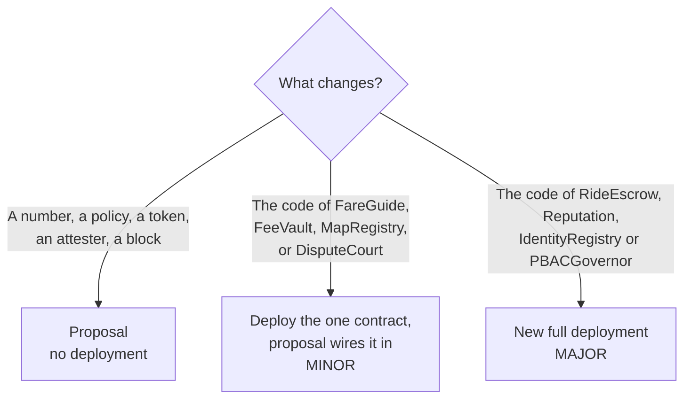

# Contracts: deployment

How contract code gets from this repository to a network people ride on, how a new version follows it, and
what happens to the version before.

Related: [overview.md](overview.md), [security.md](security.md), [scalability.md](scalability.md), and
[gov/README.md](../../gov/README.md) for the tool that governs a deployment once it is live.

**Status.** Only the local testnet is deployed today (`script/DeployLocal.s.sol`, `testnet/deploy.sh`), and CI
builds, tests and plays one ride on it. Everything about Polygon Amoy and Polygon PoS below is the design to
build to. The last section lists what is missing, so nobody reads this page as a description of something
that runs.

## What makes these contracts different to deploy

Four facts decide everything else on this page.

| Fact                                                                                                                                                                                                               | Consequence                                                                                                                            |
| ------------------------------------------------------------------------------------------------------------------------------------------------------------------------------------------------------------------ | -------------------------------------------------------------------------------------------------------------------------------------- |
| There is no admin key and no proxy ([security.md](security.md), C1). Code at an address never changes                                                                                                               | A fix is never "pushed". It is either a parameter changed by proposal, a new contract wired in by proposal, or a whole new deployment  |
| There is no pause                                                                                                                                                                                                  | A deployment cannot be stopped in a hurry. What ships must be right, and the route for the day it is not is written down before launch |
| The deployer can do anything until`finishBootstrap` (L11), and the deploy script is many transactions, not one                                                                                                   | A deployment is not trusted because it was made. It is trusted after anyone has checked it against the published configuration         |
| Addresses are identity. Every quote and receipt hash carries the chain id and the escrow's address, the app ships with the addresses compiled in, and stake, reputation and credentials live in specific contracts | A new deployment is a new network of people, not an update. Moving to one has a cost that no script removes                            |

## Environments

|                   | Local                                     | Testnet                                        | Production                                                    |
| ----------------- | ----------------------------------------- | ---------------------------------------------- | ------------------------------------------------------------- |
| Chain             | anvil, id 31337                           | Polygon Amoy, id 80002                         | Polygon PoS, id 137                                           |
| BRL tokens        | Mocks that mint to anyone                 | Mocks, deployed once and reused                | The real BRLA and BRZ contracts                               |
| Deployer key      | anvil's public mnemonic                   | A throwaway key held by CI                     | A key made for one deployment, on a hardware wallet           |
| Who broadcasts    | Anyone:`make deploy`                    | CI, on a release candidate tag                 | A person, in a ceremony two people attend                     |
| Governance timing | 2 min vote, 1 min timelock                | Hours, so a proposal can be rehearsed in a day | Days. See "Launch configuration"                              |
| Instituto Klippel | Seeded account#1                          | A test multisig                                | The production multisig ([gov/README.md](../../gov/README.md)) |
| Deployment file   | `deployments/local.json`, not committed | `deployments/amoy.json`, committed           | `deployments/polygon.json`, committed                       |
| Resets            | Whenever:`make testnet-reset`           | With each release candidate                    | Never                                                         |

Testnet exists to rehearse: the exact script, the exact configuration shape and the exact checks that
production will get, plus the app built against it. A step that was not run on testnet is not run for the
first time on production.

## From commit to production

```mermaid
flowchart LR
    pr[Pull request] --> ci[CI: fmt, tests,<br/>local deploy, a ride,<br/>governance checks]
    ci --> main[main]
    main --> rc[Tag<br/>contracts-vX.Y.Z-rc.N]
    rc --> amoy[CI deploys to Amoy<br/>and verifies it]
    amoy --> soak[Soak: app built against it,<br/>e2e suites, a real proposal]
    soak --> tag[Tag<br/>contracts-vX.Y.Z]
    tag --> rel[CI: reproducible build,<br/>dry run on a fork of mainnet,<br/>release bundle]
    rel --> cer[Ceremony: a person broadcasts<br/>from a hardware wallet]
    cer --> ver[Verification by a second person<br/>and by CI]
    ver --> pub[deployments/polygon.json merged,<br/>sources verified, app released]
```



| Stage             | Gate to pass                                                                                                                                                       | Who                      |
| ----------------- | ------------------------------------------------------------------------------------------------------------------------------------------------------------------ | ------------------------ |
| Pull request      | `forge fmt --check`, `forge test`, local deploy, `demo-ride.sh`, `gov/test.sh`, the security review ([CLAUDE.md](../../CLAUDE.md))                          | Author, reviewer, CI     |
| Release candidate | Deploys and verifies on Amoy with no manual step                                                                                                                   | CI                       |
| Soak              | The app's end-to-end suites against Amoy; one proposal taken through vote, queue and execute with`klippel-gov`; a map pack activated                             | Maintainers              |
| Audit             | For any change to a contract that holds funds (`RideEscrow`, `IdentityRegistry`, `FeeVault`) or to `PBACGovernor`: an external review of the tagged commit | External                 |
| Release           | The build from the tag reproduces byte for byte; the dry run on a fork of mainnet ends with the expected addresses and a closed bootstrap                          | CI                       |
| Ceremony          | Runbook below                                                                                                                                                      | Two people               |
| Publication       | Verification passes when run by someone who was not the deployer                                                                                                   | A second person, then CI |

**Versions.** A tag `contracts-vMAJOR.MINOR.PATCH` names what is on chain:

| Part  | Changes when                                                          | On chain                                            |
| ----- | --------------------------------------------------------------------- | --------------------------------------------------- |
| MAJOR | A new full deployment: new governor, new addresses                    | New network of contracts. The old one keeps running |
| MINOR | A contract is replaced or added inside a live deployment, by proposal | One or more new addresses in the deployment file    |
| PATCH | Scripts, tests, docs, tooling                                         | Nothing                                             |

A parameter changed by proposal is not a version: it is governance doing its job, and `klippel-gov status`
shows the result.

## Configuration

Two kinds of value go into a deployment, and they are kept apart on purpose.

**Launch parameters are public and live in git.** `ProtocolDeployer.Config` is filled from
`deployments/config/<network>.json`, a file reviewed in a pull request like code. Nothing that decides how the
protocol behaves comes from an environment variable: a variable leaves no record of who chose it or why.

| Field                                            | Production guidance                                                                                                                             | Why                                                                                       |
| ------------------------------------------------ | ----------------------------------------------------------------------------------------------------------------------------------------------- | ----------------------------------------------------------------------------------------- |
| `tokens`                                       | Addresses of the real BRLA and BRZ, taken from their issuers and checked on the explorer by two people                                          | L10: only plain ERC-20s. A wrong address here is where fares go                           |
| `stakeToken`                                   | One of the above                                                                                                                                |                                                                                           |
| `feeBeneficiary`                               | A multisig or cold wallet that never signs day to day                                                                                           | It receives every fee                                                                     |
| `attesters`                                    | Instituto Klippel's multisig, threshold 2 or more                                                                                               | L22: one key here approves any licence                                                    |
| `taxBps`, `taxCollector`                     | The collector is a plain account that can receive the token                                                                                     | L13: a collector that cannot receive blocks settlements                                   |
| `params.votingPeriod`                          | Days                                                                                                                                            | People must have time to see a proposal                                                   |
| `params.timelockDelay`                         | Days, and longer than`completionTimeout` plus a dispute                                                                                       | Whoever disagrees with a passed proposal must have time to finish rides and unstake first |
| `unbondingPeriod`                              | Longer than`votingPeriod`                                                                                                                     | L6: otherwise stake votes twice                                                           |
| `params.quorum`, `stakeUnit`, `rideWeight` | A quorum the first validators can reach, and that a single one cannot                                                                           | At launch the only votes are the first validators' stake                                  |
| `proposerMinAccountAge`                        | Above zero                                                                                                                                      | A proposal should not come from an account made a minute ago                              |
| `mapRebuildQuorum`                             | At least 3                                                                                                                                      | C13                                                                                       |
| Everything else                                  | `completionTimeout`, `commitPeriod`, `revealPeriod`, the tariff and the verifier tolerances start from the values in `ProtocolDeployer` | Reviewed again for real traffic before launch                                             |

The local testnet's numbers (a 2 minute vote, a 1 minute timelock, zero account age) are for tests. The
production script refuses a configuration with a vote or a timelock under a day, an unbonding period not
longer than the vote, a zero address in any role, or a chain id that does not match the file's name.

**Secrets and endpoints come from the environment**, and none of them can change what gets deployed.

| Variable                                                                                                                                       | Used by                                 | Holds                                                                                      | Where it is set                                                 |
| ---------------------------------------------------------------------------------------------------------------------------------------------- | --------------------------------------- | ------------------------------------------------------------------------------------------ | --------------------------------------------------------------- |
| `RPC_URL`                                                                                                                                    | `testnet/*.sh`, deploy scripts        | Chain node. Default`http://127.0.0.1:8545`                                               | Shell; GitHub environment secret for Amoy and for mainnet reads |
| `MNEMONIC`                                                                                                                                   | `LocalAccounts.sol`, `testnet/*.sh` | The local testnet's accounts. Default: anvil's public mnemonic                             | Local only. Never set to a real one                             |
| `DEPLOYMENT`                                                                                                                                 | `testnet/*.sh`, `gov/test.sh`       | Path to the deployment file                                                                | Shell                                                           |
| `NETWORK`                                                                                                                                    | Production deploy script (to build)     | `amoy` or `polygon`: selects `deployments/config/<network>.json` and the output file | Workflow input; shell at the ceremony                           |
| `DEPLOYER_KEY`                                                                                                                               | Amoy deploy only (to build)             | The throwaway testnet deployer                                                             | GitHub environment`amoy`, secret                              |
| `ETHERSCAN_API_KEY`                                                                                                                          | `forge verify-contract`               | Explorer API key for source verification                                                   | GitHub environment secret; shell at the ceremony                |
| `KLIPPEL_GOV_RPC`, `KLIPPEL_GOV_DEPLOYMENT`, `KLIPPEL_GOV_WALLET`, `KLIPPEL_GOV_SAFE`, `KLIPPEL_GOV_OUT`, `KLIPPEL_GOV_FROM_BLOCK` | `gov/klippel-gov`                     | See[gov/README.md](../../gov/README.md)                                                     | Operator's shell                                                |
| `KLIPPELGO_RPC`, `KLIPPELGO_DEPLOYMENT`                                                                                                    | `tests/`, the app's build             | Chain and addresses the tests and the app use                                              | See[tests/README.md](../../tests/README.md)                      |

There is no variable for a production private key, anywhere. The production deployer signs on a hardware
wallet (`--ledger`), and no workflow holds a key that can do anything on mainnet.

**The deployment file** is the output, and the one thing the app, the tests and `klippel-gov` all read:

```json
{
  "chainId": 137,
  "version": "1.0.0",
  "commit": "<the tagged commit>",
  "deployBlock": 0,
  "PBACGovernor": "0x…", "IdentityRegistry": "0x…", "Reputation": "0x…", "FeeVault": "0x…",
  "RideEscrow": "0x…", "DisputeCourt": "0x…", "MapRegistry": "0x…", "FareGuide": "0x…",
  "BRLA": "0x…", "BRZ": "0x…",
  "institutoKlippel": "0x…", "taxCollector": "0x…"
}
```

`deployBlock` is where `klippel-gov` starts reading proposals from. Forge's own record of the transactions
(`contracts/broadcast/<script>/<chain id>/`) is committed with it for every chain but the local one.

## Keys

| Key                        | Power                                                                          | Kept                                                                                                                                                           |
| -------------------------- | ------------------------------------------------------------------------------ | -------------------------------------------------------------------------------------------------------------------------------------------------------------- |
| Production deployer        | Everything, from the first transaction until`finishBootstrap`. Nothing after | A fresh account on a hardware wallet, funded with gas for one deployment, never used again. Its only value afterwards is that its nonce explains the addresses |
| Amoy deployer              | The same, on a testnet                                                         | GitHub environment secret. Worthless by design                                                                                                                 |
| Instituto Klippel multisig | Attester; proposer                                                             | Its owners' hardware wallets ([gov/README.md](../../gov/README.md))                                                                                             |
| Fee beneficiary            | The fees                                                                       | A separate multisig or cold wallet                                                                                                                             |
| First validators           | The only votes at launch, and the map quorum                                   | Each validator's own                                                                                                                                           |
| CI                         | Reads mainnet. Writes to Amoy                                                  | GitHub environments, with required reviewers on`polygon` even though it only reads                                                                           |

## Workflows

| Workflow                  | Trigger                                                      | Does                                                                                                                                    | Can write to |
| ------------------------- | ------------------------------------------------------------ | --------------------------------------------------------------------------------------------------------------------------------------- | ------------ |
| `ci.yml` (exists)       | Pull request, push to`main`                                | Format, tests, local deploy, one ride,`gov/test.sh`, core and Android jobs                                                            | Nothing      |
| `deploy-testnet.yml`    | Tag`contracts-v*-rc.*`, or by hand                         | Deploys to Amoy, verifies the deployment and the sources, opens a pull request with`deployments/amoy.json` and the broadcast record   | Amoy         |
| `release.yml`           | Tag`contracts-v*` (no `-rc`)                             | Clean build from the tag, twice, comparing bytecode; dry run of the production script on a fork of mainnet; attaches the release bundle | Nothing      |
| `verify-deployment.yml` | After a deployment file changes on`main`; nightly; by hand | Runs the verification below against each committed deployment and reports drift                                                         | Nothing      |

What the two new deployment workflows look like:

```yaml
# deploy-testnet.yml
on:
  push: { tags: ['contracts-v*-rc.*'] }
  workflow_dispatch:
jobs:
  deploy:
    environment: amoy                      # holds RPC_URL, DEPLOYER_KEY, ETHERSCAN_API_KEY
    steps:
      - checkout with submodules, foundry-toolchain pinned to a version
      - forge build && forge test
      - NETWORK=amoy forge script script/Deploy.s.sol --rpc-url "$RPC_URL" --broadcast --slow --verify
      - contracts/script/verify-deployment.sh deployments/amoy.json
      - open a pull request with deployments/amoy.json and contracts/broadcast/Deploy.s.sol/80002/
```

```yaml
# release.yml
on:
  push: { tags: ['contracts-v[0-9]+.[0-9]+.[0-9]+'] }
jobs:
  bundle:
    environment: polygon                   # RPC_URL only, read access; required reviewers
    steps:
      - checkout with submodules, foundry-toolchain pinned to a version
      - forge build --force, record the hash of every runtime bytecode; build again in a clean job and compare
      - forge test
      - anvil --fork-url "$RPC_URL" & NETWORK=polygon forge script script/Deploy.s.sol --rpc-url localhost
      - verify-deployment.sh against the fork: expected addresses, closed bootstrap, state equal to the config
      - attach to the release: ABIs, bytecode hashes, deployments/config/polygon.json, the dry run's addresses
```

Neither workflow, nor any other, broadcasts to mainnet. Third-party actions are pinned to a commit, and the
Foundry version is pinned, because the compiler is part of what gets deployed.

## The production deployment

Two people, one of whom does not hold the deployer key. Everything is read aloud from the release bundle.

1. **Freeze.** The tag is on `main`, the audit covers that commit, the Amoy soak ran on the same commit.
2. **Rebuild.** Check out the tag with submodules, build, and compare the bytecode hashes with the release
   bundle. A mismatch stops the ceremony.
3. **Check the configuration.** Read `deployments/config/polygon.json` against the explorer: both token
   addresses, the beneficiary, the multisig (threshold and owners, in the Safe app), the tax collector.
4. **Fund the deployer** with gas for the deployment and little more.
5. **Dry run** on a fork, from the deployer's address. Note the addresses it predicts.
6. **Broadcast** with `--ledger --slow`. The script deploys, wires through `bootstrapCall`, sets the launch
   policies and calls `finishBootstrap`. If it stops part of the way, nothing is announced: the half-made
   deployment is abandoned and the ceremony starts again from step 4 with a new deployer account.
7. **Verify**, by the person who did not broadcast, from their own machine and node. See below.
8. **Publish.** Verify sources on the explorer, open the pull request with `deployments/polygon.json` and the
   broadcast record, and only after it merges tell anyone the addresses.

Until step 8, the deployment does not exist as far as anyone else knows, which is what makes step 6 safe to
repeat.

**Verification** is what turns "someone deployed something" into a deployment. `verify-deployment.sh` checks,
and fails on any difference:

| Check                                                                                                                                                                                 | Against                               | Catches                                                                               |
| ------------------------------------------------------------------------------------------------------------------------------------------------------------------------------------- | ------------------------------------- | ------------------------------------------------------------------------------------- |
| Runtime bytecode at each address                                                                                                                                                      | The build from the tag                | Different code                                                                        |
| `bootstrapper() == 0`                                                                                                                                                               |                                       | L11: a deployer that kept its power                                                   |
| `governor()` of every contract, the governor's `registry` and `reputation`, the escrow's `reputation`, `feeVault`, `court`, the court's `escrow`, `Reputation.escrow` | The deployment file                   | A contract wired to something else                                                    |
| Every parameter, policy, token configuration, attester, the tariff and the verifier tolerances                                                                                        | `deployments/config/<network>.json` | A value changed between deploy and bootstrap's end                                    |
| The full list of`PolicySet`, `AttesterSet`, `TokenConfigured`, `ModulesSet` and `ParamsSet` events since `deployBlock`                                                    | The same file                         | Something extra set during bootstrap: a second attester, a policy on another function |
| No proposals, no identities, no stake, no rides                                                                                                                                       |                                       | A deployment someone used before it was announced                                     |

`klippel-gov status` already checks that the bootstrap is closed and that every contract answers to the
governor, and is what an operator runs day to day; it does not compare bytecode or the rest of the wiring. After launch the nightly run compares state with the last executed proposals
instead of the launch file: parameters are meant to move, by proposal and only by proposal.

**Day one.** A fresh deployment has no voters and no map, so nobody can ride yet:

1. Instituto Klippel's multisig registers (`klippel-gov --safe … register`).
2. The first validators register and stake. Their stake is the only voting weight there is.
3. Each rebuilds the pilot city's map pack and attests its root; one proposes the activation; they vote; the
   timelock passes; it executes ([docs/maps-and-routing.md](../../docs/maps-and-routing.md)).
4. Drivers register, stake, and have their licences approved.
5. The app built with `deployments/polygon.json` is released.

With a timelock of days, step 3 sets the earliest launch date. Plan the ceremony that far ahead.

## Shipping a change after launch



**A parameter** needs no engineer: `klippel-gov propose …`, the vote, the timelock. It is the efficient path,
and most of what will ever need changing was made a parameter for that reason.

**A replaced contract** goes through the same pipeline as a release (tag, Amoy, audit if it holds funds),
is deployed by anyone since it has no privilege of its own (its constructor takes the governor), is verified
and source-verified, and only then is wired in by a proposal whose description names the tag and the address.
Voters check the bytecode at that address against the tag before voting. The timelock is the community's
window to leave if they disagree. What each replacement costs today:

| Contract             | Wired by                                                                                                                          | Safe to replace in place?    | What is lost                                                                                                                                                                    |
| -------------------- | --------------------------------------------------------------------------------------------------------------------------------- | ---------------------------- | ------------------------------------------------------------------------------------------------------------------------------------------------------------------------------- |
| `FareGuide`        | Nothing on chain: the app reads its address                                                                                       | Yes, with an app release     | Nothing. Old apps keep reading the old tariff                                                                                                                                   |
| `MapRegistry`      | `setPolicy` for `attest`; the app reads its address                                                                           | Yes, with an app release     | Activated packs must be attested and activated again                                                                                                                            |
| `FeeVault`         | `RideEscrow.setModules`                                                                                                         | Yes                          | Nothing: sweep the old vault. Rides already open pay the new one, since the vault is read at settlement                                                                         |
| `DisputeCourt`     | `RideEscrow.setModules`, `setPolicy` for `commit`                                                                           | Only when no dispute is open | An open dispute is stranded:`resolve` accepts only the current court, so its ride stays locked until the old court is wired back                                              |
| `RideEscrow`       | `Reputation.setEscrow`, `setPolicy` for `open` and `accept`, a new `DisputeCourt` (its escrow is fixed at construction) | No                           | `Reputation` accepts one escrow: once it points at the new one, `complete` and `timeout` revert on the old, and the two escrows' ride ids collide in `Reputation.rides` |
| `Reputation`       | `PBACGovernor.setModules`, `RideEscrow.setModules`                                                                            | No                           | Every score and every completed-ride count, and with them voting weight                                                                                                         |
| `IdentityRegistry` | `PBACGovernor.setModules`                                                                                                       | No                           | Roles, credentials, blocks. Stake stays withdrawable from the old registry but counts for nothing                                                                               |
| `PBACGovernor`     | It is`immutable` in every contract                                                                                              | No                           | Everything                                                                                                                                                                      |

So the bottom four are a new deployment in practice, and that is the honest state of deployability today:
cheap for parameters and the leaf contracts, expensive for the core. Two changes, made before the first
production deployment, would move `RideEscrow` into the cheap group, and are worth more than any tooling:

- `Reputation` accepting a set of escrows, with rides keyed by escrow and id, so an old escrow drains while a
  new one opens.
- A way for an old escrow's disputes to keep their court when the escrow's court is replaced: the court
  recorded per ride at `freeze`.

Each is a contract change with its own review; neither is made by this page.

## Old versions

An old deployment cannot be switched off, and should not need to be: it holds people's money, and the rule
is that what an account is owed it can always take (C15 says the same of a block).

**Retiring a deployment** is something its own governance does, in this order:

1. **Announce** the successor: its tag, its addresses, the date. The app release that moves to it ships.
2. **Close the door.** A proposal on the old governor calls `setToken` with a fee of zero for each coin: no
   new ride can open. Rides under way are untouched, since each keeps the terms it opened with (C5).
3. **Drain.** Rides complete, time out or are disputed. Nothing forces the last one: a Started ride with no
   receipt waits for one of its parties (L3). Stake leaves through `requestUnstake` and `withdrawStake`, which
   need no policy. `FeeVault.sweep` sends the last fees. Leave the dispute court and its jurors' policy alone
   until no ride is open.
4. **Keep reading it.** `deployments/polygon.json` now names the successor, and the old file moves to
   `deployments/retired/polygon-v1.json`. `verify-deployment.yml` keeps watching it, and
   `klippel-gov --deployment deployments/retired/polygon-v1.json` keeps governing it, for as long as it holds
   a single token.

What does not move to the successor, and has to be said plainly to users before step 1:

|                                 | In the new deployment                                                                       |
| ------------------------------- | ------------------------------------------------------------------------------------------- |
| Stake                           | Withdrawn from the old registry after`unbondingPeriod`, staked again by its owner         |
| Driving licence and KYC         | Approved again by the attester. The multisig can prepare these in bulk from its own records |
| Rides completed, score, ratings | Start at zero                                                                               |
| Votes                           | Follow stake and rides, so they start from the new stake alone                              |
| Blocked accounts                | Proposed again, if still wanted                                                             |
| Map packs                       | Attested and activated again                                                                |

**The app** ships with one deployment's addresses, so an app version belongs to a deployment. During a
retirement, the old app keeps working against the old contracts for whoever has a ride under way, and tells
its user to update before starting another. Two things must be settled before the first retirement: the gossip
topic (`/klippelgo/match/1/<cell>`) does not carry the deployment, so phones on both would hear each other's
requests; and the app needs to hold a retired deployment long enough to finish a ride and withdraw stake.

**If a deployed contract turns out to be exploitable**, there is no pause to pull. In order of speed:

1. Instituto Klippel's attester revokes licences: immediate, and it stops drivers accepting, which stops new
   rides in practice. It is a blunt tool and is the only fast one.
2. An app release that refuses to open rides on that deployment. It reaches only phones that update.
3. The proposal that closes the door (step 2 of retiring a deployment). It takes the vote and the timelock.

Whether that is enough, or whether the community wants a guardian that can only stop new rides, is a decision
about C1 and belongs to the community, before launch. This page does not make it.

## What has to be built

| Missing                                                                                                                                                                  | For                                              |
| ------------------------------------------------------------------------------------------------------------------------------------------------------------------------ | ------------------------------------------------ |
| `script/Deploy.s.sol`: reads `deployments/config/<network>.json`, refuses unsafe values, writes the deployment file with `version`, `commit` and `deployBlock` | Any network that is not local                    |
| `deployments/config/amoy.json`, `polygon.json`                                                                                                                       | The reviewed launch parameters                   |
| `script/verify-deployment.sh`                                                                                                                                          | Trusting a deployment                            |
| `deploy-testnet.yml`, `release.yml`, `verify-deployment.yml`, and the GitHub environments `amoy` and `polygon`                                                 | The pipeline                                     |
| A pinned Foundry version in every workflow                                                                                                                               | Reproducible bytecode                            |
| The app reading a deployment per build flavour instead of`local.json` only (`apps/android/app/build.gradle.kts`)                                                     | Testnet and production builds                    |
| The deployment in the gossip topic; the app keeping a retired deployment                                                                                                 | Retiring a version                               |
| `Reputation` with several escrows; a court kept per dispute                                                                                                            | Replacing`RideEscrow` without a new deployment |
| A decision on stopping new rides in an emergency                                                                                                                         | Launch                                           |
| An external audit                                                                                                                                                        | Production                                       |

A change that builds one of these updates this page in the same pull request, and moves its row out of this
table.
