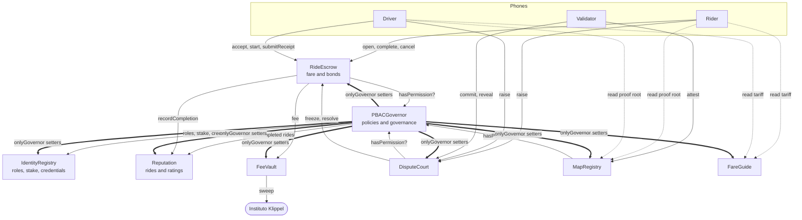
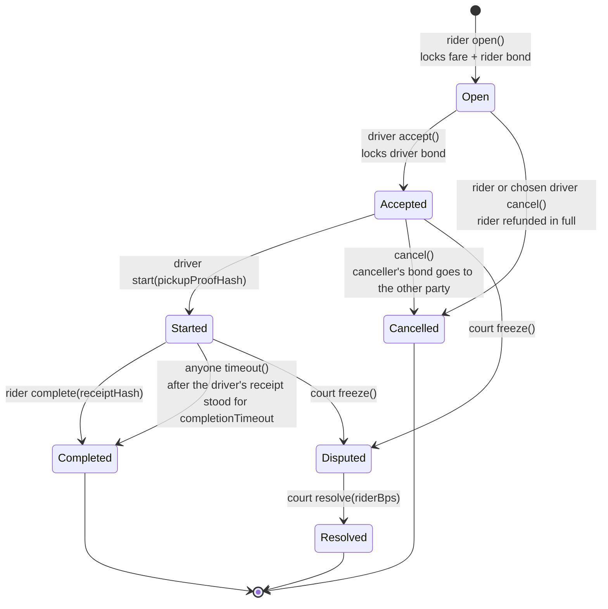
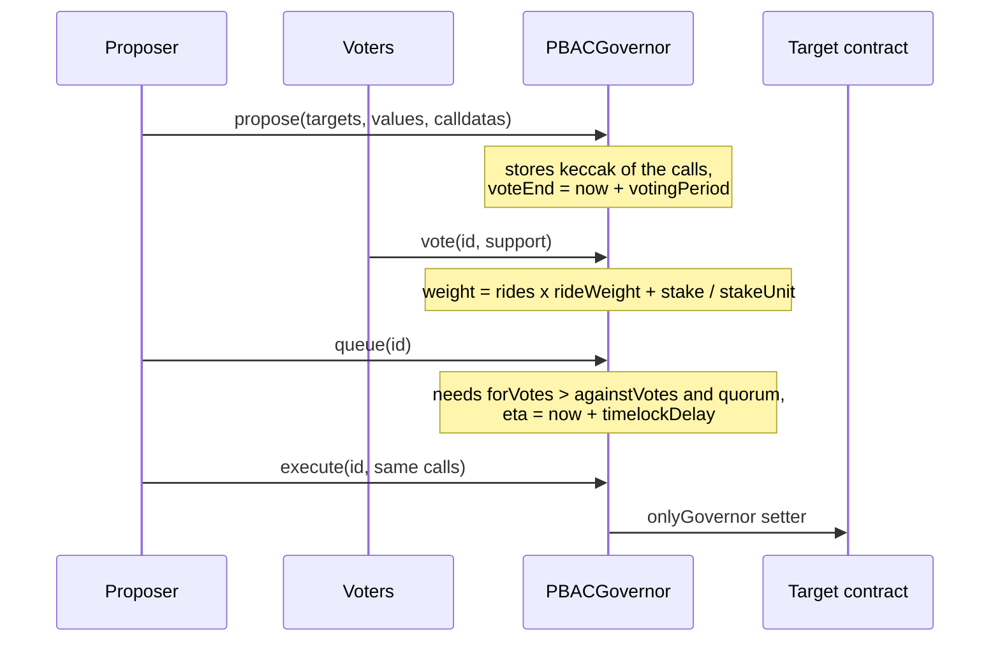

# Contracts: architecture overview

The contracts are the only shared state KlippelGo has. They hold the fare of a ride while it happens, keep the
rules everyone plays by, and record the few facts phones need to agree on. Everything else (matching, routes,
positions, personal data) happens between phones and never reaches the chain.

Related: [security.md](security.md), [scalability.md](scalability.md), the
[core's overview](../../core/docs/overview.md) for the proofs these contracts anchor, and the
[app's overview](../../apps/docs/overview.md) for who calls them.

## What each contract does

| Contract | Responsibility | Holds funds |
| --- | --- | --- |
| [`PBACGovernor`](../src/PBACGovernor.sol) | Policies (who may call what) and governance (propose, vote, timelock, execute) | No |
| [`Governed`](../src/Governed.sol) | Base of every other contract: `permitted` and `onlyGovernor` | No |
| [`IdentityRegistry`](../src/IdentityRegistry.sol) | Roles, stake with unbonding, credential hashes from trusted attesters | Stake |
| [`RideEscrow`](../src/RideEscrow.sol) | The ride state machine: locks the fare and both bonds, pays out | Fares and bonds |
| [`FeeVault`](../src/FeeVault.sol) | Collects R$ 1,00 per completed ride for Instituto Klippel | Fees |
| [`Reputation`](../src/Reputation.sol) | Completed-ride counts and star ratings between the two parties of a ride | No |
| [`DisputeCourt`](../src/DisputeCourt.sol) | Commit-reveal juror vote that splits a disputed fare | No |
| [`MapRegistry`](../src/MapRegistry.sol) | Proof roots of the map packs, and the verifier's tolerances | No |
| [`FareGuide`](../src/FareGuide.sol) | The tariff and the band riders and drivers may price in | No |

## How they fit together

Two kinds of arrows matter:

- **Policy checks** (`hasPermission?`). A user-facing function marked `permitted` asks the governor whether
  `msg.sender` satisfies the policy stored for `(this contract, this selector)`. The governor answers from the
  caller's roles, stake, account age, score and credentials.
- **Governor setters**. Every parameter has a setter guarded by `onlyGovernor`. The governor calls it only when
  executing a proposal that passed a vote and waited out the timelock.

There is no owner and no admin key. The deployer wires the contracts through `bootstrapCall` and then calls
`finishBootstrap`, which sets `bootstrapper` to zero for good.

## The ride state machine

Where the money goes at each exit:

| Exit | Rider gets | Driver gets | FeeVault gets |
| --- | --- | --- | --- |
| Completed | rider bond | fare − fee + driver bond | fee |
| Cancelled from Open | fare + rider bond | nothing (posted nothing) | nothing |
| Cancelled from Accepted by rider | fare | driver bond + rider bond | nothing |
| Cancelled from Accepted by driver | fare + rider bond + driver bond | nothing | nothing |
| Resolved | `riderBps` of the fare + rider bond | the rest − fee + driver bond | fee, only if the driver's share covers it |

The fee and both bonds are copied from the token's config into the ride when it opens, so a later governance
change never alters a ride already under way.

## Governance

`setPolicy`, `setParams` and `setModules` on the governor itself are `onlySelf`: a proposal that targets the
governor is the only way to change a policy.

## What the chain knows about a ride

Addresses of rider and driver, the token, the fare, the bonds and fee, timestamps, and three hashes:
`quoteHash`, `pickupProofHash` and `receiptHash`. No place, no route, no name. What those hashes commit to is
defined in the core ([core/docs/overview.md](../../core/docs/overview.md)) and stays on the two phones unless a
dispute makes a party reveal it to jurors.

## Structure and patterns

These are the rules new contract code follows. The skill that applies them is
[`change-contracts`](../../.claude/skills/change-contracts/SKILL.md).

**Layout**

| Path | What goes there |
| --- | --- |
| `src/` | One contract per file, named after the contract |
| `src/interfaces/` | Interfaces other contracts import, to avoid import cycles |
| `src/mocks/` | Test-only tokens. Never referenced by production contracts |
| `script/ProtocolDeployer.sol` | The one place that deploys and wires the protocol and sets launch policies |
| `script/DeployLocal.s.sol`, `script/SeedPhones.s.sol` | Local network values and seeded accounts |
| `test/Protocol.t.sol` | Behaviour of the whole protocol, deployed through `ProtocolDeployer` |
| `test/ProofEncoding.t.sol` | Hash encodings shared with the Rust verifier, checked against the same vectors |

**Patterns**

1. Every contract extends `Governed`. No `Ownable`, no admin address, no pausing key.
2. A function a user calls and that should be restricted is `permitted`, and its policy is set in
   `ProtocolDeployer`. A function that changes a parameter is `onlyGovernor`. A function called by another
   protocol contract checks that exact address (`NotCourt`, `NotEscrow`).
3. A function that moves tokens is `nonReentrant`, uses `SafeERC20`, and writes its state before it transfers.
4. Every state change emits an event. Events index the ids and addresses a phone filters by.
5. Failures are custom errors, never revert strings.
6. Amounts are in the token's own base units. BRL tokens differ in decimals (BRLA 18, BRZ 4), so nothing
   hard-codes a decimal count: per-token values live in `tokenConfig`.
7. No function loops over state that users can grow. See [scalability.md](scalability.md).
8. Personal data never goes on chain, not even encrypted. Only hashes and addresses.
9. An encoding that the phones or the verifier also compute (quote hash, receipt hash, Merkle leaves) has a
   vector in `ProofEncoding.t.sol` and the same vector in `core/verify/tests/vectors.rs`.

**Adding or changing a contract**

1. Write the behaviour and its test in `test/Protocol.t.sol`.
2. Wire it in `ProtocolDeployer` and set its policies there. Add its address to the deployment file written by
   `DeployLocal.s.sol`, and to `Deployment.kt` in the app if phones call it.
3. Update the table and diagram on this page, the access table in [security.md](security.md), and the README's
   policy table if a policy changed.
4. `forge fmt` (line length 110) and `make test-contracts`.

**Tooling**: Foundry, Solidity 0.8.28, OpenZeppelin as a git submodule in `lib/`. CI runs `forge fmt --check`,
`forge test`, then deploys to a local chain and plays one ride (`testnet/demo-ride.sh`).
