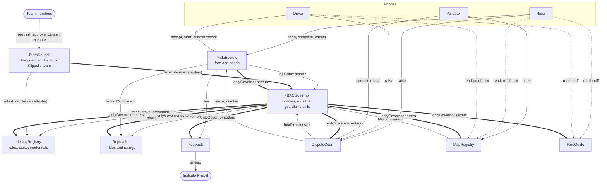
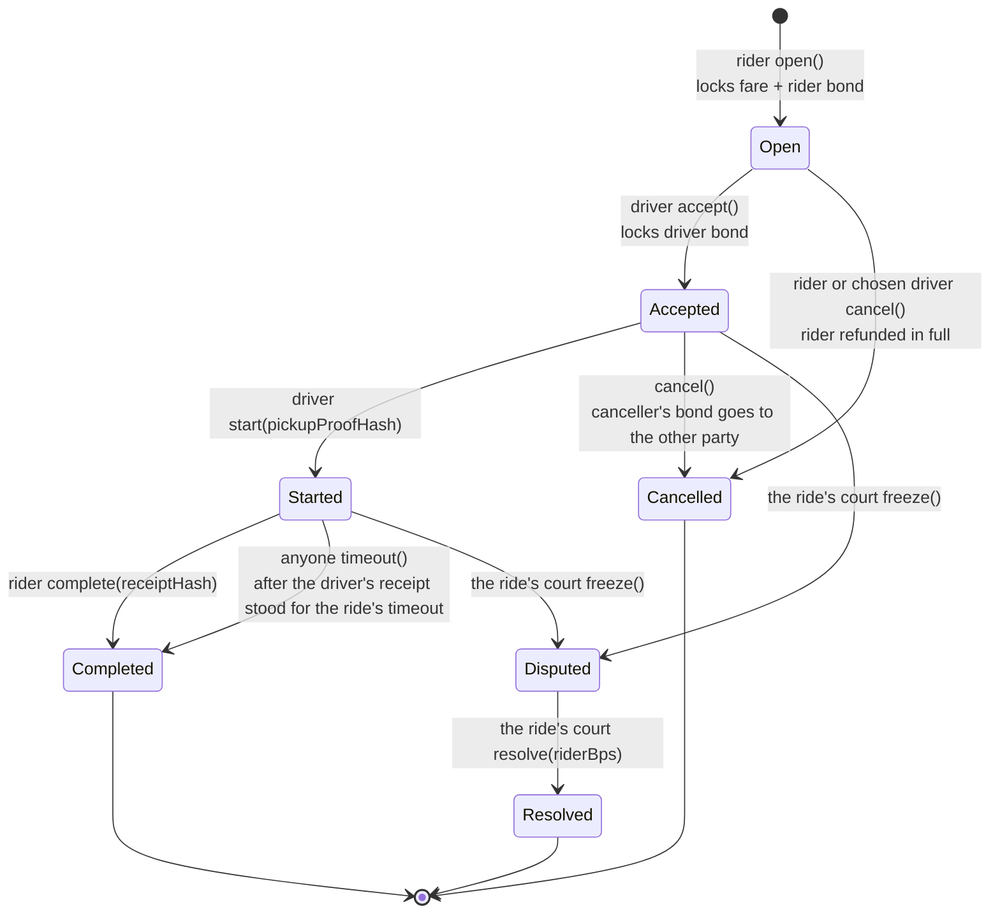
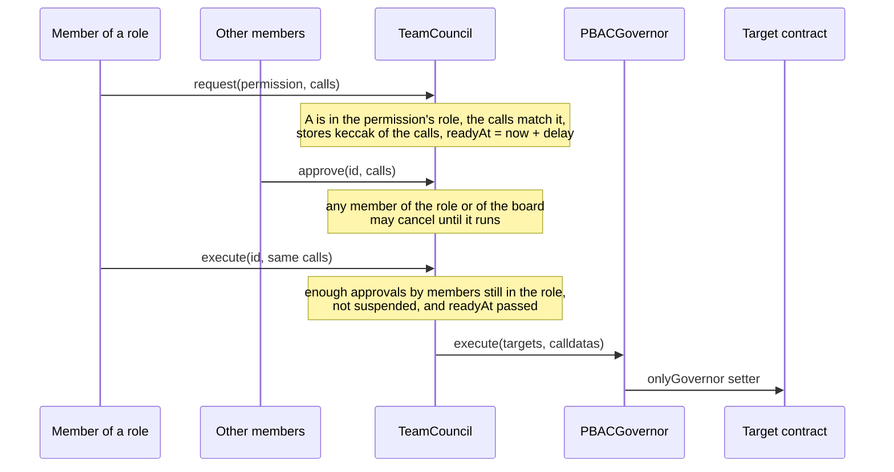

# Contracts: architecture overview

The contracts are the only shared state KlippelGo has. They hold the fare of a ride while it happens, keep the
rules everyone plays by, and record the few facts phones need to agree on. Everything else (matching, routes,
positions, personal data) happens between phones and never reaches the chain.

Related: [security.md](security.md), [scalability.md](scalability.md), [deployment.md](deployment.md), the
[core's overview](../../core/docs/overview.md) for the proofs these contracts anchor, and the
[app's overview](../../apps/docs/overview.md) for who calls them.

## What each contract does

| Contract | Responsibility | Holds funds |
| --- | --- | --- |
| [`PBACGovernor`](../src/PBACGovernor.sol) | Policies (who may call what), and the guardian: the one account whose calls it runs as the governor | No |
| [`TeamCouncil`](../src/TeamCouncil.sol) | The guardian: Instituto Klippel's team, its members and roles, and the approvals and delay each action needs. Also the attester the team issues credentials as | No |
| [`Governed`](../src/Governed.sol) | Base of every other contract: `permitted` and `onlyGovernor` | No |
| [`IdentityRegistry`](../src/IdentityRegistry.sol) | Roles, stake with unbonding, credential hashes from trusted attesters, and the accounts the guardian blocked | Stake |
| [`RideEscrow`](../src/RideEscrow.sol) | The ride state machine: locks the fare and both bonds, pays out, and takes the fee and the government's tax from the fare. Keeps a payment it could not make until its payee withdraws it, and holds no more of a coin than its cap | Fares, bonds, payments owed |
| [`FeeVault`](../src/FeeVault.sol) | Collects R$ 1,00 per completed ride for Instituto Klippel | Fees |
| [`Reputation`](../src/Reputation.sol) | Completed-ride counts and star ratings between the two parties of a ride, reported by the escrows the guardian listed | No |
| [`DisputeCourt`](../src/DisputeCourt.sol) | Commit-reveal juror vote that splits a disputed fare | No |
| [`MapRegistry`](../src/MapRegistry.sol) | Proof roots of the map packs, and the verifier's tolerances | No |
| [`FareGuide`](../src/FareGuide.sol) | The tariff and the band riders and drivers may price in, and what one native coin is worth in reais, for showing gas as a ride's infrastructure cost | No |

## How they fit together

Two kinds of arrows matter:

- **Policy checks** (`hasPermission?`). A user-facing function marked `permitted` asks the governor whether
  `msg.sender` satisfies the policy stored for `(this contract, this selector)`. The governor answers from the
  caller's roles, stake, account age, score and credentials. An account governance blocked
  (`IdentityRegistry.setBlocked`) satisfies none.
- **Governor setters**. Every parameter has a setter guarded by `onlyGovernor`. The governor calls it only
  when its guardian asks, through `PBACGovernor.execute`. The guardian is the team council, which runs an
  action once enough members of the right role approved it and its delay is over.

No contract has an owner. The deployer wires the contracts through `bootstrapCall`, calls `finishBootstrap`,
which sets `bootstrapper` to zero for good, and hands the guardian's seat to the council it deployed.

## The ride state machine

Where the money goes at each exit:

| Exit | Rider gets | Driver gets | FeeVault gets | Tax collector gets |
| --- | --- | --- | --- | --- |
| Completed | rider bond | fare − fee − tax + driver bond | fee | tax |
| Cancelled from Open | fare + rider bond | nothing (posted nothing) | nothing | nothing |
| Cancelled from Accepted by rider | fare | driver bond + rider bond | nothing | nothing |
| Cancelled from Accepted by driver | fare + rider bond + driver bond | nothing | nothing | nothing |
| Resolved | `riderBps` of the fare + rider bond | the rest − its tax − fee + driver bond | fee, only if what is left of the driver's share covers it | the ride's tax, in the proportion of the fare the driver keeps |

The fee and both bonds are copied from the token's config into the ride when it opens, the tax is worked out
then as `fare × taxBps` and kept with its collector, and so are the court and the completion timeout. A later
change never alters a ride already under way, nor where its tax goes, nor who may judge it. The rider never pays
more than the fare: fee and tax both come out of the driver's part.

Each payment in this table is made on its own. One that fails, because its payee's address is frozen by the
coin's issuer or cannot receive it, is kept in `owed` for that payee, who takes it with `withdraw`; the others
are paid as usual. Deposits are checked to arrive whole, and when the guardian set a cap on a coin, a deposit
that would take what the escrow holds of it (`held`) above the cap is refused.

Gas is not in this table. Each account pays the network for its own transactions in the chain's native coin,
and the escrow never sees it. `FareGuide.nativeCoinCentavos` is only a rate the guardian publishes so every
phone converts gas to reais the same way when it shows a ride's infrastructure cost.

## Governance

`setPolicy` and `setModules` on the governor itself are `onlySelf`: a call the guardian runs through `execute`
is the only way to change a policy. The guardian changes in two steps: the guardian names a successor with
`proposeGuardian`, and nothing happens until that address calls `acceptGuardian`.

A permission names one function on one contract, optionally one value of one of its arguments (blocking but not
unblocking, say), how many approvals it needs and how long it waits; or it is a playbook, a list of calls
stored by hash that a role runs as it is. The council's own functions (members, suspensions, roles,
permissions) are reached the same way, under the board's permissions. Who holds which at launch, and why, is
[docs/governance.md](../../docs/governance.md); the code that sets it up is
[`script/TeamDeployer.sol`](../script/TeamDeployer.sol).

## Instituto Klippel's part

Instituto Klippel's team is the guardian. Each member acts with their own key, in the roles the board gave
them:

| It wants to | How | Takes effect |
| --- | --- | --- |
| Approve or revoke a driving licence (CNH), or KYC | Credenciamento, as the council, which is a trusted attester: `IdentityRegistry.attest`, `revoke` | Approve with two members, revoke with one, both at once |
| Block an account, or stop new rides | Segurança: `IdentityRegistry.setBlocked`, or the `stop-rides` playbook | One member, at once. Unblocking takes two |
| Change a fee, the tax, a cap, the tariff | Finanças | Two members, then a day |
| Change a policy, a timeout, the map packs | Operações | Two members, then a day |
| Change who is in the team, the guardian, the contracts wired in, the fee beneficiary | The board (Diretoria) | Three members, then 72 hours |

On the local testnet the council has one member, Instituto Klippel's account #1, in every role, with one
approval and no delay. The tool for all of this is [`gov/klippel-gov`](../../gov/README.md).

## What the chain knows about a ride

Addresses of rider and driver, the token, the fare, the bonds and fee, timestamps, and three hashes:
`quoteHash`, `pickupProofHash` and `receiptHash`. No place, no route, no name. What those hashes commit to is
defined in the core ([core/docs/overview.md](../../core/docs/overview.md)) and stays on the two phones unless a
dispute makes a party reveal it to jurors.

## Structure and patterns

These are the rules new contract code follows. The skill that applies them is
[`change-contracts`](../../.claude/skills/change-contracts/SKILL.md).

**Layout**

| Path | What goes there |
| --- | --- |
| `src/` | One contract per file, named after the contract |
| `src/interfaces/` | Interfaces other contracts import, to avoid import cycles |
| `src/mocks/` | Test-only tokens. Never referenced by production contracts |
| `script/ProtocolDeployer.sol` | The one place that deploys and wires the protocol and sets launch policies |
| `script/TeamDeployer.sol` | The team council's launch roles, permissions, playbooks and numbers, and the handover of the guardian's seat |
| `script/DeployLocal.s.sol`, `script/SeedPhones.s.sol` | Local network values and seeded accounts |
| [`../gov/`](../../gov/README.md) | `klippel-gov`, the command-line tool team members request, approve and execute actions with. Not a contract: it lists every call the council makes by signature, so a new one is added there too |
| `test/Protocol.t.sol` | Behaviour of the whole protocol, deployed through `ProtocolDeployer` |
| `test/TeamCouncil.t.sol` | The council with its launch numbers, deployed through `TeamDeployer` |
| `test/ProofEncoding.t.sol` | Hash encodings shared with the Rust verifier, checked against the same vectors |

**Patterns**

1. Every protocol contract extends `Governed`. No `Ownable`, no admin address, no pausing key. The one account
   with power over them is the governor's guardian, `TeamCouncil`, which acts only through actions its members
   approve.
2. A function a user calls and that should be restricted is `permitted`, and its policy is set in
   `ProtocolDeployer`. A function that changes a parameter is `onlyGovernor`. A function called by another
   protocol contract checks that exact address (`NotCourt`, `NotEscrow`).
3. A function that moves tokens is `nonReentrant`, uses `SafeERC20`, and writes its state before it transfers.
   The escrow pays through `_pay`, which keeps a failed payment as owed, and takes deposits through `_deposit`,
   which checks the cap and that the whole amount arrived.
4. Every state change emits an event. Events index the ids and addresses a phone filters by.
5. Failures are custom errors, never revert strings.
6. Amounts are in the token's own base units. BRL tokens differ in decimals (BRLA 18, BRZ 4), so nothing
   hard-codes a decimal count: per-token values live in `tokenConfig`.
7. No function loops over state that users can grow. See [scalability.md](scalability.md). The council loops
   over an action's approvers, roles and a role's permissions: state only the team grows.
8. Personal data never goes on chain, not even encrypted. Only hashes and addresses.
9. An encoding that the phones or the verifier also compute (quote hash, receipt hash, Merkle leaves) has a
   vector in `ProofEncoding.t.sol` and the same vector in `core/verify/tests/vectors.rs`.

**Adding or changing a contract**

1. Write the behaviour and its test in `test/Protocol.t.sol`.
2. Wire it in `ProtocolDeployer` and set its policies there. Add its address to the deployment file written by
   `DeployLocal.s.sol`, and to `Deployment.kt` in the app if phones call it. A new `onlyGovernor` function
   needs a permission for the role that should call it, in `TeamDeployer` (and, on a live network, a `grant`
   by the board), and goes into `KNOWN_CALLS` in `gov/klippel-gov`, or members see it as an unknown call.
3. Update the table and diagram on this page, the access table in [security.md](security.md), and the README's
   policy table if a policy changed.
4. `forge fmt` (line length 110) and `make test-contracts`.

**Tooling**: Foundry, Solidity 0.8.28, OpenZeppelin as a git submodule in `lib/`. CI runs `forge fmt --check`,
`forge test`, then deploys to a local chain, plays one ride (`testnet/demo-ride.sh`) and runs the governance
tool's checks (`gov/test.sh`).
