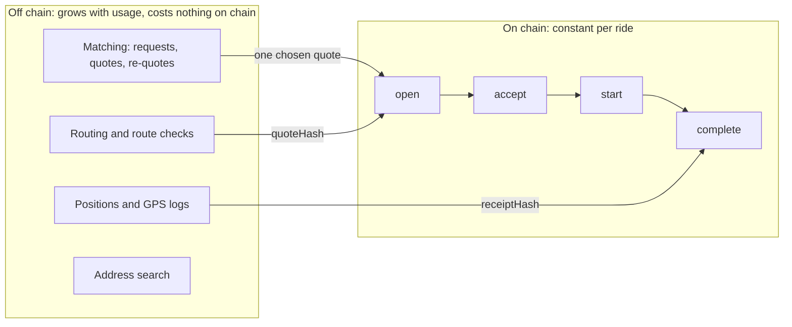

# Contracts: scalability

The chain is the only resource every KlippelGo user shares, and the only one that costs money per use. The
design keeps it small: a ride touches the chain four times, each time for a constant amount of work, and
nothing else about the ride is ever written there.

Related: [overview.md](overview.md), [core scalability](../../core/docs/scalability.md),
[app scalability](../../apps/docs/scalability.md).

## What goes on chain and what does not

A rider may receive fifty quotes and reprice three times: the chain sees one `open`. A trip may log a
thousand GPS fixes: the chain sees one 32-byte hash.

## Cost of a ride

Gas measured by `forge test --gas-report` on the test suite, with the mock tokens and a tax set (the report's
maximum for `open` and `complete`, since most tests run with no tax). Real tokens cost what their
own `transferFrom` costs, so read these as the protocol's share.

| Step | Gas | Notes |
| --- | --- | --- |
| `open` | 338 000 | Writes the ride (the largest write, two slots more for the tax and its collector) and pulls fare + bond |
| `accept` | 95 000 | Policy check reads registry and reputation; pulls the bond |
| `start` | 75 000 | |
| `complete` | 276 000 | Four transfers, the tax among them, and the reputation record |
| **Ride, happy path** | **about 784 000** | Plus a token `approve` the first time |
| `cancel` | 58 000 | |
| `submitReceipt` + `timeout` | 73 000 + 203 000 | When the rider does not confirm |
| Dispute: `raise`, `commit`, `reveal`, `settle` | 117 000, 82 000, 64 000, 169 000 | Per juror for commit and reveal |

Rerun the report after changing a contract: `cd contracts && forge test --gas-report`.

## Why every call is constant

- Rides, disputes, proposals, packs and identities are mappings keyed by id or address. No function iterates
  over them.
- A policy check reads a fixed number of slots: one policy, one identity, at most two reputation values and
  one credential.
- Voting weight is computed from two stored numbers, with no checkpoint history to search.
- The only loop over caller-supplied data is `PBACGovernor.execute`, over the calls of one proposal, paid by
  whoever executes it.

So cost per ride does not grow with the number of rides, users or regions. State grows linearly: one `Ride`
(about ten slots) per ride, kept for good.

## What limits growth

| Limit | Where it bites | Lever |
| --- | --- | --- |
| Chain throughput | Rides per second across all cities share the chain's block space. At about 784 000 gas a ride, block gas limit ÷ 784 000 is the ceiling per block | Deploy per region or on a rollup: `Domain` (chain id + escrow address) already scopes every hash, so several escrows can coexist |
| Gas price against a R$ 1,00 fee | If four transactions cost a meaningful share of a fare, short rides stop making sense | A low-fee chain (the target is Polygon PoS); a paymaster with smart accounts (not built); merging `accept` and `start` is possible but removes the driver's bond before pickup |
| Reading history | Phones find their rides by filtering `RideOpened` logs by indexed rider or driver. Public RPCs cap log ranges | See [app scalability](../../apps/docs/scalability.md): keep a cursor, or use an indexer as a cache that is never trusted |
| Disputes | Each needs humans to read evidence. Juror work grows with the dispute rate, not with rides | `klippelgo-juror` makes the check mechanical; the verifier is written to run in a zkVM so a proof can replace the vote for what is provable |
| Map packs | One activation and `rebuildQuorum` attestations per region per release | Constant per region. Rebuilding is off chain and takes minutes of validator compute |
| Governance | One vote transaction per voter per proposal | Fine at community scale. A very large electorate would need off-chain signatures tallied on chain |

## Adding regions and tokens

A new city is a new map pack in `MapRegistry` and nothing else: the escrow does not know regions exist. A new
BRL token is one `setToken` proposal. Neither requires redeploying or migrating.

## What would not scale, and is therefore not done

- Storing requests, quotes or driver presence on chain.
- Matching on chain.
- Any list a user can append to and a function then walks.
- Verifying routes on chain step by step. The chain holds one root per pack; checks happen on phones and
  jurors' machines against that root.

A change that adds any of these needs a very good reason and a line in this file.
