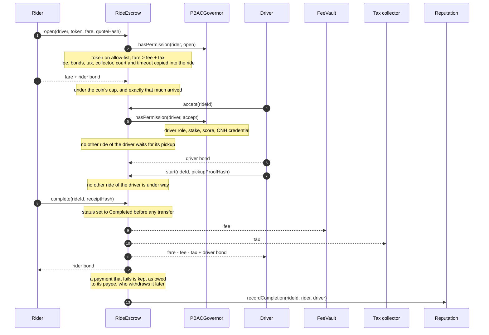
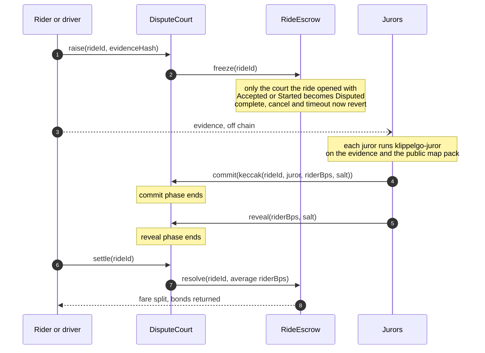
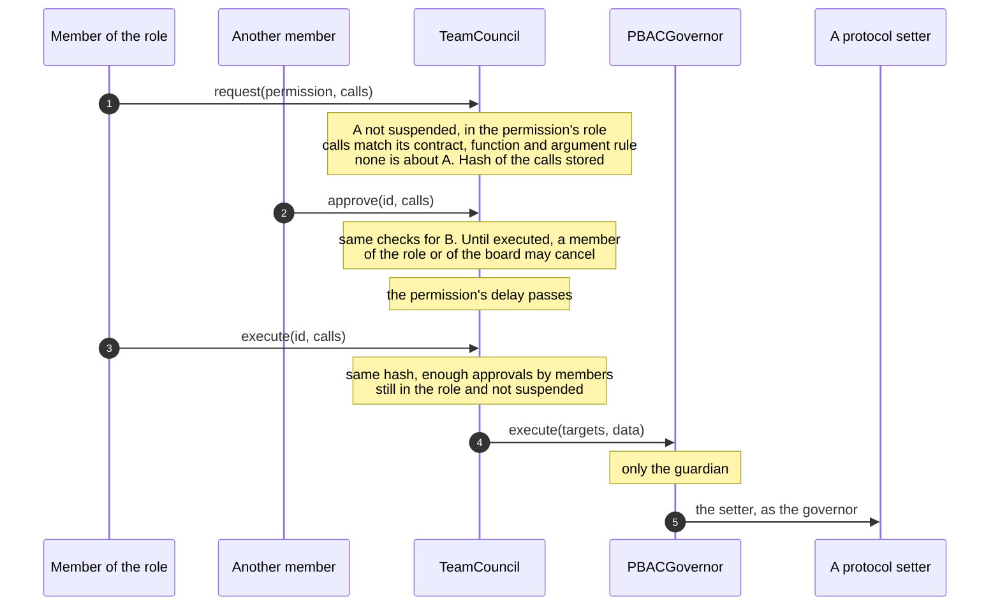
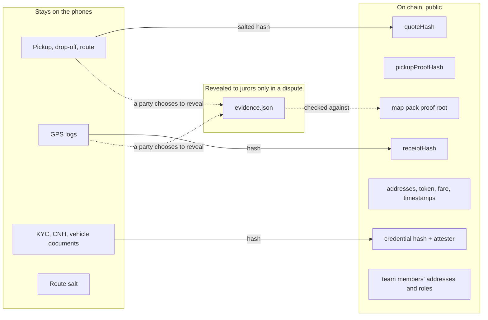

# Contracts: security

What the contracts protect, who may do what, the rules that must always hold, and where the protection ends
today. The numbered invariants (`C1` to `C27`) are what the
[security reviewer](../../.claude/agents/security-reviewer.md) checks a change against.

Related: [overview.md](overview.md), [core security](../../core/docs/security.md),
[app security](../../apps/docs/security.md), [team governance](../../docs/governance.md).

## What is at stake

| Asset                                                 | Where                                              | Who could want it                                            |
| ----------------------------------------------------- | -------------------------------------------------- | ------------------------------------------------------------ |
| Fares and bonds of rides under way, and payments owed | `RideEscrow`                                     | The other party, a third party, a malicious token            |
| Stake                                                 | `StakeVault`                                     | Anyone                                                       |
| Collected fees                                        | `FeeVault`                                       | Anyone                                                       |
| The rules (policies, parameters, tariff, map roots)   | `PBACGovernor` and every setter                  | Anyone who gains from changing them                          |
| The guardian's seat: who may change the rules         | `PBACGovernor.guardian`, held by `TeamCouncil` | Anyone, above all                                            |
| The team: members, roles, what each role may do       | `TeamCouncil`                                    | A member acting alone, a thief of members' keys              |
| Reputation, roles and credentials, which outlive releases | `Reputation`, `IdentityStore`                 | Sybil accounts, a code contract wired in to rewrite them     |
| Which releases apps may run                           | `ReleaseRegistry`                                | Anyone who wants phones to run other code, or none           |
| People's accounts: their coins, stake and identity    | `KlippelGoAccount` clones                        | Anyone who could sign for them                               |
| The paymaster's deposit and the reais it collected    | `BrlPaymaster`, its EntryPoint deposit           | Anyone who could make it pay for gas it is not paid back for |

The chain itself is trusted to order and execute transactions. BRL tokens on the allow-list are trusted not to
rebase or call back; that they deliver what is sent is checked (C17), and that their issuer may freeze an
address is allowed for (C16, C18). The guardian is trusted with every setter: it is Instituto Klippel's team
council, where no member acts alone on what moves money or changes rules (C14, C19). Nothing else is trusted:
not the deployer after the seat is handed over, not attesters beyond the credential they sign, not validators
individually.

## Who may call what

| Function                                                                                                                                           | Caller                                                                                                                              | Enforced by                                                            |
| -------------------------------------------------------------------------------------------------------------------------------------------------- | ----------------------------------------------------------------------------------------------------------------------------------- | ---------------------------------------------------------------------- |
| `RideEscrow.open`                                                                                                                                | Rider role                                                                                                                          | `permitted`                                                          |
| `RideEscrow.accept`                                                                                                                              | The driver named in the ride, with driver role, stake, score and CNH credential, while no other ride of theirs waits for its pickup | `permitted` + `NotDriver` + `DriverBusy`                         |
| `RideEscrow.start`                                                                                                                               | The ride's driver, while no other ride of theirs is under way                                                                       | `NotDriver` + `DriverBusy`                                         |
| `RideEscrow.submitReceipt`                                                                                                                       | The ride's driver                                                                                                                   | `NotDriver`                                                          |
| `RideEscrow.complete`                                                                                                                            | The ride's rider                                                                                                                    | `NotRider`                                                           |
| `RideEscrow.cancel`                                                                                                                              | Rider or driver of the ride                                                                                                         | `NotParty`                                                           |
| `RideEscrow.decline`                                                                                                                             | The ride's driver, while it is Open                                                                                                 | `NotDriver` + `WrongStatus`                                        |
| `RideEscrow.timeout`                                                                                                                             | Anyone, after the driver's receipt stood for the ride's own `completionTimeout`                                                   | time check                                                             |
| `RideEscrow.freeze`, `resolve`                                                                                                                 | The court the ride opened with                                                                                                      | `NotCourt`                                                           |
| `RideEscrow.withdraw(token, payee)`                                                                                                              | Anyone, for a payee the escrow owes a payment it could not make. The money goes only to the payee                                   | `NothingOwed`                                                        |
| `DisputeCourt.raise`                                                                                                                             | Rider or driver of the ride, once                                                                                                   | `NotParty`, `AlreadyRaised`                                        |
| `DisputeCourt.commit`                                                                                                                            | Validator with stake, not a party to the ride                                                                                       | `permitted` + `PartyCannotJudge`                                   |
| `DisputeCourt.reveal`                                                                                                                            | A juror who committed, with the matching value and salt                                                                             | commitment check                                                       |
| `MapRegistry.attest`                                                                                                                             | Validator with stake, once per pack                                                                                                 | `permitted`                                                          |
| `Reputation.recordCompletion`                                                                                                                    | An escrow the guardian listed as a writer (`setWriter`), once per ride                                                              | `NotWriter`, `AlreadyRecorded`                                     |
| `Reputation.rate`                                                                                                                                | A party of a recorded ride, once                                                                                                    | `NotParty`, `AlreadyRated`                                         |
| `IdentityRegistry.register`                                                                                                                      | Anyone, for their own address. It writes the identity store as one of its writers                                                   | the store's `InvalidRoles`                                           |
| `IdentityStore.addRoles`                                                                                                                         | A code contract the guardian listed as a writer (`setWriter`). Roles only grow; the first registration's time never moves           | `NotWriter`, `InvalidRoles`                                        |
| `IdentityStore.attest`                                                                                                                           | A trusted attester, for an account with no valid credential of that kind from another attester                                      | `UntrustedAttester`, `NotIssuer`                                   |
| `IdentityStore.revoke`                                                                                                                           | The credential's attester, or the governor                                                                                          | `NotIssuer`                                                          |
| `StakeVault.addStake`                                                                                                                            | A registered account, for its own stake                                                                                             | `NotRegistered`                                                      |
| `StakeVault.requestUnstake`, `withdrawStake`                                                                                                   | The owner of the stake, the second after its `unbondingPeriod`. No policy, no writer list, nobody else                             | `InsufficientStake`, `StillUnbonding`                              |
| `ReleaseRegistry.publish`, `deprecate`, `revoke`, `reinstate`                                                                                | The governor. A version is published once; a status moves Active → Deprecated → Revoked, and back to Active only by `reinstate`     | `onlyGovernor`, `AlreadyPublished`, `WrongStatus`                |
| `FeeVault.sweep`                                                                                                                                 | Anyone: the destination is fixed                                                                                                    | none needed                                                            |
| Every `set…` (among them `IdentityStore.setBlocked`, `setWriter` on `IdentityStore` and `Reputation`, `StakeVault.setUnbondingPeriod` up to 30 days, and `RideEscrow.setCap`), `MapRegistry.activate`/`retire`, `FeeVault.payClaim` | The governor, running the guardian's calls                                                                                          | `onlyGovernor`, `InvalidPeriod`                                    |
| `PBACGovernor.setPolicy`, `setModules`                                                                                                         | The governor calling itself, for the guardian                                                                                       | `onlySelf`                                                           |
| `PBACGovernor.execute`, `proposeGuardian`                                                                                                      | The guardian                                                                                                                        | `NotGuardian`                                                        |
| `PBACGovernor.acceptGuardian`                                                                                                                    | The address the guardian named                                                                                                      | `NotPendingGuardian`                                                 |
| `PBACGovernor.bootstrapCall`, `finishBootstrap`                                                                                                | The deployer, until `finishBootstrap`                                                                                             | `NotBootstrapper`                                                    |
| `TeamCouncil.request`, `approve`                                                                                                               | A member, not suspended, of the permission's role, for calls that match the permission and are not about the member                 | `NotMember`, `NotInRole`, `CallsDoNotMatch`, `AboutThemselves` |
| `TeamCouncil.cancel`                                                                                                                             | A member of the action's role, or of a role that cancels any (not for a protected role's action)                                    | `NotInRole`                                                          |
| `TeamCouncil.execute`                                                                                                                            | Anyone, once enough members approved and the delay is over, within 14 days of that                                                  | `NotEnoughApprovals`, `TooEarly`, `Expired`, `CallsDoNotMatch` |
| `TeamCouncil.acceptGuardianSeat`                                                                                                                 | Anyone: it only succeeds when the council is the one named                                                                          | the governor's `NotPendingGuardian`                                  |
| `TeamCouncil.setMemberRole`, `setSuspended`, `createRole`, `grant`, `grantPlaybook`, `revokePermission`, `setApprovalsAndDelay`      | The council itself, executing an action                                                                                             | `NotSelf`, `Protected`, `WouldLockOut`                           |
| `KlippelGoAccount.validateUserOp`                                                                                                                | The EntryPoint, for an operation one of the account's keys signed                                                                   | `onlyEntryPoint`, the signers' check                                 |
| `KlippelGoAccount.execute` (ERC-7821 batch)                                                                                                      | The EntryPoint (after `validateUserOp`), or the account itself                                                                    | `AccountUnauthorized`                                                |
| `KlippelGoAccount.approvePaymaster`                                                                                                          | The EntryPoint or the account itself: so only an operation the account signed                                                       | `_checkEntryPointOrSelf`                                             |
| `KlippelGoAccount.proposeKeyChange`, `approveKeyChange`                                                                                      | Anyone, carrying the approval of one of the account's keys, signed by that key over the change, so a friend or the guardian can pay for it when the account cannot. The change applies when more than half of the keys approved it| `NotASigner`, `BadApproval`, `AlreadyApproved`, `UnknownKeyChange`                          |
| `KlippelGoAccount.startRecovery`                                                                                                             | The guardian the keys named, for one new key                                                                                        | `NotGuardian`                                                        |
| `KlippelGoAccount.finishRecovery`                                                                                                            | Anyone, once `RECOVERY_DELAY` (2 days) has passed and no change of keys came since it started                                       | `NoRecovery`, `RecoveryNotReady`                                     |
| `KlippelGoAccount.initialize`                                                                                                                    | Once per clone, by the factory in the same transaction that makes it; never on the implementation                                   | `initializer`, `_disableInitializers`                              |
| `KlippelGoAccount.isValidSignature`                                                                                                              | Anyone (a view): whether the account's keys signed a hash                                                                           | none needed                                                            |
| `AccountFactory.createAccount`                                                                                                                   | Anyone: an account belongs to whoever holds its key, whoever creates it                                                             | none needed                                                            |
| `BrlPaymaster.validatePaymasterUserOp`, `postOp`                                                                                               | The EntryPoint                                                                                                                      | `onlyEntryPoint`                                                     |
| `BrlPaymaster.deposit`, `addStake`                                                                                                             | Anyone: they only add                                                                                                               | none needed                                                            |
| `BrlPaymaster.withdraw`, `unlockStake`, `withdrawStake`, `withdrawTokens`                                                                  | The governor                                                                                                                        | `onlyGovernor`                                                       |

Instituto Klippel acts through the council, which is the guardian and the trusted attester the team issues
credentials with. Who in the team may ask for what, with how many approvals and what delay, is
[docs/governance.md](../../docs/governance.md); [`gov/klippel-gov`](../../gov/README.md) is the tool its members
use, and holds no power the table does not give.

## A ride, and what protects each step

If the rider never confirms, the driver calls `submitReceipt`, which fixes the driver's evidence on chain and
starts the ride's `completionTimeout`. During that time the rider can still `complete` with the same receipt or
raise a dispute. After it, anyone can call `timeout`.

## A dispute

The commitment binds the ride id and the juror's address, so a commitment cannot be copied by another juror or
reused for another ride.

## A change of a rule

An action needing one approval and no delay runs inside `request`. Calls to the council's own functions and to
`IdentityStore.attest`/`revoke` and `PBACGovernor.proposeGuardian` run as the council, not through the
governor.

## Where data lives

The route hash inside `quoteHash` is salted, so a known pair of addresses cannot be confirmed by hashing
guesses. Fares and the pair of addresses in a ride are public: that is what an escrow on a public chain costs.
Team members are addresses; who each belongs to is in Instituto Klippel's own records.

## Invariants

A change that breaks one of these is a security bug, whatever the tests say.

- **C1. Only the guardian governs.** After `finishBootstrap`, no address can change a parameter, move the
  protocol's funds or bypass a policy except the governor running the guardian's calls through `execute`.
  The guardian changes only by two steps: the guardian names a successor, who must accept. The governor
  cannot be named. In a deployment, the guardian is `TeamCouncil`.
- **C2. Escrow is solvent.** For every ride not in a final state, the escrow holds `fare + riderBond` (plus
  `driverBond` from Accepted on) of that ride's token, and it holds every payment it owes. Every exit pays
  out, or keeps as owed, exactly what was locked: nothing is left behind and nothing is taken from another
  ride. `held` counts all of it per token.
- **C3. One exit per ride.** A ride reaches Completed, Cancelled or Resolved once. The status is written
  before any transfer, and every function that transfers is `nonReentrant`.
- **C4. Only parties move a ride.** Outside the court and `timeout`, only the ride's rider or driver changes
  its state, and each only through their own functions.
- **C5. A ride keeps the terms it opened with.** Fee, bonds, the tax amount, the tax collector, the court and
  the completion timeout are read from the ride, never from the current `tokenConfig`, `taxBps`,
  `taxCollector`, `court` or `completionTimeout`. A change of any of them applies to rides opened afterwards.
  Only where the fee is paid (`feeVault`) is read at settlement.
- **C6. Only allow-listed tokens.** `open` reverts for a token whose fee is zero, and for a fare not above
  the fee plus the tax, so a settlement never pays out more than the fare. `setTax` refuses a rate of 100% or
  more, and a non-zero rate with no collector.
- **C7. A dispute freezes the ride.** Only the ride's own court freezes it, and while Disputed only `resolve`
  from that court moves funds.
- **C8. A split is bounded.** `riderBps` is at most 10 000 at both the court and the escrow.
- **C9. A juror is not a party**, votes once per dispute, and cannot change a committed vote.
- **C10. A receipt cannot be swapped.** Once a receipt hash is on record, `complete` accepts only the same
  hash and `submitReceipt` reverts.
- **C11. Stake cannot be borrowed for an instant.** Stake counts for policies only while it is in the
  stake vault, and leaves only after `unbondingPeriod`.
- **C12. Reputation comes only from listed escrows.** `recordCompletion` is callable only by an escrow the
  guardian listed as a writer, once per ride and escrow, and only parties of a recorded ride can rate, once
  each. Which escrows are listed is the guardian's to decide (L19).
- **C13. A map root needs a quorum.** `activate` reverts unless `rebuildQuorum` distinct validators attested
  exactly that root, and a pack is activated once.
- **C14. An action runs exactly what was requested, with its approvals and its delay.** The council stores the
  hash of an action's calls; `execute` runs only calls with that hash, after the permission's delay and no later
  than 14 days after it, when as many approvers as the permission asks are, at that moment, members of its role
  and not suspended. The approval that makes an action ready runs it in the same transaction, and reverts with
  it if its calls revert. A permission
  covers one function on one contract (and, when set, one value of one argument), or one playbook of calls
  stored by hash. Once executed, cancelled or expired, an action never runs. An approval counts again if its
  member is lifted from a suspension or put back in the role while the action is still pending.
- **C15. A block stops what an account starts, never what it is owed.** A blocked account satisfies no
  policy, so it cannot `open`, `accept`, `commit` or `attest` a map. No function that returns funds or ends a
  ride is `permitted`: a blocked rider or driver still completes, cancels, files a receipt, raises a dispute,
  withdraws what it is owed and withdraws stake. Only the governor sets the flag, and it can clear it.
- **C16. A payee that cannot receive holds up only its own payment.** Every payment the escrow makes on a ride
  is tried on its own; one that fails (a frozen or blocked address) is kept in `owed` for its payee, and the ride
  settles for everyone else. Anyone may send what is owed to its payee with `withdraw(token, payee)`, so a
  payee that cannot call the escrow (the fee vault, a contract collecting the tax) is paid too.
- **C17. A deposit arrives whole.** `open` and `accept` check that the escrow's balance grew by exactly the
  amount transferred, so a token that keeps a share of transfers cannot leave the escrow owing more than it
  holds.
- **C18. A coin is capped.** When a cap is set, no deposit takes what the escrow holds of that coin above it.
- **C19. The team cannot lock itself out, nobody goes round the board's delay, and the board cannot touch
  recovery.** The board (role 0) always keeps active permissions to grant and to set members. Every
  permission or playbook that changes who decides (the council's members, roles and permissions, or the
  guardian's seat) waits at least `minBoardDelay`, whatever role holds it, also when its delay is changed
  later, and no permission waits more than 30 days. No member leaves a role with fewer members than any of its
  permissions needs approvals; nobody requests or approves their own entry into a role or their own
  suspension; and the members and permissions of a protected role change only by that role's own actions,
  whose actions only its members cancel.
- **C20. Only an account's own keys act for it.** An account runs calls only for the EntryPoint, after its
  `validateUserOp` found the operation signed by one of its signers over the EntryPoint's hash of that operation
  (or for itself, inside such an operation). A phone's key signs
  P-256 over SHA-256 of the hash, checked by `DeviceKeyVerifier` with `s` in the lower half. An account's address
  is fixed by its first signer alone (a clone at `CREATE2` from the factory), so it can receive money before it
  exists, and the factory cannot put another first signer at that address. The implementation has a signer no
  key matches and cannot be initialized.
- **C21. The paymaster is paid back for the gas it pays.** It charges an operation in a coin on the escrow's
  allow-list only, at the price `FareGuide` holds for the native coin, never at a price of zero: it takes the
  most the operation could cost before it runs and returns the rest after. Anything else fails validation and
  costs it nothing.
- **C22. A driver has at most two rides in hand.** At most one ride of a driver is Accepted and at most one is
  Started: `accept` reverts while one waits for its pickup (`pickupOf`), `start` while one is under way
  (`onTripOf`). Each place is freed by every way a ride leaves that state: `start`, `cancel`, `freeze` and
  settling. It limits only what the driver does; `open`, by anyone, is never refused for it, so nobody can
  fill a driver's places but the driver. A Disputed ride holds no place: a driver who raises a dispute on their
  own ride frees it, at the price of that ride's fare frozen until the court rules. The places are per escrow,
  so while an old and a new escrow both take rides, a driver can hold two on each.
- **C23. Data outlives the code that writes it, by fixed rules.** `IdentityStore` and `Reputation` are written
  only by code contracts the governor listed as writers (`DataContract.setWriter`), and their own rules bind
  every writer: roles only grow and the first registration's time never moves; a ride is recorded once per
  escrow and rated once per party; credentials are issued and revoked only by attesters by the rules in the
  store. A release replaces code contracts and changes the writer lists; it never moves the data.
- **C24. Nothing can be wired in to move stake.** `StakeVault` has no writer list, no slashing and no setter
  but the unbonding period, which the governor cannot set above `MAX_UNBONDING_PERIOD` (30 days). Only the owner
  of a stake adds it, asks for it back and withdraws it. Its code is final: slashing means a new vault people
  move their stake into.
- **C25. A release is what was published.** A version is published once, with its contracts hash and APK
  hashes, and these never change. `latest` is the highest version published, so a backport never becomes the update newer apps are offered. Its status moves Active → Deprecated → Revoked; only `reinstate` brings it
  back to Active. Only the governor moves it. What it binds is honest apps (L33): an escrow is closed for
  everyone by its policies, not by the registry.
- **C26. An account's keys change only by a majority of them, or by its guardian after a delay they let pass.**
  A change (keys to add, keys to remove, and whether to name a guardian and whom) applies once more than half of
  the account's keys approved it, each with its own signature over `approvalHash(id)`, which names the domain
  `KlippelGo key change v1`, the chain, the account and the change's id; an approval counts once per key, and only
  from a key the account has. The id is `keccak256(abi.encode(keysEpoch, add, remove, setGuardian, guardian))`:
  every applied change and finished recovery raises `keysEpoch`, which voids every other change and approval made
  before it, and any recovery waiting. Keeping the guardian names none. The account is never its own key nor
  its own guardian, and the last key is never removed. Who sends a change or an approval does not matter: anyone
  may, as what counts is the key's signature, so a key that stopped the account paying (revoked the paymaster's
  allowance, spent the coins) does not stop the others taking it off. One key alone still signs every operation
  and certificate (threshold 1, C20); what it cannot do alone, once the account has two keys, is change them.
- **C27. A guardian's recovery replaces every key with one, and only if the keys let it.** Only the guardian
  starts it, naming the new key; anyone finishes it from `RECOVERY_DELAY` (2 days) later, when it adds that key
  and removes every other. Any change of keys in between, an empty one included, cancels it.

## Known limits

These are real today. A change that touches one should either close it or leave it no worse, and say which.

| #   | Limit                                                                                                                                                                                                                                                                                                                                                                                                                                                                                                                                                                                                                                                                                  | Why it stands                                                                                                 | What closes it                                                                                                                                                                                                                                                                  |
| --- | -------------------------------------------------------------------------------------------------------------------------------------------------------------------------------------------------------------------------------------------------------------------------------------------------------------------------------------------------------------------------------------------------------------------------------------------------------------------------------------------------------------------------------------------------------------------------------------------------------------------------------------------------------------------------------------- | ------------------------------------------------------------------------------------------------------------- | ------------------------------------------------------------------------------------------------------------------------------------------------------------------------------------------------------------------------------------------------------------------------------- |
| L1  | `pickupProofHash` and `receiptHash` are recorded, not verified                                                                                                                                                                                                                                                                                                                                                                                                                                                                                                                                                                                                                     | Checking needs both phones' signatures and the proof data                                                     | Smart accounts with P-256 keys; later a validity proof from `core/verify`                                                                                                                                                                                                     |
| L2  | `open` does not check the fare against `FareGuide`                                                                                                                                                                                                                                                                                                                                                                                                                                                                                                                                                                                                                                 | The escrow never learns the trip's length                                                                     | By design: the phones keep the band ([app security](../../apps/docs/security.md))                                                                                                                                                                                                |
| L3  | A Started ride with no receipt and no dispute stays locked until a party acts                                                                                                                                                                                                                                                                                                                                                                                                                                                                                                                                                                                                          | Nobody else knows what happened                                                                               | Either party can always act: `complete`, `submitReceipt` then `timeout`, or `raise`                                                                                                                                                                                     |
| L4  | Jurors are not paid and not slashed; one juror alone decides if only one reveals; no reveal means 50/50                                                                                                                                                                                                                                                                                                                                                                                                                                                                                                                                                                                | First version of the court                                                                                    | Juror selection, rewards, slashing, a minimum number of reveals                                                                                                                                                                                                                 |
| L5  | Stake is a gate, never seized: there is no slashing anywhere                                                                                                                                                                                                                                                                                                                                                                                                                                                                                                                                                                                                                           | Not built, and the stake vault's code is final (C24)                                                         | Slashing by court or governance decision, in a new vault people move their stake into                                                                                                                                                                                           |
| L7  | Completed rides and ratings between two of one's own accounts cost only R$ 1,00 plus the tax each, so reputation can be bought                                                                                                                                                                                                                                                                                                                                                                                                                                                                                                                                                         | Sybil cost is the fee, the tax and gas                                                                        | Credential-gated ratings, or weight from rides with distinct, credentialed counterparts                                                                                                                                                                                         |
| L8  | An account with no ratings passes any `minScore`                                                                                                                                                                                                                                                                                                                                                                                                                                                                                                                                                                                                                                     | New drivers must be able to start                                                                             | Credential and stake gates carry the weight until the first rating                                                                                                                                                                                                              |
| L9  | A dispute can be raised once per ride, by either party, at no cost                                                                                                                                                                                                                                                                                                                                                                                                                                                                                                                                                                                                                     | First version                                                                                                 | A dispute bond                                                                                                                                                                                                                                                                  |
| L10 | Rebasing or hook tokens would break C2                                                                                                                                                                                                                                                                                                                                                                                                                                                                                                                                                                                                                                                 | The escrow assumes the rest of a plain ERC-20; a token that keeps a share of transfers is refused (C17)       | The guardian must only allow-list plain tokens, and a watcher on each coin's proxy alerts Finanças when its code changes ([accounts-and-pix.md](../../docs/accounts-and-pix.md))                                                                                                |
| L11 | The deployer is all-powerful until `finishBootstrap`, and is the guardian until the council accepts the seat                                                                                                                                                                                                                                                                                                                                                                                                                                                                                                                                                                         | Wiring needs it, and the council's permissions name the protocol's addresses                                  | `TeamDeployer` hands the seat over in the same script, which is many transactions and not one. Verify `bootstrapper() == 0`, `guardian() == TeamCouncil` and `pendingGuardian() == 0`, and the rest of [deployment.md](deployment.md), "Verification", on any deployment |
| L12 | Rider and driver addresses and fares are public and linkable across rides                                                                                                                                                                                                                                                                                                                                                                                                                                                                                                                                                                                                              | Public chain                                                                                                  | Fresh accounts per ride with smart accounts; not built                                                                                                                                                                                                                          |
| L14 | `FareGuide.nativeCoinCentavos` is a number the guardian types in, not a price feed, and it prices the gas people pay through the paymaster                                                                                                                                                                                                                                                                                                                                                                                                                                                                                                                                           | No oracle                                                                                                     | A rate set too high overcharges everyone's gas in reais; too low, and the paymaster's native deposit pays the difference until Finanças corrects it. An oracle, or a band the rate must stay within                                                                            |
| L15 | `setTax` accepts any rate under 100%                                                                                                                                                                                                                                                                                                                                                                                                                                                                                                                                                                                                                                                 | Same kind of power as the fee in `setToken`                                                                 | Rides under way are unaffected and the rider never pays more than the fare; a high rate makes `open` revert or drivers stop quoting. A cap in the contract, if Instituto Klippel wants one                                                                                    |
| L16 | A block follows an address, not a person. A rider needs no credential, so a blocked rider can register another address and ride again                                                                                                                                                                                                                                                                                                                                                                                                                                                                                                                                                  | Riders are pseudonymous by design                                                                             | For drivers the CNH credential carries the weight: the attester refuses the same licence on a new address, and revoking it acts at once. For riders, a policy on `open` that asks for a KYC credential                                                                        |
| L17 | A blocked account can still `reveal` a vote it committed in a dispute                                                                                                                                                                                                                                                                                                                                                                                                                                                                                                                                                                                                                | Blocking a juror mid-dispute would otherwise change the outcome                                               | By design                                                                                                                                                                                                                                                                       |
| L19 | Nothing in the protocol contracts bounds the guardian. At once, it can: name any court or escrow for new rides; set a tax up to 99,99% to a collector of its choosing for new rides; set huge bonds; set a completion timeout of zero for new rides; set the unbonding period up to 30 days (C24); drain `FeeVault` with `payClaim` or redirect it; list a code contract as a writer of `Reputation` or `IdentityStore` that records completions or adds roles (C23 still binds it); open any policy (unlicensed drivers, its own jurors, anyone attesting maps, then a map quorum of one); point the governor at other identity, stake or reputation contracts; publish, deprecate, revoke or reinstate a release; revoke any credential, block anyone; hand the seat on | The guardian is the one authority by design                                                                   | The guardian is the team council: these need the board's three approvals and 72 hours, or Finanças' or Operações' two and a day ([docs/governance.md](../../docs/governance.md)), and every request is public and cancellable. C5 keeps rides under way on their own terms    |
| L20 | Whoever approves with `klippel-gov` believes the chain node: it serves both an action's calls and the hash they are checked against, so a node that lies consistently shows a member other calls than the ones requested                                                                                                                                                                                                                                                                                                                                                                                                                                                             | The tool has no light client                                                                                  | Use a node Instituto Klippel runs or trusts. The council rechecks the calls' hash itself at `execute`                                                                                                                                                                         |
| L21 | An attester re-issues a credential the guardian revoked, and a block does not stop a trusted attester from attesting                                                                                                                                                                                                                                                                                                                                                                                                                                                                                                                                                                   | Attesters are trusted for what they sign                                                                      | The guardian removes the attester (`setAttester`), which voids everything it issued                                                                                                                                                                                           |
| L22 | A trusted attester other than the council is one key unless whoever holds it makes it more: the contracts cannot tell a multisig from a single account, and removing an attester voids every credential it issued                                                                                                                                                                                                                                                                                                                                                                                                                                                                      | An attester is an address                                                                                     | An operating rule, which no code enforces: any attester the board adds should be a multisig with a threshold of at least 2. The council itself issues with Credenciamento's two approvals. The local testnet also lists a plain key                                             |
| L23 | A court with a bug strands every ride that opened with it: the court is fixed per ride and nothing reassigns it                                                                                                                                                                                                                                                                                                                                                                                                                                                                                                                                                                        | A court named later must not reach rides already under way (C5, C7)                                           | Audit a court like the escrow before wiring it in. A new court only helps rides opened after it                                                                                                                                                                                 |
| L24 | Anyone with the rider role and enough of a coin can fill its cap with rides left Open, naming a driver that never accepts, and stop new rides in that coin until they cancel                                                                                                                                                                                                                                                                                                                                                                                                                                                                                                           | The cap counts what is held, whoever holds it                                                                 | Set caps well above normal use; Finanças raises a cap with its two approvals and its day. A cost or time limit on Open rides would close it                                                                                                                                    |
| L25 | The `resume-rides` playbook puts back the `open` and `accept` policies as they were when it was stored                                                                                                                                                                                                                                                                                                                                                                                                                                                                                                                                                                           | A playbook is exact calls, so whoever runs it chooses nothing                                                 | After Operações changes either policy, the board stores a new `resume-rides` with `grantPlaybook` and revokes the old one                                                                                                                                                 |
| L26 | Three directors' keys stolen together can, after 72 hours, do anything the guardian can, including replace the other directors and hand the seat on. Two can, at once, suspend the honest directors (two approvals, no delay), so the board cannot reach its three until directors are replaced; and one director can cancel any role's pending action                                                                                                                                                                                                                                                                                                                                 | The board is the top of the team, and suspending must be fast                                                 | Recuperação (protected) cancels any of their actions and suspends them in one transaction, and replaces directors after 7 days; the watcher pages every member on each request. Recuperação's own keys are the last line: a cold multisig                                   |
| L27 | A permission's argument rule (`argWord`) reads a fixed word of the calldata. On a dynamic argument that word is an offset the caller chooses, so the rule does not hold there                                                                                                                                                                                                                                                                                                                                                                                                                                                                                                        | The council does not know the function's argument types                                                       | Set an argument rule only on a static argument (an address, a number, a bool), as every launch permission does. `grant` does not check it                                                                                                                                     |
| L28 | Each account lets the paymaster take any amount of each launch coin (`initialize` approves it), since its first operation must already pay                                                                                                                                                                                                                                                                                                                                                                                                                                                                                                                                           | The approval must exist before the first operation runs                                                       | The paymaster takes only what its own code computes for gas (C21); its code never changes. A new paymaster, or a new coin, needs an operation from each account that approves it (`approvePaymaster`), paid in a coin the old one still takes                                 |
| L29 | `isValidSignature` answers for a bare hash, with no ERC-7739 wrapping, so a signature the account gave for one hash is good for anything that asks about that hash                                                                                                                                                                                                                                                                                                                                                                                                                                                                                                                   | KlippelGo's only use is the session certificate, whose hash carries its own domain, the chain and the account | The account must never be asked to sign another dapp's hash. ERC-7739's nested typed data, if accounts are ever used elsewhere                                                                                                                                                  |
| L30 | Operations are simulated and bundled by Instituto Klippel's own bundler with the ERC-7562 rules off: the paymaster reads the escrow and `FareGuide`, and an account's first operation reads the factory's storage and calls the coins, all of which a public mempool would refuse. The bundler is also believed for the gas an operation needs and for the receipt the phone reads a ride's id from; the phones cap the first, and give the paymaster's check a floor (apps A15)                                                                                                                                                                                                                                             | The paymaster's price lives in other contracts                                                                | Run the bundler (local: `testnet/bundler`); anyone can run another, with the same rules off. The paymaster is staked so that public bundlers could take it once the reads are allowed for staked entities                                                                     |
| L31 | On the local testnet the EntryPoint at the canonical address is a copy put there with `anvil_setCode` (`testnet/entrypoint.sh`), not the released bytecode                                                                                                                                                                                                                                                                                                                                                                                                                                                                                                                         | Bundlers simulate against that address; the released bytes cannot be reproduced here                          | Local only. On Polygon the EntryPoint is the released one. The local copy is built from the same tagged sources (eth-infinitism v0.9.0)                                                                                                                                         |
| L32 | A rider who does not act holds up the driver's next ride (C22). One who does not show at the pickup keeps the driver's place until the driver cancels, which pays that rider the driver's bond. One who never confirms arrival keeps the driver's next pickup waiting until the driver's receipt has stood for the ride's `completionTimeout`, or a dispute frees it. A completion timeout set near 2^64 (L19) would hold that place for good                                                                                                                                                                                                                                        | One rider in the car at a time, and the escrow cannot tell a no-show from a late rider                        | A pickup timeout after which the driver may cancel an accepted ride and keep the bond; until then, the driver's choice is to cancel or to wait                                                                                                                                  |
| L33 | The release registry binds only apps that obey it. A modified app ignores a `Revoked` status, and one Segurança member revokes a release at once (`revoke`, or the `revoke-release-<version>` playbook), which stops honest apps on it from starting rides until the board puts it back (`reinstate`, two directors) | A check in the app is all an app can carry; a revoke after a vulnerability cannot wait | Close the release's escrow too, which binds every app: the release's `revoke-release-<version>` playbook does both in one action. The board stores one per release it publishes, since it names that release's escrow, and new `stop-rides`/`resume-rides` for that escrow: the launch ones name the launch escrow. A plain `revoke` run first makes that playbook revert (the release is revoked already), and then `stop-rides` closes the escrow |
| L34 | One of an account's keys signs every operation alone, money included: a taken phone can spend the account's coins, or revoke the paymaster's allowance so the account pays for nothing, until a majority of the keys takes it off | The keys are for riding, from one phone at a time, without asking the others | The phone's own lock on its key (apps P20). Removal stops what the key does next, not what it already sent. Removal itself can be paid by anyone (C26), but the app does not yet send it from another account (apps P28) |
| L35 | A guardian can replace every key of an account whose devices do not cancel within two days, and a guardian whose own account was taken can be made to | The delay is the only check on the guardian; the phones say so when they next read the account | Name someone trusted, or none. The app reads the account's own events at each change check and shows the recovery on every screen (apps A19) |
| L36 | Whoever holds a majority of an account's keys, the only phone of a one-phone account included, can cancel any recovery and change the keys at will | The contract cannot tell the owner from a thief holding the same keys | More devices: with three, one taken phone is a minority |
| L37 | `finishRecovery` and `_apply` loop over the account's keys | Only a majority of those keys, or the guardian with one key, grows them, at most 16 a change | Pattern 7 concerns state strangers grow; this is the account's own |

L6 (voting weight without a snapshot), L13 (a collector that cannot receive blocks a settlement) and L18 (a
block took a vote and a timelock) were closed: there is no voting, a failed payment is kept as owed and anyone
can send it on (C16), and Segurança blocks at once.

## How it is tested

`test/Protocol.t.sol` deploys through the real `ProtocolDeployer` and covers each exit of the state machine,
each `Not…` guard, the dispute flow, the guardian changing a parameter, a block and what it leaves alone, map
activation with and without quorum, a ride keeping its court and timeout across a change, a frozen payee, a
coin that charges on transfer, fees owed to a frozen vault, and the cap. `test/TeamCouncil.t.sol` deploys the
council with the launch numbers through `TeamDeployer` and covers approvals, delays, expiry, cancelling,
suspension, the separation and lockout rules, the floor and ceiling on delays, the playbooks, recovery and
handing the seat on. `test/Accounts.t.sol` runs accounts through a real EntryPoint v0.9: an account made by its
first operation and paying in BRZ, a wrong key, a wrong hash and a high-`s` signature refused, a new key added
and the old one removed by both keys, one taken phone of three unable to take the others off or approve twice or in
another key's name and the other two taking it off, an approval good for one change only, the last key never
removed, the account never its own key or guardian, a guardian's recovery finished after the delay and cancelled by
a majority (and by the only key of a one-key account), a change that keeps the guardian naming none, an approval given on one account
refused on another with the same keys, the other two removing a taken key that revoked the paymaster with a friend
sending and paying, the id's encoding pinned by a vector the phones share, nobody but the EntryPoint or the account
running its calls,
the same account created twice being the same one, `isValidSignature`, the paymaster refusing an unlisted coin
and a zero price, only the governor taking what it holds, the implementation unusable. [`gov/test.sh`](../../gov/test.sh) runs the governance
tool against a local chain: licences issued and revoked by the council, a block, a setting, the playbooks, a
second member with two approvals, a suspension, a release published with an APK, deprecated, revoked and put
back, and the multisig path. The protocol tests also cover the data contracts (only a listed writer adds roles,
roles only grow, a new registry writing the same identities, a ride recorded once), the stake vault (no writer
list, the 30-day ceiling, only registered accounts stake) and the release registry (published once, its
statuses, at most eight APKs); the council tests cover Segurança revoking a release at once, the
`revoke-release-<version>` playbook closing the escrow, the board publishing after 72 hours and wiring a registry into
the identities. `test/ProofEncoding.t.sol` pins the
encodings shared with the verifier. A change to a guard or to a payout needs a test that fails without it.
