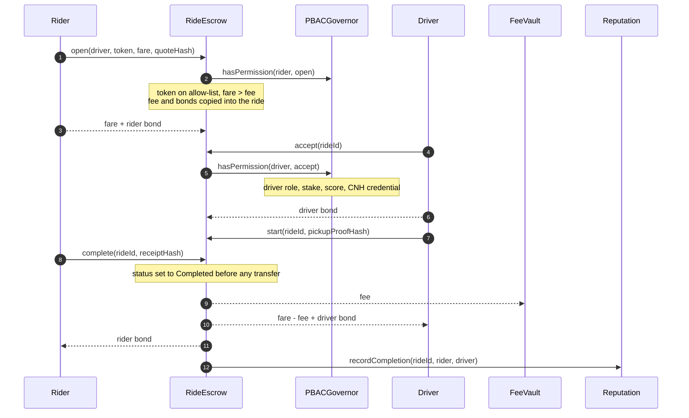
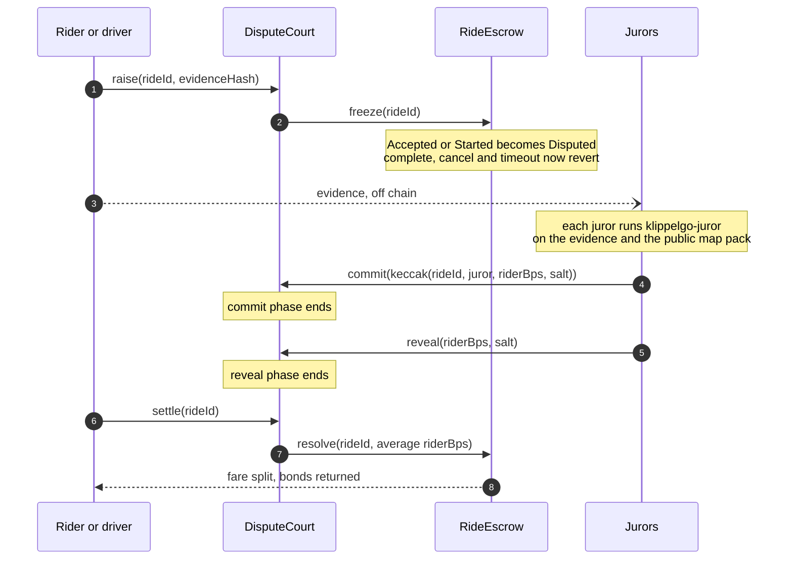
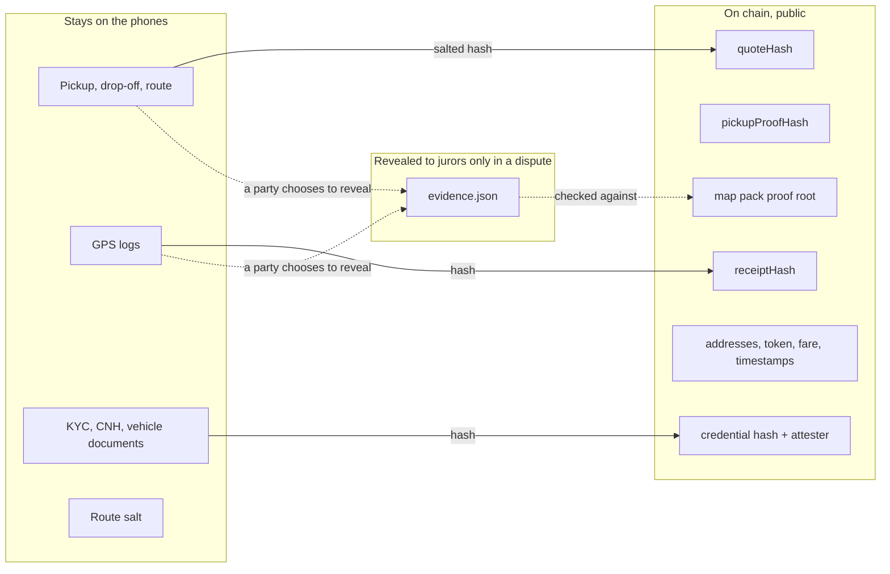

# Contracts: security

What the contracts protect, who may do what, the rules that must always hold, and where the protection ends
today. The numbered invariants (`C1` to `C14`) are what the
[security reviewer](../../.claude/agents/security-reviewer.md) checks a change against.

Related: [overview.md](overview.md), [core security](../../core/docs/security.md),
[app security](../../apps/docs/security.md).

## What is at stake

| Asset | Where | Who could want it |
| --- | --- | --- |
| Fares and bonds of rides under way | `RideEscrow` | The other party, a third party, a malicious token |
| Stake | `IdentityRegistry` | Anyone |
| Collected fees | `FeeVault` | Anyone |
| The rules (policies, parameters, tariff, map roots) | `PBACGovernor` and every setter | Anyone who gains from changing them |
| Reputation and voting weight | `Reputation`, `IdentityRegistry` | Sybil accounts |

The chain itself is trusted to order and execute transactions. BRL tokens on the allow-list are trusted to
behave as plain ERC-20s. Nothing else is trusted: not the deployer after bootstrap, not attesters beyond the
credential they sign, not validators individually.

## Who may call what

| Function | Caller | Enforced by |
| --- | --- | --- |
| `RideEscrow.open` | Rider role | `permitted` |
| `RideEscrow.accept` | The driver named in the ride, with driver role, stake, score and CNH credential | `permitted` + `NotDriver` |
| `RideEscrow.start`, `submitReceipt` | The ride's driver | `NotDriver` |
| `RideEscrow.complete` | The ride's rider | `NotRider` |
| `RideEscrow.cancel` | Rider or driver of the ride | `NotParty` |
| `RideEscrow.timeout` | Anyone, after the driver's receipt stood for `completionTimeout` | time check |
| `RideEscrow.freeze`, `resolve` | `DisputeCourt` only | `NotCourt` |
| `DisputeCourt.raise` | Rider or driver of the ride, once | `NotParty`, `AlreadyRaised` |
| `DisputeCourt.commit` | Validator with stake, not a party to the ride | `permitted` + `PartyCannotJudge` |
| `DisputeCourt.reveal` | A juror who committed, with the matching value and salt | commitment check |
| `MapRegistry.attest` | Validator with stake, once per pack | `permitted` |
| `Reputation.recordCompletion` | `RideEscrow` only | `NotEscrow` |
| `Reputation.rate` | A party of a completed ride, once | `NotParty`, `AlreadyRated` |
| `IdentityRegistry.attest` | A trusted attester | `UntrustedAttester` |
| `IdentityRegistry.revoke` | The credential's attester, or the governor | `NotIssuer` |
| `FeeVault.sweep` | Anyone: the destination is fixed | none needed |
| Every `set…`, `MapRegistry.activate`/`retire`, `FeeVault.payClaim` | The governor, executing a passed proposal | `onlyGovernor` |
| `PBACGovernor.setPolicy`, `setParams`, `setModules` | The governor calling itself | `onlySelf` |
| `PBACGovernor.bootstrapCall` | The deployer, until `finishBootstrap` | `NotBootstrapper` |

## A ride, and what protects each step

If the rider never confirms, the driver calls `submitReceipt`, which fixes the driver's evidence on chain and
starts `completionTimeout`. During that time the rider can still `complete` with the same receipt or raise a
dispute. After it, anyone can call `timeout`.

## A dispute

The commitment binds the ride id and the juror's address, so a commitment cannot be copied by another juror or
reused for another ride.

## Where data lives

The route hash inside `quoteHash` is salted, so a known pair of addresses cannot be confirmed by hashing
guesses. Fares and the pair of addresses in a ride are public: that is what an escrow on a public chain costs.

## Invariants

A change that breaks one of these is a security bug, whatever the tests say.

- **C1. No privileged key.** After `finishBootstrap`, no address can change a parameter, move funds or bypass
  a policy except the governor executing a passed proposal.
- **C2. Escrow is solvent per ride.** For every ride not in a final state, the escrow holds
  `fare + riderBond` (plus `driverBond` from Accepted on) of that ride's token. Every exit pays out exactly
  what was locked: nothing is left behind and nothing is taken from another ride.
- **C3. One exit per ride.** A ride reaches Completed, Cancelled or Resolved once. The status is written
  before any transfer, and every function that transfers is `nonReentrant`.
- **C4. Only parties move a ride.** Outside the court and `timeout`, only the ride's rider or driver changes
  its state, and each only through their own functions.
- **C5. A ride keeps the terms it opened with.** Fee and bonds are read from the ride, never from the current
  `tokenConfig`.
- **C6. Only allow-listed tokens.** `open` reverts for a token whose fee is zero, and for a fare not above
  the fee.
- **C7. A dispute freezes the ride.** While Disputed, only `resolve` from the court moves funds.
- **C8. A split is bounded.** `riderBps` is at most 10 000 at both the court and the escrow.
- **C9. A juror is not a party**, votes once per dispute, and cannot change a committed vote.
- **C10. A receipt cannot be swapped.** Once a receipt hash is on record, `complete` accepts only the same
  hash and `submitReceipt` reverts.
- **C11. Stake cannot be borrowed for an instant.** Stake counts for policies and votes only while it is in
  the registry, and leaves only after `unbondingPeriod`.
- **C12. Reputation comes only from real settlements.** `recordCompletion` is callable only by the escrow, and
  only parties of a recorded ride can rate, once each.
- **C13. A map root needs a quorum.** `activate` reverts unless `rebuildQuorum` distinct validators attested
  exactly that root, and a pack is activated once.
- **C14. A proposal executes exactly what was voted.** `execute` checks the calls against the stored hash,
  after quorum, majority and timelock, once.

## Known limits

These are real today. A change that touches one should either close it or leave it no worse, and say which.

| # | Limit | Why it stands | What closes it |
| --- | --- | --- | --- |
| L1 | `pickupProofHash` and `receiptHash` are recorded, not verified | Checking needs both phones' signatures and the proof data | Smart accounts with P-256 keys; later a validity proof from `core/verify` |
| L2 | `open` does not check the fare against `FareGuide` | The escrow never learns the trip's length | By design: the phones keep the band ([app security](../../apps/docs/security.md)) |
| L3 | A Started ride with no receipt and no dispute stays locked until a party acts | Nobody else knows what happened | Either party can always act: `complete`, `submitReceipt` then `timeout`, or `raise` |
| L4 | Jurors are not paid and not slashed; one juror alone decides if only one reveals; no reveal means 50/50 | First version of the court | Juror selection, rewards, slashing, a minimum number of reveals |
| L5 | Stake is a gate, never seized: there is no slashing anywhere | Not built | Slashing by court or governance decision |
| L6 | Voting weight is read when the vote is cast, with no snapshot | Simplicity | Safe only while `unbondingPeriod` is longer than `votingPeriod`. Neither setter enforces that: a proposal changing either must keep it |
| L7 | Completed rides give voting weight and cost R$ 1,00 each to fake between two own accounts | Sybil cost is the fee plus gas | Credential-gated weight, or weight from rated rides only |
| L8 | An account with no ratings passes any `minScore` | New drivers must be able to start | Credential and stake gates carry the weight until the first rating |
| L9 | A dispute can be raised once per ride, by either party, at no cost | First version | A dispute bond |
| L10 | Fee-on-transfer, rebasing or hook tokens would break C2 | The escrow assumes plain ERC-20s | Governance must only allow-list plain tokens |
| L11 | The deployer is all-powerful until `finishBootstrap` | Wiring needs it | `ProtocolDeployer` calls it in the same script. Verify `bootstrapper() == 0` on any deployment |
| L12 | Rider and driver addresses and fares are public and linkable across rides | Public chain | Fresh accounts per ride with smart accounts; not built |

## How it is tested

`test/Protocol.t.sol` deploys through the real `ProtocolDeployer` and covers each exit of the state machine,
each `Not…` guard, the dispute flow, governance changing a parameter, and map activation with and without
quorum. `test/ProofEncoding.t.sol` pins the encodings shared with the verifier. A change to a guard or to a
payout needs a test that fails without it.
