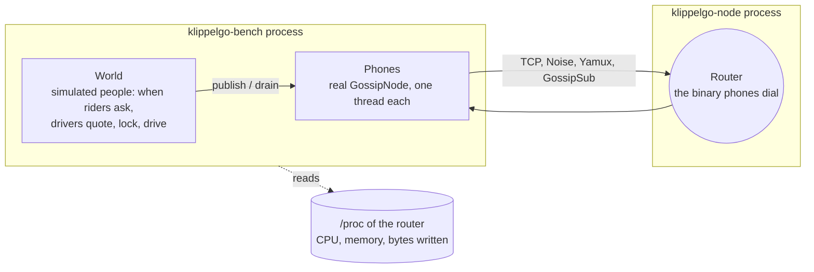
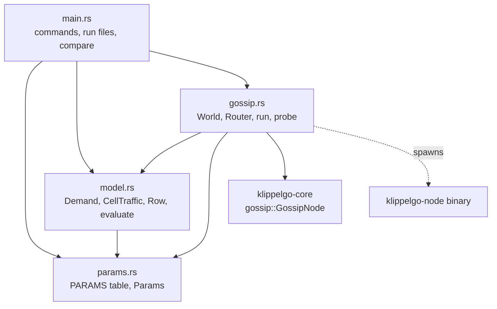
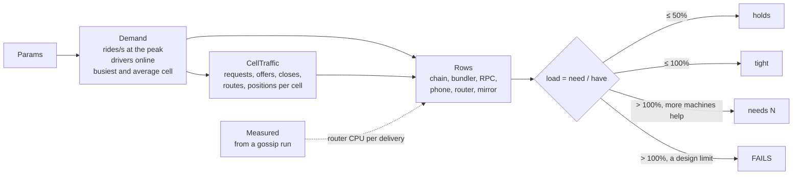
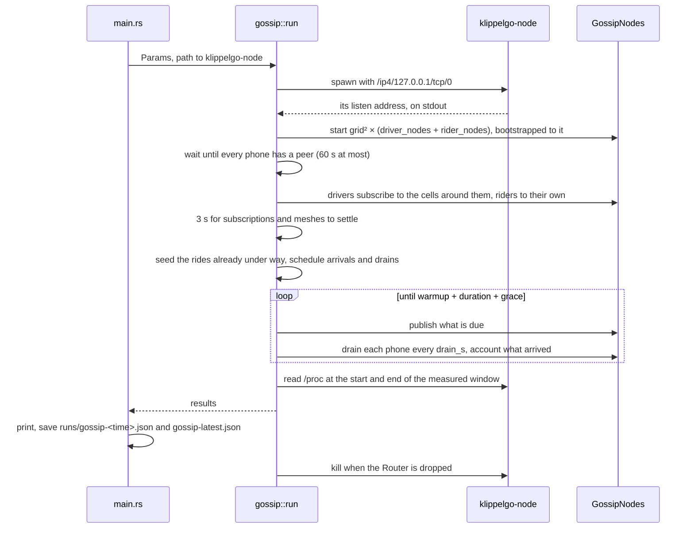
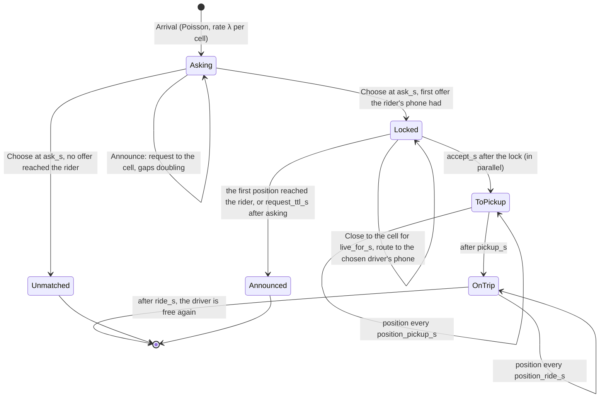
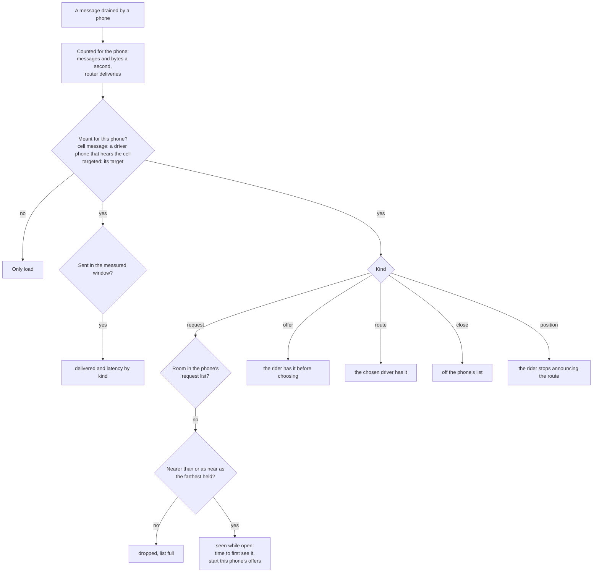
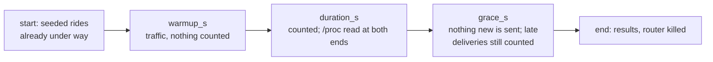

# Core: the scalability benchmark

`klippelgo-bench` ([`bench/`](../bench)) answers whether KlippelGo holds at a given number of drivers and
riders, and measures it again after each change. How to run it, its parameters and what it found are in
[bench/README.md](../bench/README.md). This page is how it is built and what happens when it runs.

Related: [scalability.md](scalability.md) (the figures it measured), [overview.md](overview.md) (where the
crate sits), [apps scalability](../../apps/docs/scalability.md), [contracts scalability](../../contracts/docs/scalability.md).

## What is real and what is simulated

| Piece | Real or simulated |
| --- | --- |
| Router | Real: the `klippelgo-node` binary, started as a child process, as `make gossip-node` runs it |
| Phones | Real: `klippelgo_core::gossip::GossipNode`, the object the apps get through UniFFI, each dialling only the router |
| Topics, cells, message sizes, cadences | As the app uses them: `/klippelgo/match/<release>/<cell>` (one release for every simulated phone), the nine cells around a driver, the sizes of the signed JSON messages, `Matchmaker`'s intervals |
| Message content | A 41-byte header the benchmark reads back, padded to the real message's size. The router never reads content, so this changes nothing it does |
| People | Simulated: riders arrive at random (Poisson) at the busiest cell's rate; drivers quote, are chosen and drive on fixed durations |
| Matchmaker's limits | Simulated on each phone: the 2 s drain, the 200-request list and what leaves it. A request a phone quoted is not kept past its close here: one phone quotes for hundreds of people, and keeping them would fill a list as no real phone's fills |
| Chain, bundler, RPC, mirrors | Not run. The model computes their load from the app's cadences and measured gas |

## Code structure

| File | Holds |
| --- | --- |
| [`main.rs`](../bench/src/main.rs) | The commands (`model`, `gossip`, `compare`, `probe`, `params`), the headline figures of a run, saving runs to `bench/runs/` with the commit they measured, and `compare` |
| [`params.rs`](../bench/src/params.rs) | `PARAMS`: every number with its default and its source (*code*, *assumed*, *measured*, *bench*). `Params` parses `--name value` and records what differs from the defaults |
| [`model.rs`](../bench/src/model.rs) | `Demand` (rides a second, drivers online, the busiest cell), `CellTraffic` (messages a second one cell carries, by kind), `evaluate` (one `Row` per shared resource), and `Measured` (what a gossip run feeds back) |
| [`gossip.rs`](../bench/src/gossip.rs) | `Router` (the child process), `Phone`, `Trip`, `Event`, `World` (the event loop and the accounting), `run`, and `probe` |

### Rules of the crate

1. **Only the core's public API.** The benchmark uses `GossipNode` as the apps do and runs the router binary as
   it ships. A change to either is measured without touching the benchmark.
2. **Every number is a parameter.** No figure lives in code outside `PARAMS`. A run saves all of them, so two
   runs with different defaults can still be compared.
3. **The model and the load test share their arithmetic.** `CellTraffic` gives both the model's figures and
   the load test's predictions, so a run shows the model's figure next to the measured one.

## The model

`CellTraffic::for_rate` turns a cell's rate of new rides λ into messages a second, from the app's cadences:

| Kind | Messages a second in a cell |
| --- | --- |
| Request | λ × announcements in `ask_s`, gaps from `announce_s` up to `open_gap_most_s`, doubling |
| Offer | λ × `offers_per_request` × announcements in `ask_s` − `quote_delay_s`, the same gaps |
| Close | λ × announcements in `live_for_s`, gaps up to `close_gap_most_s` |
| Route | λ × announcements in `accept_s` + `drain_s`, gaps up to `route_gap_most_s`: the rider stops at the driver's first position |
| Position | λ × (`pickup_s` ÷ `position_pickup_s` + `ride_s` ÷ `position_ride_s`), each to one phone on the ride's topic, not to the cell, unless `ride_topics` is 0 |

A driver's phone hears nine cells, so it receives nine times what goes to the cell. A row marked `scales_out` (bundler, RPC,
router bytes and CPU, mirrors) reports how many machines it needs. The others are limits of the design (block
space, a phone's inbox and request list, its mobile data, GossipSub's mesh), which more machines do not lift.

## The gossip load test

### One run

### People on phones

A cell at the target has hundreds of drivers, more phones than one computer runs. So `World` keeps people
apart from phones: each cell has `drivers_per_cell` logical drivers, spread round-robin over its
`driver_nodes` driver phones, and its riders' trips are given to its `rider_nodes` rider phones. A phone
subscribes as one real phone there would, so it receives exactly what one real phone receives. The router
forwards to fewer phones than it would, and the model scales its measured cost per delivery up.

| Grid of 3 | Hears |
| --- | --- |
| A driver phone in the middle cell | All nine cells, as a driver in a city does. The figures for one phone come from these |
| A driver phone at an edge or corner | Its in-grid neighbours only (six or four) |
| A rider phone | Its own cell, and the topics of the rides it carries. The router ignores a phone on more than 100 |

### A ride

Offers follow the request: when a driver phone first holds a request, each logical driver on that phone who
was picked to quote it starts announcing an offer `quote_delay_s` later, until asking ends. A driver phone that
never received the request sends no offer, and one that never received the route sends no positions, as on a
real phone.

The run starts in steady state: `new_trip` is called for rides asked up to `rider_listen_s` before the start (about twenty minutes), each
placed in the phase it would be in now (still asking, closing, announcing the route, driving to the pickup, on the trip).

### The event loop

`World` is single-threaded. Events wait in a binary heap ordered by time in microseconds since the start; the
loop sleeps until the next one is due (5 ms at most) and handles everything that is.

| Event | Does |
| --- | --- |
| `Arrival(cell)` | A new trip in the cell, picks the drivers who will quote it, schedules the next arrival |
| `Announce(trip)` | Publishes the request while asking |
| `Close(trip)` | Publishes the close for `live_for_s` after the lock |
| `Route(trip)` | Publishes the route until a position reached the rider, or the request expires |
| `Offer(trip, k)` | Publishes the k-th driver's offer while asking |
| `Choose(trip)` | At the end of asking: the first offer the rider's phone had, from a driver still free, or unmatched |
| `Position(trip)` | Publishes the chosen driver's position on the ride's topic, which the rider's phone joins at the lock, once the driver's phone has the route, every 4 s to the pickup and every 0.9 s on the trip |
| `Drain(phone)` | Drains the phone's inbox and accounts every message. Phones are staggered across `drain_s` |

`most_behind_ms` records how late the loop handled any event while measuring. If it grows, or the process uses
most of the computer's cores, the computer is the limit, not the network.

### What a message carries

| Bytes | Field |
| --- | --- |
| 0–3 | `KGB1` |
| 4 | Kind: request, offer, close, route, position |
| 5–8 | Target phone, or every driver who hears the cell |
| 9–16 | The trip or offer it is about |
| 17–24 | When the first message about it was sent, for "time to first see it" |
| 25–32 | When this message was sent |
| 33–36 | Its cell |
| 37– | Zeros up to the real message's size |

### Counting

| Figure | Numerator | Denominator |
| --- | --- | --- |
| Delivered, by kind | Messages that reached a phone meant to have them | For each message sent while measuring: driver phones hearing its cell, or one |
| Requests seen | (request, driver phone) pairs where the phone held it before asking ended | Requests asked while measuring × driver phones hearing their cell |
| Offers seen | Offers the rider's phone had before choosing | Offers drivers started |
| Routes seen | Chosen drivers' phones that had the route | Rides locked while measuring |
| Router CPU per million deliveries | Router CPU seconds in the window | Every message any phone drained in the window |

### The measured window

A request counts towards "seen" only if it was asked inside the window and its asking ended inside it.

## The probe

`gossip::probe` puts N phones on one topic, has the first `publishers` of them publish `rate` messages a second
of `size` bytes, drains them every second and reports the share each phone received. It has no rides and no
`World`, so it tells whether a delivery problem is the network's or the ride model's. It is how the mesh limit
in [scalability.md](scalability.md) was isolated: full delivery up to about 12 phones a topic, then a share that
falls with the message rate.

## Runs and comparison

Each `gossip` run writes `bench/runs/gossip-<unix time>.json` and `gossip-latest.json`:

| Key | Holds |
| --- | --- |
| `params`, `changed` | Every parameter, and those not at their default |
| `code` | The commit and whether the working tree had changes |
| `label` | `--label`, e.g. `stress` or `light` |
| `results.drivers`, `results.riders` | Per-phone load and the request, offer, route and position figures |
| `results.router` | Deliveries, CPU, memory, bytes written |
| `results.messages` | By kind: sent per cell, the model's figure, delivered, latency |
| `results.load_generator` | The benchmark process's own CPU and lag |
| `results.received_per_phone`, `connected_at_end` | For finding phones that received nothing |

`compare` reads two runs, prints the headline figures side by side with the change and whether it is better,
and lists the parameters that differ. `model --measured <run>` takes the router's CPU per delivery from a
`light` run.
