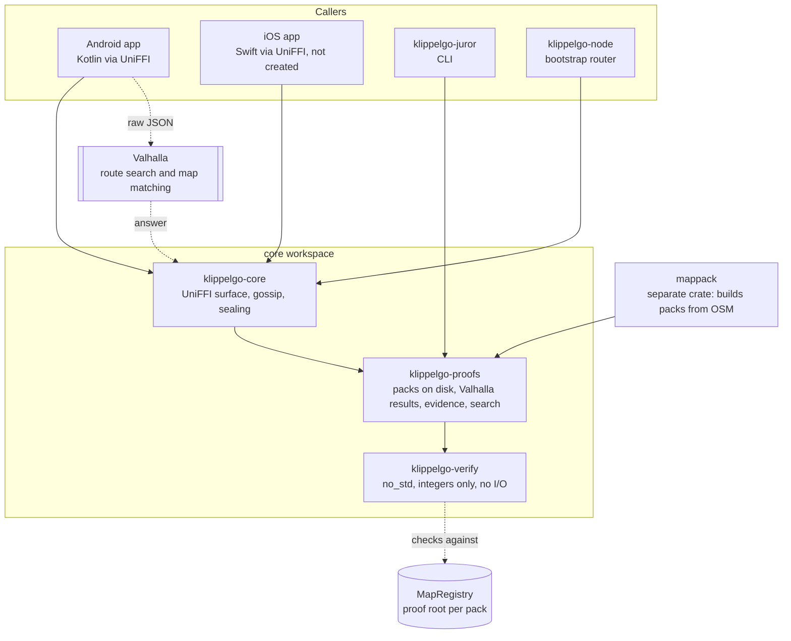
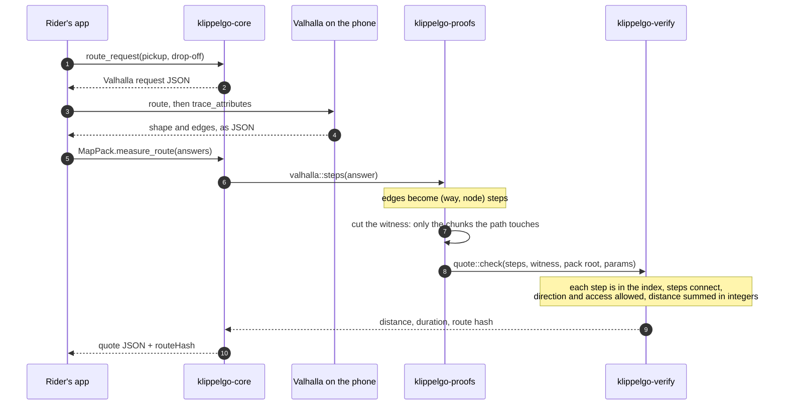
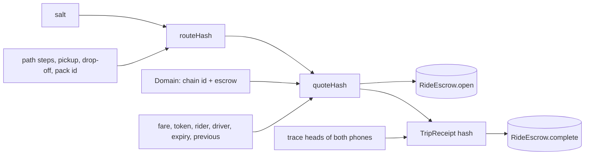

# Core: architecture overview

The core is the Rust code every KlippelGo app shares. It does the things that must give the same answer on
every phone and on a juror's laptop: hashing a quote, checking a route against the map, sealing a route for
one driver, and moving messages between phones. The apps call it through UniFFI; the UI, the wallet and the
chain calls live in the apps.

Related: [security.md](security.md), [scalability.md](scalability.md), the full design of maps and proofs in
[docs/maps-and-routing.md](../../docs/maps-and-routing.md), and the
[contracts overview](../../contracts/docs/overview.md) for what the hashes are anchored to.

## Crates

| Crate | Path | What it is | May do I/O |
| --- | --- | --- | --- |
| `klippelgo-verify` | [`verify/`](../verify/src/lib.rs) | The deterministic checker of route quotes and trip receipts | No. `no_std`, `forbid(unsafe_code)` |
| `klippelgo-proofs` | [`proofs/`](../proofs/src/lib.rs) | Opens a pack and checks it against its manifest, cuts witnesses from the proof index, turns Valhalla output into `(way, node)` steps, reads and writes evidence, address search | Files only |
| `klippelgo-core` | [`src/`](../src/lib.rs) | The UniFFI surface the apps see, the gossip node, sealing, money, geohash cells, network settings | Files and network |
| `mappack` | [`../mappack/`](../../mappack/README.md) | Builds a region's pack from OpenStreetMap. Not part of the app | Yes |

### Modules of `klippelgo-core`

| Module | Role |
| --- | --- |
| [`maps`](../src/maps.rs) | `MapPack` and the free functions the apps call: search, route requests for Valhalla, `measure_route`, `check_quote`, `route_hash`, `quote_hash`, `region_cell`, receipts, `TripLog` |
| [`gossip`](../src/gossip.rs) | libp2p GossipSub over TCP, Noise and Yamux. Moves bytes on topics and knows nothing about rides |
| [`sealed`](../src/sealed.rs) | One-way sealing to a per-offer key: X25519 then ChaCha20-Poly1305 |
| [`geo`](../src/geo.rs) | Geohash cells: precision 5 for discovery topics, precision 6 for the regions a request shows |
| [`money`](../src/money.rs) | BRL amounts in a token's base units, and the R$ 1,00 fee |
| [`chain`](../src/chain.rs) | Chain id, default RPC and deployment file per network |
| `bin/node.rs` | The bootstrap router phones dial |

### Modules of `klippelgo-verify`

| Module | Role |
| --- | --- |
| `index` | The proof index: ways sorted, chunks of 64, keccak leaves, a Merkle tree compatible with OpenZeppelin's |
| `path` | A route as `(way, node)` steps, checked for connectivity and drivability against the index |
| `geo` | Fixed-point distances |
| `quote`, `receipt` | Canonical encodings, hashes, and the checks behind each |
| `trace` | The GPS log: hash chain, signed heads, countersignatures, physical plausibility |
| `sig` | Wallet (secp256k1) and trace-key (P-256) signatures |

## How a quote is made and checked

Valhalla searches; the verifier decides. Nothing Valhalla returns is believed until the verifier has walked it
on the proof index, and the proof index is believed only because its Merkle root matches the one in
`MapRegistry`.

The chosen driver's phone runs the second half of this on the route it receives (`MapPack.check_quote`), and a
juror runs it with `klippelgo-juror <pack dir> <evidence.json>`.

## The hashes

`routeHash` hides where the trip goes; `quoteHash` binds it to one fare, one rider, one driver, one escrow on
one chain. Both are computed identically in Rust and, where the contracts need them, in Solidity: the shared
vectors are in `verify/tests/vectors.rs` and `contracts/test/ProofEncoding.t.sol`.

## Structure and patterns

These are the rules new core code follows. The skill that applies them is
[`change-core`](../../.claude/skills/change-core/SKILL.md).

**Where code goes**

| If the code… | It belongs in |
| --- | --- |
| Decides whether a claim is true, from bytes | `verify`. Integers only, no floats, no clock, no randomness, no files, no network |
| Finds or prepares those bytes (files, JSON, Valhalla output) | `proofs` |
| Is called by an app, or talks to the network | `klippelgo-core`, exported through UniFFI |
| Reads OpenStreetMap or builds a pack | `mappack` |

**Patterns**

1. **The verifier is pure.** Same bytes in, same answer out, on any machine. A float, a `HashMap` iteration
   order, a system call or a platform-sized integer in a result would break jurors and a future zkVM proof.
2. **Encodings are canonical and versioned.** Every signed or hashed structure starts with a domain tag
   (`"KlippelGo … vN"`). Changing what is hashed means a new version number, new vectors in both test suites,
   and the old version rejected.
3. **Everything received is a claim.** A function that opens, decodes or receives returns data the caller must
   still check. Doc comments say so (`open_route`: "check it with `MapPack::check_quote` before believing it").
4. **Gossip is a transport.** `gossip.rs` never learns what a ride is. Meaning and validation live in the
   caller ([app overview](../../apps/docs/overview.md)).
5. **The UniFFI surface is small and plain.** Records and functions with primitives, strings and byte arrays.
   Coordinates cross it as E7 integers, never floats. Errors are `thiserror` enums.
6. **Tolerances are parameters.** Every threshold is in `verify::Params`, mirrored by
   `MapRegistry.VerifierParams`. No constant threshold inside a check.
7. **Secrets are generated here and stay on the device.** Keys come from the OS random source (`getrandom`).

**Changing the core**

1. Put the code in the right crate (table above) and test it there: unit tests beside the code, cross-crate
   behaviour in `verify/tests/` and `tests/`.
2. If an encoding changed, bump its version and update the vectors on both sides.
3. If the UniFFI surface changed, rebuild the Android bindings (`./gradlew :app:assembleDebug` does it) and
   update the callers in `apps/android`.
4. If the gossip node changed, rebuild its container: phones and the router must agree on limits
   (`docker compose -f testnet/docker-compose.yml up -d --build gossip`).
5. `cargo fmt --all`, `cargo clippy --workspace --all-features --all-targets -- -D warnings`, `make test-core`.
6. Update these docs when a module, a hash, a limit or a guarantee changed.

**Tooling**: one workspace, toolchain pinned in `rust-toolchain.toml`, Android builds through `cargo-ndk`.
CI runs fmt, clippy with warnings as errors, and the tests of the workspace and of `mappack`.
