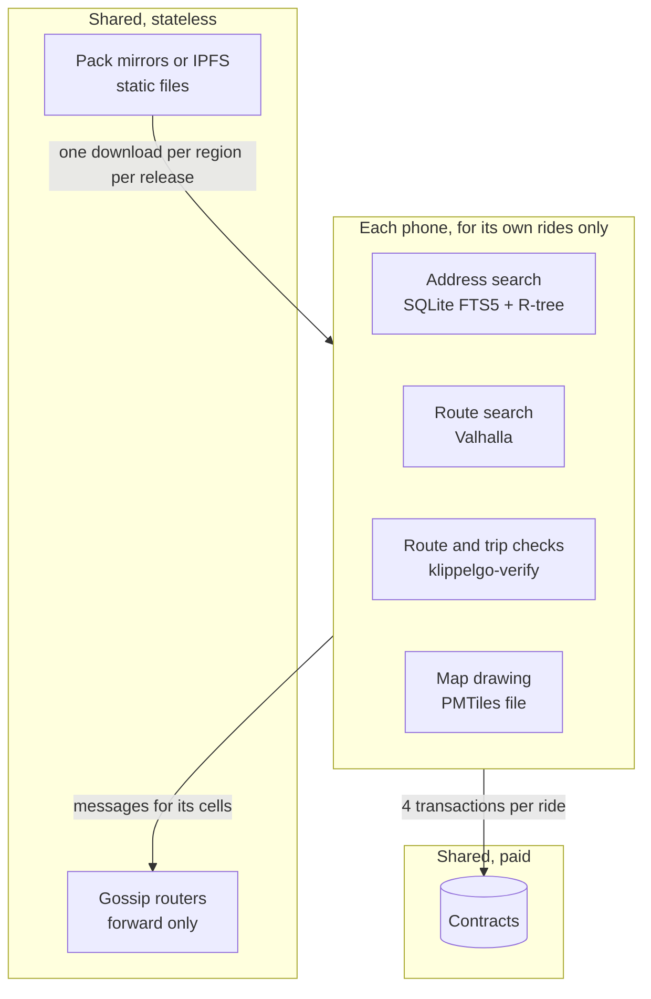
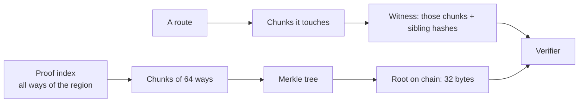

# Core: scalability

KlippelGo has no application server, so "scaling" means three things here: how much work one phone does as a
city gets busy, how much the few shared pieces (gossip routers, pack mirrors) carry, and how the cost of a
proof grows with the size of a map and the length of a trip.

Related: [overview.md](overview.md), [contracts scalability](../../contracts/docs/scalability.md),
[app scalability](../../apps/docs/scalability.md). Measurements come from
[docs/maps-and-routing.md](../../docs/maps-and-routing.md#what-is-built).

## Where the work happens

Search, routing, verification and map drawing use the phone's own CPU and storage and nobody else's. Adding a
million users adds a million phones doing their own work. Nothing in the middle computes a route, stores a
request or keeps a session.

## Maps: bounded by the region

A pack covers one region, so its size and every index in it are bounded by a city, not by the country.

| Measure | Cascavel | São Paulo, 15 km across |
| --- | --- | --- |
| Pack size | 7.6 MB | 73 MB |

A new city is a new pack. It changes nothing for phones in other cities, which never download it.

## Proofs: proportional to the trip

The proof index is cut into chunks of 64 ways under a Merkle tree. A check needs only the chunks the path
touches plus a logarithmic number of sibling hashes, never the whole index.

| Measure | Value |
| --- | --- |
| Witness for a 3.8 km route | 23 chunks, 162 KB |
| Evidence for a 14 km trip with both GPS logs | 355 KB of JSON |

So verification cost grows with trip length and is nearly flat in map size (one more tree level each time the
map doubles). This is also what keeps a future zero-knowledge proof feasible: the program proves a walk over a
few dozen chunks, not over a city.

The verifier's own work is linear in the number of steps and fixes. The receipt check places fixes on the
path with a bounded look-ahead window, so it does not compare every fix with every step.

## Gossip: sharded by geography

Topics are per geohash-5 cell (`/klippelgo/match/1/<cell>`, about 5 km). A phone subscribes only to the cells
around it, so the traffic it receives depends on how busy its neighbourhood is, not on how many users exist.

What one cell carries, from the constants in the code:

| Message | Size | How often |
| --- | --- | --- |
| Request | a few hundred bytes | Re-announced at most every 2.5 s while open (gossip keeps no history) |
| Offer | a few hundred bytes | Re-announced with the request's cycle while valid |
| Sealed route | a few KB; tens for a trip across a large city; 64 KB at most | Re-announced until the request expires |
| Sealed position | a few hundred bytes | At most every 4 s per ride on the way to its pickup, and every second once it has started |

A phone keeps at most 200 requests and 50 offers per request, and the node's inbox holds 4096 messages between
two drains, dropping the oldest. Memory per phone is therefore bounded whatever the cell does.

### What limits gossip, and the levers

| Limit | Where it bites | Lever |
| --- | --- | --- |
| Re-announcing | Bandwidth in a cell grows with open requests × 0.4 messages per second, plus their offers. Sealed routes are the heavy part | Announce less often once peers have acknowledged; send sealed routes and positions directly between the two phones (the ride channel) instead of to the cell |
| One router subscribes to every topic it hears | A single bootstrap node carries all cells of all cities | Run routers per region and give phones the routers of their region; routers are stateless, so adding one needs no coordination |
| A very busy cell | A stadium exit puts thousands of phones on one topic | Split to geohash 6 when a cell is busy: the topic format already carries the cell, and `geo` already computes both precisions |
| No peer scoring | A flooding peer costs every phone in the cell bandwidth | GossipSub scoring and an application-level validator ([security.md](security.md), K1) |
| Phones only dial out | Two phones behind NAT always talk through a router | Relays and hole punching, with the ride channel |

Routers hold no state worth keeping: restarting one loses nothing, because phones re-announce.

## Mirrors

A pack is static files named by hash. Any HTTP server, CDN or IPFS gateway can serve it, and a phone verifies
what it gets against the chain ([security.md](security.md)), so mirrors need no trust and scale like any
static hosting. A phone downloads a region once per release, and only files whose hash changed.

## What would not scale, and is therefore not done

- A server that computes routes, geocodes or stores requests.
- A verifier that needs the whole proof index in memory to check one route.
- One global gossip topic.
- State on routers.

## Not measured yet

Gossip under load (messages per second per cell before phones fall behind), battery cost of staying subscribed,
and Valhalla route time on low-end phones. Until they are, the tables above are structure, not capacity
figures.
