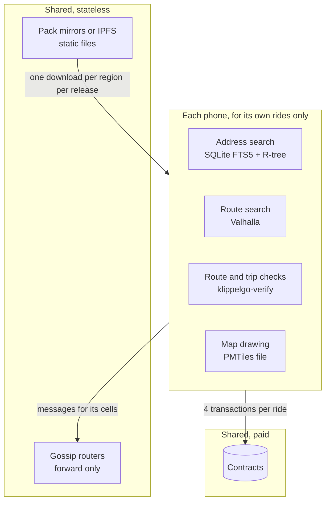
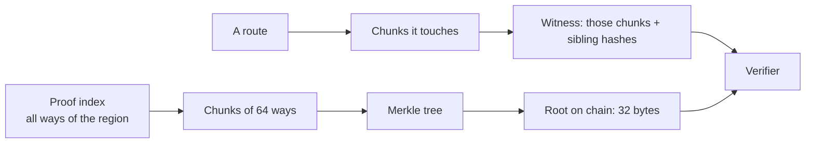

# Core: scalability

KlippelGo has no application server, so "scaling" means three things here: how much work one phone does as a
city gets busy, how much the few shared pieces (gossip routers, pack mirrors) carry, and how the cost of a
proof grows with the size of a map and the length of a trip.

Related: [overview.md](overview.md), [contracts scalability](../../contracts/docs/scalability.md),
[app scalability](../../apps/docs/scalability.md). Measurements come from
[docs/maps-and-routing.md](../../docs/maps-and-routing.md#what-is-built).

## Where the work happens

Search, routing, verification and map drawing use the phone's own CPU and storage and nobody else's. Adding a
million users adds a million phones doing their own work. Nothing in the middle computes a route, stores a
request or keeps a session.

## Maps: bounded by the region

A pack covers one region, so its size and every index in it are bounded by a city, not by the country.

| Measure | Cascavel | São Paulo, 15 km across |
| --- | --- | --- |
| Pack size | 7.6 MB | 73 MB |

A new city is a new pack. It changes nothing for phones in other cities, which never download it.

## Proofs: proportional to the trip

The proof index is cut into chunks of 64 ways under a Merkle tree. A check needs only the chunks the path
touches plus a logarithmic number of sibling hashes, never the whole index.

| Measure | Value |
| --- | --- |
| Witness for a 3.8 km route | 23 chunks, 162 KB |
| Evidence for a 14 km trip with both GPS logs | 355 KB of JSON |

So verification cost grows with trip length and is nearly flat in map size (one more tree level each time the
map doubles). This is also what keeps a future zero-knowledge proof feasible: the program proves a walk over a
few dozen chunks, not over a city.

The verifier's own work is linear in the number of steps and fixes. The receipt check places fixes on the
path with a bounded look-ahead window, so it does not compare every fix with every step.

## Gossip: sharded by geography

Topics are per release and geohash-5 cell (`/klippelgo/match/<release>/<cell>`, about 5 km; the release is 16 hex characters of its contracts hash, so phones of two releases with other code contracts are on separate topics). A phone subscribes only to the cells
around it, so the traffic it receives depends on how busy its neighbourhood is, not on how many users exist.

What one cell carries, from the constants in the code:

| Message | Size | How often |
| --- | --- | --- |
| Request | a few hundred bytes | Re-announced while open, gaps growing from 2.5 s to 5 s (gossip keeps no history) |
| Offer | a few hundred bytes | The same, while the rider is heard and the request is not closed |
| Close | a few hundred bytes | About three times in 15 s |
| Sealed route | a few KB; tens for a trip across a large city; 64 KB at most | Gaps growing from 2.5 s to 60 s, until the driver's first position shows it arrived, or the request expires |
| Sealed position | a few hundred bytes | At most every 4 s per ride on the way to its pickup, and every second once it has started. On a topic of the ride's own, not the cell's |

A phone keeps at most 200 requests, those it can act on, and 50 offers per request, and the node's inbox holds 4096 messages between
two drains, dropping the oldest. Memory per phone is therefore bounded whatever the cell does.

### What limits gossip, and the levers

| Limit | Where it bites | Lever |
| --- | --- | --- |
| A topic per ride | A router joins and leaves each one, and tells every phone: 9 MB an hour per phone at the target, and about 1.5 MB in one exchange when a phone connects, 3 MB at most. So a router holds 2¹⁵ topics at most, a phone accepts that exchange and a router does not. It leaves topics nobody is on every 30 s, and joins any it had no room for. A join costs one frame per connected phone, which is most of what `core/tests/gossip_full.rs` spends its time on, and about 1.7 GB of a router filling with 340 phones connected. And each second a router looks through its connected phones for every topic with too few peers, as a ride's always has: 60 ns per topic and phone, measured up to 200 phones on 10 000 topics, 0.12 of a core. Extrapolated, that is 100 cores on one router at the target and a tenth of one on each of thirty, and the model does not count it | Routers per region; a ride channel directly between the two phones |
| One router subscribes to every topic it hears | A single bootstrap node carries all cells of all cities | Run routers per region and give phones the routers of their region; routers are stateless, so adding one needs no coordination |
| A very busy cell | A stadium exit puts thousands of phones on one topic | Split to geohash 6 when a cell is busy: the topic format already carries the cell, and `geo` already computes both precisions |
| No peer scoring | A flooding peer costs every phone in the cell bandwidth | GossipSub scoring and an application-level validator ([security.md](security.md), K1) |
| Phones only dial out | Two phones behind NAT always talk through a router | Relays and hole punching, with the ride channel |
| A router forwards a topic to its GossipSub mesh only | The mesh holds 6 to 12 peers per topic. Phones outside it get lazy gossip (IHAVE), which loses a message's first sends, so what arrives is what is announced again. Measured with a cell's 6 messages a second: 58% of messages per send, and over a request's announcements 97% of drivers in 15 s at p95, with 225 or 459 phones on the square of cells. Not measured at a target cell's 6 000 | Phones that reach several forwarders (other phones, several routers per cell); far fewer subscribers per topic (smaller cells, routes on the ride's topic); mesh parameters sized for a router |

Routers hold no state worth keeping: restarting one loses nothing, because phones re-announce.

## Mirrors

A pack is static files named by hash. Any HTTP server, CDN or IPFS gateway can serve it, and a phone verifies
what it gets against the chain ([security.md](security.md)), so mirrors need no trust and scale like any
static hosting. A phone downloads a region once per release, and only files whose hash changed.

## What would not scale, and is therefore not done

- A server that computes routes, geocodes or stores requests.
- A verifier that needs the whole proof index in memory to check one route.
- One global gossip topic.
- State on routers.

## Measured under load

[`bench/`](../bench/README.md) ([how it works](benchmark.md)) models every shared service at a number of drivers and riders, and runs a 3×3
square of cells at the busiest cell's traffic through `klippelgo-node`, with real `GossipNode` phones. At
100 000 drivers and 1 000 000 riders (the busiest cell: 667 drivers, a new ride every 5.4 s), on a developer's
computer, 2026-10-31:

| Measure | Value |
| --- | --- |
| Messages one cell carries | 5.8 a second, 7.6 KB: offers 3.7, requests 0.9, closes and sealed routes 0.6 each. Positions, 199 a second, go to one rider each |
| A driver's phone, averaged over the square | 26 messages a second measured (31 modelled), 130 MB an hour; its largest drain 125 of the inbox's 4096. In the middle of a city, nine cells: 52 a second and 255 MB an hour modelled |
| Delivery, 4 phones per cell | 100% of requests, offers, routes and positions; request to a driver's screen 1.1 s at the median, 2.6 s at p99 |
| Delivery, 20 driver and 5 rider phones per cell | 97% of drivers saw a request, 4 s at the median, 15 s at p95; 87% of offers reached the rider in time, no request got none; 89% of routes and 100% of positions arrived. Offers move between runs: see the next row |
| Delivery, 46 driver and 5 rider phones per cell | 97%, 79%, 7%, 91%, 100% |
| Router | 28 CPU seconds per million deliveries on one thread; 0.06 cores at 2 200 deliveries a second; 88 MB with 4 phones per cell, 350 MB with 51 |

`make bench` reruns all of it; `make bench-model ARGS="--drivers … --riders …"` gives the model at any scale.

Not measured yet: battery cost of staying subscribed, and Valhalla route time on low-end phones.
