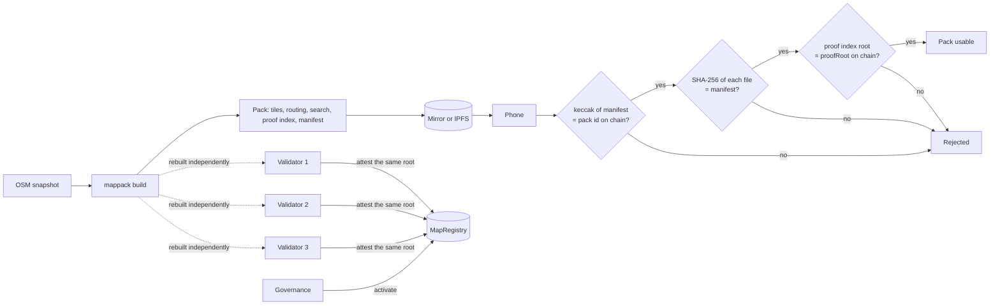
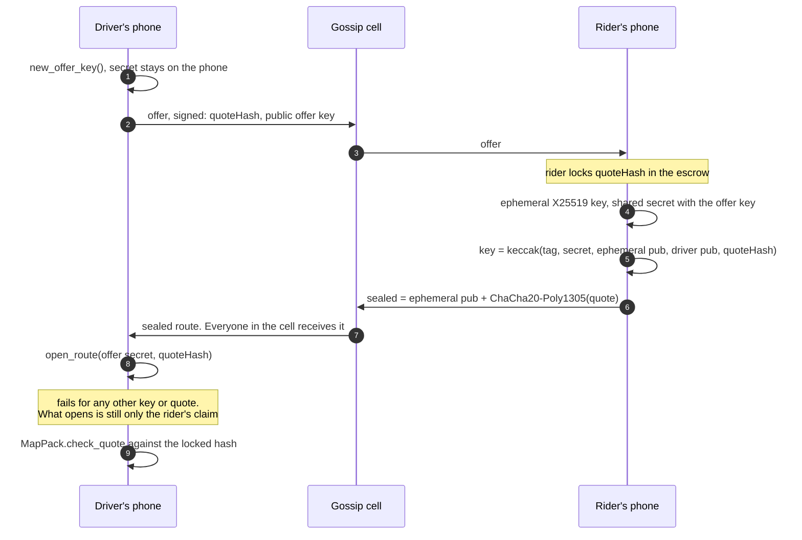
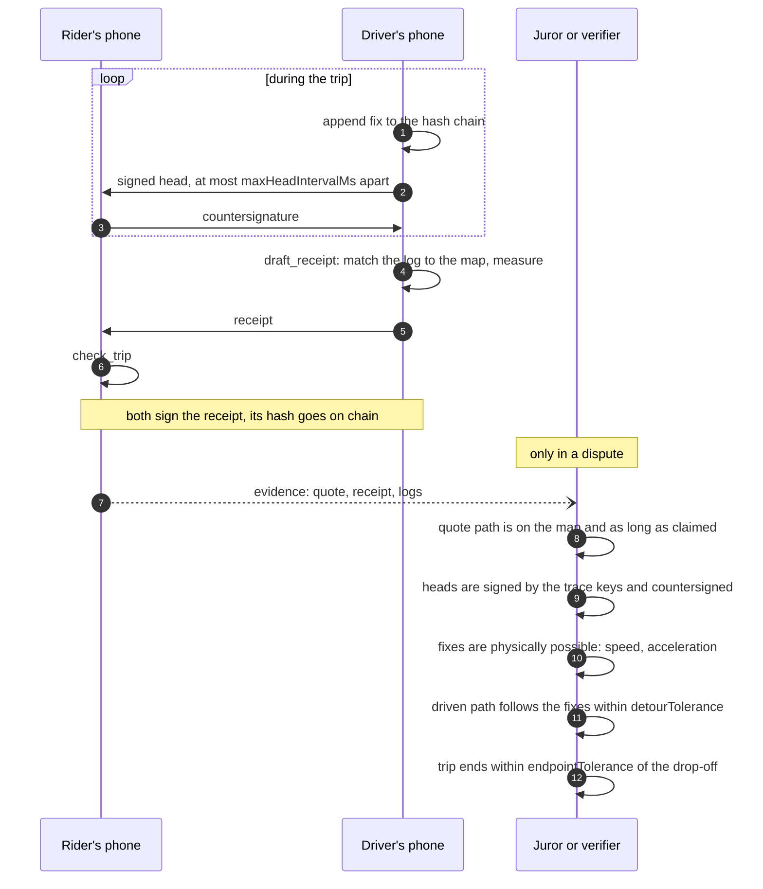
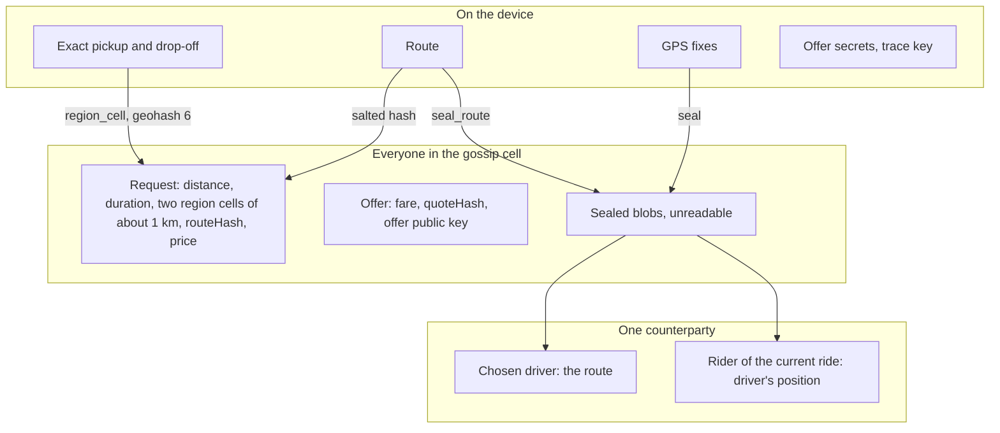

# Core: security

The core is where KlippelGo's guarantees are computed: that a route is real and as long as claimed, that a
hash means one trip at one price, that only the chosen driver reads the route, and that a message off the
network is never believed unchecked. The numbered invariants (`R1` to `R12`) are what the
[security reviewer](../../.claude/agents/security-reviewer.md) checks a change against.

Related: [overview.md](overview.md), [contract security](../../contracts/docs/security.md),
[app security](../../apps/docs/security.md), and the reasoning behind the proofs in
[docs/maps-and-routing.md](../../docs/maps-and-routing.md).

## Who is not trusted

| Party | What it could try | What stops it |
| --- | --- | --- |
| Any peer on gossip | Forge, replay, flood, send oversized or malformed messages | Peer signatures and size limit in the node; account signatures, expiry and caps in the caller |
| The bootstrap router | Drop, delay or read messages; learn which cells an IP subscribes to | It cannot forge (account signatures) or read sealed payloads. Dropping is a liveness problem, not a safety one |
| The rider | Quote a route shorter than the real one, or one that does not exist | The driver's phone checks the route on its own map before accepting |
| The driver | Claim a longer trip, pad the path, fake a GPS log | Receipt checks: detour tolerance, signed and countersigned trace heads, physical limits |
| A pack mirror | Serve a modified map | Manifest hash is the pack id; each file's SHA-256 is in the manifest; the proof root is on chain |
| Valhalla | Return a wrong or impossible path (bug or tampered tiles) | Its output is only a suggestion until the verifier walks it on the proof index |
| OpenStreetMap | A vandalised snapshot | Validators rebuild and attest; governance can `retire` a pack |

## From the map to a trusted answer

Only the proof index is consensus-critical. The basemap tiles, the Valhalla routing tiles and the search
database are covered by the manifest, so they are the files the validators built, but a wrong street name or a
bad route suggestion cannot make a false proof pass: the verifier reads only the proof index.

## Sealing a route for one driver

The quote hash is part of the key derivation, so a sealed route opens only for the quote it was made for and
cannot be replayed under another offer. The same construction carries the driver's position back to the rider
during the ride, sealed to a key the rider sent with the route.

## Checking a trip

A signed log proves that a phone recorded these fixes in this order and that the other phone saw each head
when it was made. It does not prove the GPS was honest. The countersignatures and the physical limits bound
what a liar can claim; they do not remove the need for jurors when the two phones disagree.

## What leaves the phone

## Invariants

- **R1. The verifier is deterministic.** `klippelgo-verify` stays `no_std`, without floats, clocks,
  randomness, I/O or `unsafe`. Its results never depend on iteration order or platform word size.
- **R2. Nothing is believed before it is verified.** No function returns a distance, duration or "valid"
  for a path that was not walked on a witness whose root matched the pack's.
- **R3. A witness proves its own root.** A check recomputes the Merkle root from the chunks it was given and
  compares it with the pack's root before reading any way from them.
- **R4. A pack is identified by its bytes.** Pack id is keccak-256 of `manifest.json`; `check_files` compares
  every file with the manifest; `WrongRoot` if the proof index does not hash to the manifest's root.
- **R5. A hash has one meaning.** Every hashed or signed structure has a domain tag and a version, and quote
  and receipt hashes include `Domain` (chain id and escrow). No two structures share an encoding.
- **R6. Route hashes are salted.** `route_hash` takes a 32-byte salt, and the caller passes fresh randomness
  for every request, so a guessed pair of places cannot be confirmed.
- **R7. A sealed payload opens only for its key and its quote.** A new ephemeral key per sealed message;
  the AEAD key derivation includes both public keys and the quote hash; a failed tag is an error, never
  partial output.
- **R8. Secrets do not cross the network or the logs.** Offer secrets and trace keys are never serialised
  into a message, an evidence file or a log line.
- **R9. Gossip accepts only signed, bounded, in-namespace messages.** `ValidationMode::Strict`, a maximum
  message size, topics under `/klippelgo/`, and a bounded inbox that drops the oldest.
- **R10. Gossip gives no meaning.** The node never treats a peer id as an account, and never interprets a
  payload. Callers are told every message is untrusted.
- **R11. Exact positions never go out in the clear.** The only location data that leaves unsealed is a
  geohash cell: precision 5 for the topic, precision 6 for a request's regions.
- **R12. Tolerances come from parameters.** A check uses `Params`, which governance sets in `MapRegistry`.

## Known limits

| # | Limit | Consequence | What closes it |
| --- | --- | --- | --- |
| K1 | No peer scoring, rate limiting or cost per message in gossip | A peer can flood a cell with valid-looking traffic. The caller's caps bound memory, not bandwidth | GossipSub peer scoring with an application validator; a cost for posting requests |
| K2 | Sealing is one message, one way, to a static per-offer key | No forward secrecy beyond the offer key's short life. Losing the offer secret exposes that one route | The encrypted ride channel (Noise between the two phones) |
| K3 | Sealed blobs are broadcast to the cell | Observers learn that some rider chose some driver and that a driver is on a ride, and the blob size hints at trip length | Direct or relayed phone-to-phone channel |
| K4 | The router sees IP addresses and topic subscriptions | An IP can be tied to a 5 km cell | Relays, several independent routers, later onion-style transport |
| K5 | Account keys sign every gossip message | The wallet key is used far more often than it should be | Session certificates |
| K6 | GPS can be spoofed consistently by one phone | A lone lying phone produces a self-consistent log | Countersigning by the other phone, physical limits, and jurors when the two disagree |
| K7 | Map matching on rural tracks and unusual geometry is weaker | A real trip can fail to match | Measured in [docs/maps-and-routing.md](../../docs/maps-and-routing.md); tolerances are governable |
| K8 | A geohash-6 region in a sparse area may hold very few addresses | The region can identify a place | Coarser cells where density is low |
| K9 | The UniFFI layer accepts strings and JSON from the app | A malformed input must fail, not panic across the FFI boundary | Keep returning errors; fuzz the parsers |
| K10 | Sealed positions reuse the route's key-derivation tag (`KlippelGo sealed route v1`) | The two are told apart by their signature domains and by which key they are sealed to, not by the sealing itself | A context tag as a parameter of the sealing functions |

## How it is tested

`verify/tests/trip.rs` plays whole trips, honest and dishonest. `verify/tests/vectors.rs` pins every encoding,
mirrored in Solidity. `tests/gossip.rs` runs real nodes, including oversized and off-namespace messages.
`tests/maps.rs` runs the UniFFI surface on a fixture pack. The unit test in `sealed.rs` covers the wrong key and the
wrong quote. A change to a check needs a test of the lie it is meant to catch.
