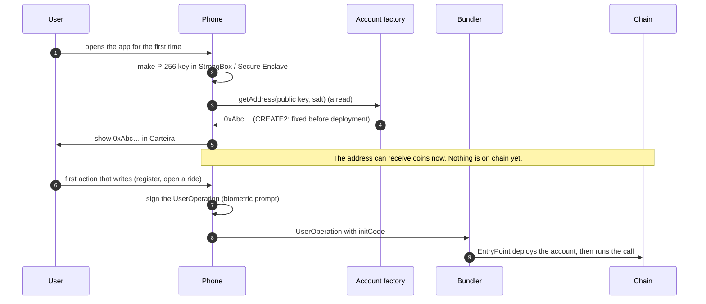
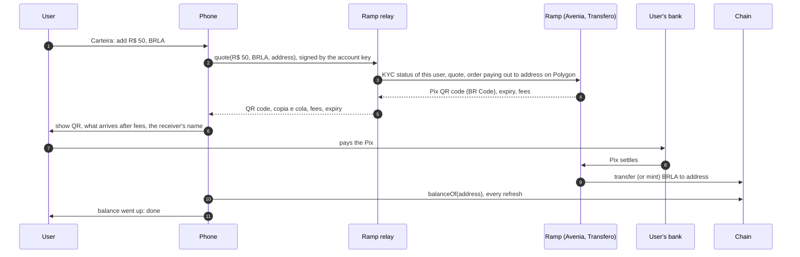
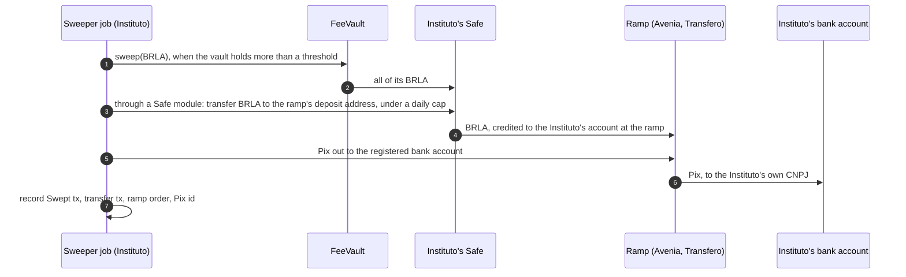

# Accounts and topping up with Pix

Status: design, nothing built. Today every phone signs with one of anvil's public test keys (`DevAccount`,
limit P1 in [apps security](../apps/docs/security.md)), and the Carteira tab mints mock coins as a stand-in for
Pix. This page says what replaces both. Decisions marked **Default** stand until the project decides otherwise
(see [Open decisions](#open-decisions)).

The user's account here is their wallet: the address that holds their reais, signs their rides and carries
their reputation. It is not `FeeVault`, the contract that collects the R$ 1,00 per ride for Instituto Klippel;
that one has no key or password at all, and its beneficiary is changed only by the Diretoria ([governance.md](governance.md)).

## The short answer

- **There are no passwords and no seed phrases.** The phone makes a key inside its secure chip (StrongBox or
  Secure Enclave) the first time the app opens. The key cannot be copied out, and signing needs the
  fingerprint, face or device PIN. Nobody, Instituto Klippel included, ever holds it or can reset it.
- **The address comes from that key.** The user's account is an ERC-4337 smart account whose address is
  computed from the key's public half before anything is sent to the chain. The app shows it at once, and it
  can receive reais before the account exists on chain.
- **Pix goes through a company licensed to sell the coin.** The user pays a Pix QR code; the ramp (BRLA's issuer
  Avenia, Transfero for BRZ, or another) receives the reais and sends the same amount of the coin to the user's
  address on Polygon. Drivers cash out the opposite way, to their own Pix key.
- **Gas stays invisible.** A paymaster pays the network fee and takes it back in BRL coin, so a user never
  holds POL.

## Accounts

### The key

| | Android | iOS |
| --- | --- | --- |
| Where it is made | Android Keystore, in StrongBox when the phone has it, else the TEE | Secure Enclave |
| Curve | P-256 | P-256 |
| Exportable | No | No |
| To sign | Biometrics or device credential, set as a key property (`setUserAuthenticationRequired`) | `.biometryAny` or `.devicePasscode` access control |

These chips do not do secp256k1, the curve Ethereum accounts use, so the key cannot own a plain account. It owns
a smart account that checks P-256 signatures with the RIP-7212 precompile at `0x100`, which Polygon PoS has and
the local testnet's Osaka rules include (see the [README](../README.md)).

**Default account contract: an audited one that already verifies P-256**, such as Safe with its passkey signer,
ZeroDev Kernel with a P-256 validator, or Coinbase Smart Wallet. Writing our own is not worth the audit. The
choice must accept a raw P-256 signature over a digest (what Keystore and the Secure Enclave produce) and a
WebAuthn signature (what a synced passkey produces, used for recovery below).

### The address

The address is a pure function of the factory, the public key and a salt, so the phone needs no server to learn
it, and a Pix top-up can land on it before the first ride. The account is deployed by its first transaction,
which is usually `IdentityRegistry.register`.

What the user sees is the address and a name they choose for themselves. The name stays on the phone.

### Recovery

The key dies with the phone. The account outlives it because its owner can be changed:

| Way back | How | **Default** |
| --- | --- | --- |
| A synced passkey | At setup the app also creates a passkey (Google Password Manager, iCloud Keychain) and adds it as a second owner. A new phone signs in with it and adds its own chip key | Yes: offered at setup, strongly recommended |
| Another device | A second phone or a tablet registers its own chip key as an owner | Optional |
| Guardians | Contacts the user picks can, together and after a delay (e.g. 48 h), replace the owner. The old key can cancel during the delay | Optional, for people without a synced passkey |

A synced passkey is weaker than a chip key: it lives in a Google or Apple account, and that account's security
becomes the account's security. It is the trade most people want, and users who do not can skip it and use
guardians.

The ride history, credentials and documents on the phone are another matter: they are encrypted under a key in
the chip, backed up to the user's own cloud backup wrapped by a recovery key (architecture plan, "Recovery").
Losing them loses no money, only the history and the credentials to have checked again.

### Gas

A paymaster pays each UserOperation's fee in POL and charges the account the same value in the ride's BRL coin,
at the rate `FareGuide.nativeCoinCentavos` already holds. The fee is collected in the same UserOperation, so a
user with reais but no POL can always act. **Default: Instituto Klippel runs the bundler and paymaster**, as the
plan already says, and the app can be pointed at any other ERC-4337 bundler.

This changes what the [README](../README.md) says today ("each side pays the network for its own transactions,
in the chain's coin"): it is still each side paying its own, but in reais.

## Topping up with Pix

### Who can turn a Pix into coins

Only the coin's issuer, or a company with an account at it, can take a Pix and deliver BRLA or BRZ. Instituto
Klippel cannot, and the protocol has no reason to: the money goes straight from the ramp to the user's address.

| Way | How it works | Good | Bad |
| --- | --- | --- | --- |
| A. The user's own account at a ramp | The user opens an account in the issuer's or an exchange's app, pays a Pix there, and withdraws to the address shown in Carteira | Nothing for us to run; no one between the user and the ramp | Two apps, a withdrawal screen, an address to paste. Most riders will give up |
| B. A ramp relay inside the app | The app asks a small relay for a quote; the relay, holding a partner account at the ramp, creates an order that pays out to the user's address and returns the Pix QR code; the user pays it in their bank app | One screen: amount, QR code, done | Someone runs the relay and holds the partner credentials. It is infrastructure, like the bundler: replaceable, but it exists |
| C. A ramp aggregator's widget | The app opens a third party's checkout with the address filled in | Little to build | Their fees, their KYC screens, and they learn the address and the CPF together |

**Default: B, with A always possible.** The relay is the one piece Instituto Klippel runs; anyone else with a
ramp partnership can run one, and the app takes its address as a setting, as it does the RPC. Carteira always
shows the address and a copy button, so way A works without the relay.

The relay is needed because the ramps' APIs are for businesses: Avenia's, for example, logs in with an
account's e-mail and password and a token sent by e-mail, then issues a JWT. Those credentials must never ship
inside an app, where anyone could pull them out. So the app talks to the relay, and only the relay talks to the
ramp.

### The flow

With Avenia's API that is: a fixed-rate quote (`GET /v2/account/quote/fixed-rate`, valid for seconds), a
ticket on that quote (`POST /v2/account/tickets`) whose beneficiary is a wallet registered for the user's
Polygon address (`POST /v2/account/beneficiaries/wallets`), and the ticket's `brCode` is the QR code. The
ticket moves through `UNPAID`, `PROCESSING` and `PAID`, by polling or by webhook. Avenia's published example
delivers BRLA to its internal balance and sends USDT to outside wallets; that BRLA goes straight to an outside
Polygon wallet must be confirmed with them before building on it. Transfero's BRZ ramp has no public API
documentation; that needs a conversation with them.

### KYC

The ramp, not KlippelGo, has to know who is paying, by law. With way B each user is a subaccount of the relay's
partner account at the ramp (Avenia calls them subaccounts, each with its own KYC: name, CPF, date of birth).
The first top-up therefore asks for those once, and they go from the phone to the ramp through the relay
without being kept by it.

This is the one place a CPF and an account address meet outside the phone. The ramp learns it in any of the
three ways; the relay should not keep it (it needs only the subaccount id, stored against the address). A rider
who wants rides that cannot be traced to their CPF must top up one address and ride from another, which costs
them their reputation (architecture plan, "Rider privacy").

### Cashing out, for drivers

The same relay, in reverse: the driver names a Pix key (their CPF, phone or e-mail), the relay asks the ramp for
an order, the ramp gives a deposit address or a permit to sign, the driver's account sends the coin, and the
ramp pays the Pix. The Pix key must be the driver's own: ramps check that the Pix account's CPF matches the
subaccount's KYC, which is also what stops a stolen phone being emptied to a stranger's bank account.

### Instituto Klippel's fees, to its bank account

The R$ 1,00 per ride already leaves the escrow on its own: `RideEscrow` pays it into `FeeVault` at settlement,
and anyone may call `FeeVault.sweep(token)`, which sends the whole balance of that coin to the beneficiary
governance named. What is left is turning the coins into reais in the Instituto's bank account, and that can run
unattended too:

| Piece | What it may do | Why it is safe to leave unattended |
| --- | --- | --- |
| `FeeVault.sweep` | Send everything to the beneficiary | Anyone may call it and the destination is fixed: a key that only pays gas, holding nothing else |
| Beneficiary: the Instituto's Safe | Receives the fees; its owners can do anything with them | Changing it takes three directors and 72 hours ([governance.md](governance.md)) |
| Safe module for the job (Zodiac Roles or the Safe Allowance module) | Exactly one call: `transfer` of a listed coin to that coin's ramp deposit address, up to a cap a day | A stolen job key can move at most the cap, and only into the Instituto's own account at the ramp. The Safe's owners change the list, never the job |
| Ramp API credentials | Ask for a Pix out | Payouts go only to bank accounts registered at the ramp in advance, in the Instituto's CNPJ. Adding one must need a person and a second factor at the ramp: confirm the ramp can enforce that before going live |

Why not name the ramp's deposit address as the beneficiary and skip the Safe? `FeeVault` has one beneficiary for
every coin, so sweeping BRZ would send it to Avenia's BRLA address, where it may be lost. And replacing a ramp
address would take the Diretoria's approval and delay each time. If the Instituto prefers no Safe in between, `FeeVault` would
need a beneficiary per coin first.

The job sweeps when a coin's balance passes a threshold or once a week, so gas stays a small part of what moves
and little sits at the ramp. Each step's record (the `Swept` event, the transfer, the ramp's order id, the Pix
end-to-end id) is what reconciles the Instituto's books with the chain.

### On the local testnet and in staging

| Network | Stand-in |
| --- | --- |
| Local testnet | Mock coins that mint to anyone; Carteira's button mints (`KlippelGoClient.mint`). Stays as it is |
| Staging (Amoy) | A relay against the ramp's sandbox (Avenia has one, with simulated Pix payments) and mock coins, or the ramp's own testnet coin if it has one |
| Polygon PoS | The real relay, the real ramps |

## Regulation

Brazil's rules for virtual-asset service providers (Law 14.478/2022 and the Banco Central's resolutions of
November 2025, in force since 2 February 2026) still allow self-custody wallets, but ask the providers that
move coins in and out of them to identify who holds the wallet. The ramp is the regulated party in all three
ways above. Whether running the relay (way B) makes Instituto Klippel an intermediary under those rules is a
question for the legal review the plan already requires before mainnet. This page is not legal advice.

## Security

What has to hold, and what to check when this is built. These become invariants in
[apps security](../apps/docs/security.md) and [contract security](../contracts/docs/security.md) when the code
lands.

| Threat | What stops it |
| --- | --- |
| The key is copied off the phone | It cannot be: non-exportable, in the chip |
| Someone with the unlocked phone spends | Every signature needs a fresh biometric or PIN check, and the app shows the amount before asking |
| A lost phone loses the money | Recovery by passkey, second device or guardians; never by Instituto Klippel |
| The relay or a lying RPC gives the app a Pix order paying out to someone else's address | The relay signs nothing and holds nothing; the app checks that the order's payout address is its own, shows the receiver's name from the BR Code, and counts a top-up only from its own balance on chain, never from the relay saying "paid" |
| A fake QR code takes the Pix | The QR code's receiver (in the BR Code) must be a ramp on a list the app ships, or governance keeps. Shown to the user before they pay |
| The relay's partner credentials leak | They can create orders and see subaccounts' KYC data. They cannot move anyone's coins, which sit at the users' own addresses. Kept in a secrets store, rotated, and the relay keeps no KYC data of its own |
| The paymaster charges too much | It charges at `FareGuide`'s rate, which governance sets; the app shows the cost before signing (A14's "≈" estimate) |
| The issuer freezes an address | See the next section |

### Guards against the ramps and the issuers

Avenia and Transfero are each two things to KlippelGo: the ramp that turns Pix into coins, and the issuer
whose token contract decides who may hold and move them. Neither can be made trustless; what we can do is keep
what each can hurt small, see it happen, and be able to leave.

| What they can do | What it does to KlippelGo today | Guard | State |
| --- | --- | --- | --- |
| Freeze a rider's or driver's address | The escrow pays everyone in the same transaction (`_settle`, `resolve`), so a frozen party makes the whole settlement revert: the other side's money is stuck in that ride too | A payment that fails at settlement is kept as owed to its payee, who withdraws it once it can receive again; everyone else is paid as usual (`RideEscrow._pay`, `withdraw`; invariant C16). This closed L13 | Built |
| Freeze `RideEscrow` or `FeeVault` | Every ride in that coin cannot settle, or no fee can leave | A cap on how much of one coin the escrow may hold at once (`RideEscrow.setCap`, by Finanças; C18), so the loss has a ceiling. `FeeVault` swept often | Cap built; the sweeper not |
| Pause the token | Nothing in that coin moves; rides wait. No one is punished, since a timeout reverts as well | Several coins on the allow-list; Finanças stops new rides in it by setting its fee to zero (`open` then refuses it) | Possible today |
| Upgrade the token contract (issuers' tokens are usually proxies they control; check each on the explorer) into one that charges on transfer, or behaves otherwise | Breaks L10: the escrow would owe more than it holds | `open` and `accept` check the escrow's balance went up by exactly what was sent, and revert if not (C17). A watcher on the token's implementation and admin slots alerts Finanças, who drop it from the allow-list | Check built. Watcher: to build, beside `klippel-gov` |
| Fail to hold the reserves | The coin drops below R$ 1 | Allow-list only coins with published reserve attestations, prefer a bank issuer (BBRL) as a second; a watcher on the coin's DEX price; Carteira says which issuer's coin the user holds | Policy and watcher, to build |
| Take a Pix and not deliver, or deliver late | A user paid and sees nothing | The app counts only what arrives on chain and shows the ramp's order id and how to claim; the relay works with two ramps and stops sending orders to one that fails; a top-up cap for new accounts while this is young | To build with the relay |
| Stop serving KlippelGo, or change terms | No new top-ups through that ramp | Coins sit at the users' own addresses and keep working. The relay keeps a second ramp. A user can swap BRLA for BRZ on a DEX and cash out at the other issuer, or use any exchange (way A) | To build with the relay |
| Misuse the CPF and address pair | A privacy breach | A data processing agreement under LGPD; the relay keeps no KYC data, so the ramp is the only one holding it | Contract with the ramp |
| Freeze the Instituto's balance at the ramp | Fees not yet paid out are held | The sweeper sends to the bank promptly and caps what waits there | With the sweeper |

The contract guards (payments kept as owed, the balance check, the cap) are built and tested in
`contracts/test/Protocol.t.sol` with a coin that freezes addresses and charges on transfer.

## What changes in this repository

| Where | Change |
| --- | --- |
| `apps/android/chain` | `KlippelGoClient` signs UserOperations through a signer interface instead of holding a private key; `DevAccount` stays only for the local testnet |
| `apps/android/app` | Key creation in Keystore with StrongBox, the setup screen with the passkey offer, Carteira showing the address, the Pix QR and the cash-out screen |
| `contracts/` | Accounts need no change: a smart account is an address like any other. `DeployLocal` deploys the EntryPoint, the account factory and a test paymaster so the local testnet matches Polygon. The guards against the issuers are built |
| New: `ramp/` | The ramp relay, small and stateless apart from subaccount ids, and the sweeper job, with their own docs |
| `gov/` | Watchers for the coins' proxies and prices, and setting up the Safe module the sweeper uses |
| Docs | P1 and P6 in apps security close or change; the README's gas line; this page's status |

## Open decisions

| Decision | Options | Default |
| --- | --- | --- |
| Smart account | Safe, Kernel, Coinbase Smart Wallet | An audited one that takes raw P-256 and WebAuthn signatures |
| Recovery offered at setup | Passkey, second device, guardians | Passkey offered first; the others in settings |
| Pix | User's own ramp account, relay, aggregator widget | Relay, with the address always shown for the user's own ramp |
| Ramps at launch | Avenia (BRLA), Transfero (BRZ), Banco Braza (BBRL) | Avenia first: its API and sandbox are public |
| Who runs the relay and paymaster | Instituto Klippel, anyone | Instituto Klippel by default, replaceable in settings |
| Paymaster fee | Pass-through at `FareGuide`'s rate, or a margin | Pass-through |
| Fees to the bank | Safe with a module for the sweeper, or a beneficiary per coin in `FeeVault` | Safe with a module |
| How often the sweeper runs | Over a threshold, weekly, both | Both: over R$ 500 in a coin, or weekly |

## Sources

- [KlippelGo Architecture Plan](https://claude.ai/code/artifact/9a1aa829-3b30-4485-9395-42fa77304dc8): keys, recovery, paymaster, coins
- [Avenia integration guide, Pix to stablecoin](https://integration-guide.avenia.io/docs/Usecases/pix2Stable&onChainTransfer)
- [Banco Central, vote on the virtual-asset service provider rules](https://normativos.bcb.gov.br/Votos/BCB/202690/Voto_do_BC_90_2026.pdf),
  and [Capital Aberto on self-custody under them](https://capitalaberto.com.br/?p=278959)
