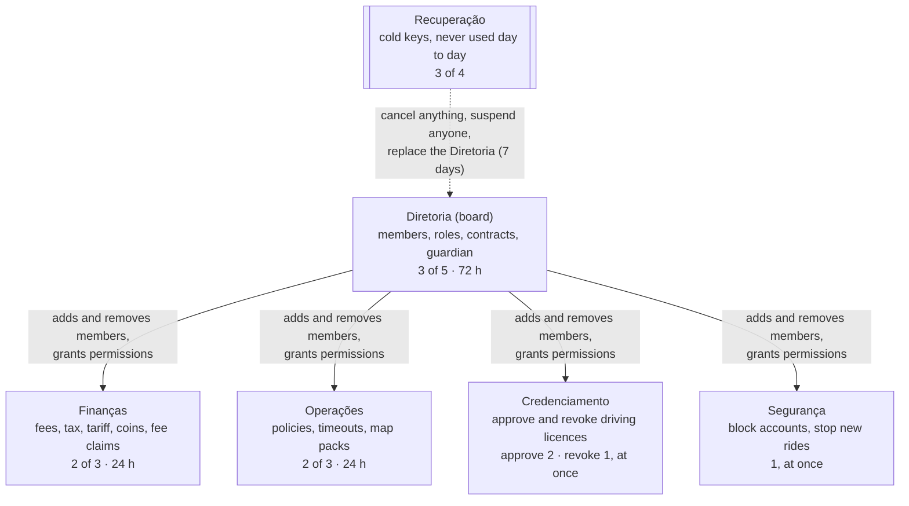
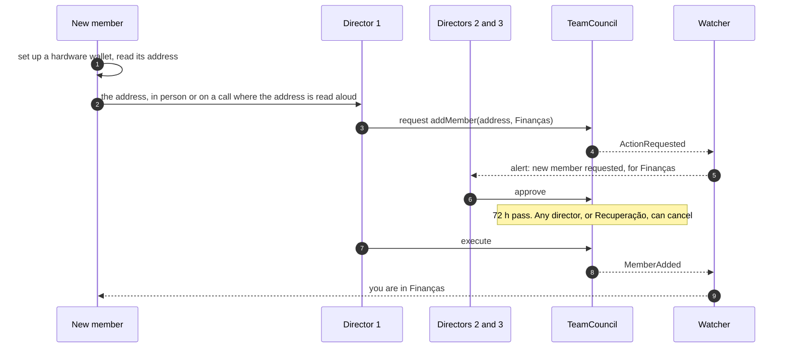
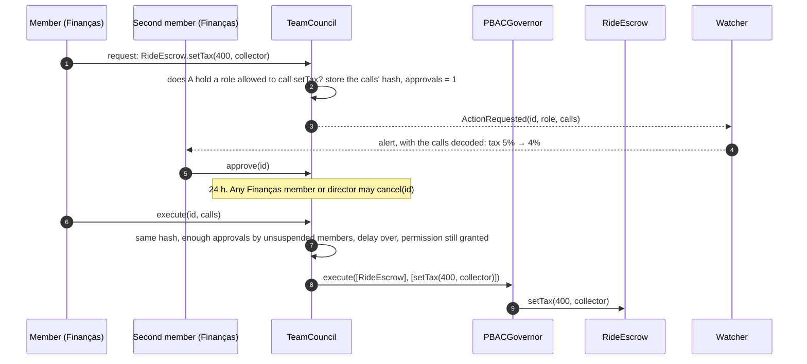
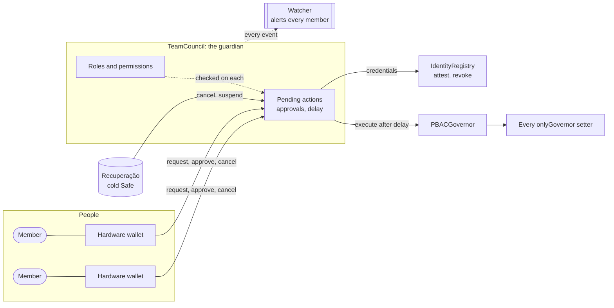
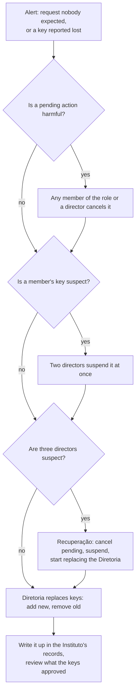

# Governance by Instituto Klippel's team

Status: design, nothing built. It builds on the `PBACGovernor` in the working tree, which already gives one
account, the **guardian**, the whole of governance: whatever a contract guards with `onlyGovernor`, the guardian
does through `PBACGovernor.execute`, at once, and only the guardian can name its successor
(`proposeGuardian`, then `acceptGuardian`). This page says what sits in the guardian's seat: not one key, but
Instituto Klippel's team, each member in roles that allow some actions and not others.

[contracts/docs](../contracts/docs/overview.md), [gov/README.md](../gov/README.md) and `klippel-gov` still
describe community voting (proposals, votes weighted by rides and stake, quorum, timelock). They follow this
page once the guardian governor lands. Decisions marked **Default** stand until the Instituto decides otherwise
(see [Open decisions](#open-decisions)).

## The idea in one paragraph

A new contract, `TeamCouncil`, is the guardian. It keeps a list of members and roles. A role is a set of
permissions, and a permission names one action (a contract and a function), how many of the role's members must
approve it, and how long it waits before it can run. A member asks for an action, the others approve, the delay
runs out, and anyone executes it; during the delay, a member can cancel it. Members and roles are changed by the
same mechanism, through a permission only the board holds. Users of the app see none of this: what changes for
them is who sets the rules, not the rules' shape.

## The organisation

The numbers are the **Default** set for launch; each is a setting the Diretoria can change. One person may hold
several roles, though the separation rules below limit which.

### Who may do what

Every action on the protocol is assigned to exactly one role. Nothing else can be done.

| Role | Actions | Approvals | Delay |
| --- | --- | --- | --- |
| Diretoria | `TeamCouncil`: add, suspend, remove a member; grant or revoke a permission; change a role's approvals or delay | 3 of the role | 72 h |
| Diretoria | `PBACGovernor.proposeGuardian`, `PBACGovernor.setModules`, `RideEscrow.setModules`, `Reputation.setEscrow`, `IdentityRegistry.setAttester` | 3 | 72 h |
| Diretoria | `FeeVault.setBeneficiary` | 3 | 72 h |
| Finanças | `RideEscrow.setToken` (the allow-list, the R$ 1,00 fee, bonds), `RideEscrow.setTax`, `FareGuide.setTariff`, `FareGuide.setNativeCoinPrice` | 2 | 24 h |
| Finanças | `FeeVault.payClaim` | 2 | 24 h |
| Operações | `PBACGovernor.setPolicy`, `RideEscrow.setCompletionTimeout`, `IdentityRegistry.setUnbondingPeriod`, `DisputeCourt.setPeriods` | 2 | 24 h |
| Operações | `MapRegistry.activate`, `retire`, `setRebuildQuorum`, `setGracePeriod`, `setVerifierParams` | 2 | 24 h |
| Credenciamento | `IdentityRegistry.attest` (approve a CNH or KYC credential) | 2 | none |
| Credenciamento | `IdentityRegistry.revoke` | 1 | none |
| Segurança | `IdentityRegistry.setBlocked(account, true)` | 1 | none |
| Segurança | `IdentityRegistry.setBlocked(account, false)` | 2 | none |
| Segurança | The "stop new rides" playbook: `setPolicy` on `RideEscrow.open` and `accept`, disabled | 1 | none |
| Diretoria | The "resume rides" playbook: those two policies back as they were | 2 | none |
| Any member of the role, and the Diretoria | Cancel a pending action of that role | 1 | none |

What sits where, and why:

- **Slow and high for what changes who decides or where money goes.** Members, permissions, the guardian, the
  contracts wired in, the fee beneficiary. A wrong or forced change here is the hardest to undo, and the 72 hours
  give everyone else time to see it and cancel it.
- **A day for prices and rules.** Users and drivers are affected at once by a tariff or a tax; a day is enough to
  catch a typo or a forced change, and short enough for normal work.
- **At once for protecting people.** Blocking an account, revoking a licence and stopping new rides are what a
  team reaches for during an incident. They take no money from anyone and are undone the same way, so one member
  may do them. Undoing a block takes two, so a person with a stolen key cannot unblock an account a colleague
  just blocked.
- **The council is the trusted attester.** `TeamCouncil` is on `IdentityRegistry`'s attester list and calls
  `attest` and `revoke` itself, not through the governor. Credentials stay issued by the council when the member
  who checked the documents leaves, which is what [gov/README.md](../gov/README.md) achieves today with a Safe.
- **Playbooks are calls written in advance.** "Stop new rides" is not a permission to call `setPolicy` with
  anything, which would let one person rewrite every rule at once. It is one exact list of calls, stored by its
  hash when the Diretoria approved it; Segurança may run that list and nothing else.

### Separation of duties

- A member cannot approve an action about themselves: adding them to a role, removing or suspending them,
  changing their address.
- A member's own request counts as their approval; the others needed must be other people.
- **Default:** no one is both in Finanças and the fee beneficiary's signers, and no one in Credenciamento approves
  their own credential as a driver.

The contract enforces the first two. The third is the Instituto's to keep in its records and check on each
change of members.

## Members

A member is an address. **Default: a hardware wallet (Ledger or Trezor) per person, held by that person, used for
nothing else.** A shared key, or one on a laptop, makes the approvals counted on chain mean nothing about who
agreed.

Only addresses and roles go on chain. Who each address belongs to is in the Instituto's own register, with the
date they joined, the roles, and the device's serial number. Under LGPD that register is personal data the
Instituto controls; the chain holds nothing that names anyone.

### Adding a member

The address travels in person or by voice because a pasted address is the easiest thing to swap: a director
approving an address the new member never held has added the attacker.

### Changing a member's roles

The same as adding: `grantRole` or `revokeRole`, by the Diretoria, three approvals, 72 hours. Moving someone from
Credenciamento to Finanças is a revoke and a grant in one request, so they never hold both and never neither.

### Removing a member

Leaving is slow on purpose for anything else, and should not be for this. So there are two steps:

| Step | Who | Approvals | Delay | Effect |
| --- | --- | --- | --- | --- |
| `suspendMember` | Diretoria, or Recuperação | 2 (Diretoria), 1 (Recuperação) | none | At once: the member's requests and approvals stop counting, including ones already given to pending actions |
| `removeMember` | Diretoria | 3 | 72 h | The member is gone from every role. A removal is also how a suspension ends for good |

A suspension can be lifted by the Diretoria with three approvals and the 72-hour delay, like adding someone back.
Anything the member did before is not undone: a credential they approved stays, issued by the council, and is
revoked by Credenciamento if it should be.

### A lost or stolen key

The member, or whoever notices, tells a director. Two directors suspend the address at once; then the Diretoria
adds the member's new address and removes the old one, in one request. Every pending action the old address
approved is checked by the watcher's list: those it alone pushed over the threshold have lost an approval and
wait again.

## Roles and permissions

Roles are data in `TeamCouncil`, not code, so the Instituto can create a role, rename one, split one, or move a
single action from one role to another without a new contract.

| Change | Call | Who |
| --- | --- | --- |
| Create a role | `createRole(name)` | Diretoria, 3, 72 h |
| Give a role an action | `grant(role, target, selector, approvals, delay)` | Diretoria, 3, 72 h |
| Take an action from a role | `revoke(role, target, selector)` | Diretoria, 3, 72 h |
| Change approvals or delay | `grant` again with the new numbers | Diretoria, 3, 72 h |
| Store a playbook | `setPlaybook(role, name, calls)` | Diretoria, 3, 72 h |
| Delete a role | `deleteRole(role)`, only once it has no actions | Diretoria, 3, 72 h |

The contract refuses changes that would lock the Instituto out of itself: an approval count above the role's
members, a Diretoria with fewer members than its own threshold, taking from the Diretoria the permission to
change permissions, or a delay on the Diretoria's own actions shorter than **Default** 24 hours.

A permission can be taken away while actions under it are pending; they then cannot execute.

## How a change runs

The request stores only the hash of its calls, and `execute` must be handed calls with the same hash, as
`PBACGovernor`'s community proposals did (invariant C14 today). Every member approving checks the calls, not a
description: `klippel-gov` decodes them, as it does for proposals now.

## Security

### The layers

| Threat | What limits it |
| --- | --- |
| One member's key is stolen | It can do alone only what one member may: block an account, revoke a licence, stop new rides, cancel. All of these are undone by others, and the key is suspended at once by two directors |
| A member turns against the Instituto | The same limits. Everything that moves money or changes rules needs a second person, and waits |
| Two keys of one role are stolen | They can request and pass that role's actions, which still wait 24 or 72 h. The watcher alerts every member on the request; any member of the role or any director cancels, and two directors suspend both keys |
| Three directors' keys are stolen | They can do anything after 72 h, including replacing the other directors. Recuperação cancels and suspends; that is what it is for |
| Recuperação's keys are stolen | They can cancel and suspend, which stops governance but changes no setting, and replace the Diretoria, which waits 7 days. Its keys are the best protected: hardware wallets in separate physical safes, used only in a drill and an emergency |
| An approval is phished: a member signs something else than they think | Members approve by `id`, and `klippel-gov` shows the decoded calls of that `id` from the chain. A hardware wallet shows only the `id` and the council's address; the member checks both on the tool's screen |
| The watcher is down | Nothing executes because of it, but nobody hears of a request. The council's delay is the reason the watcher must page people, and a second watcher run elsewhere costs little |
| The council contract has a bug | It is the guardian, so a bug is a protocol-wide failure. It needs the external audit [deployment.md](../contracts/docs/deployment.md) asks of `PBACGovernor`, and the guardian handover (`proposeGuardian`, `acceptGuardian`) is how a fixed version replaces it, by the Diretoria |

### What even the whole team cannot do

These hold because the protocol contracts do not offer them to the guardian:

- Take a user's coins from their own address, or from a ride's escrow. Rides already open settle by the terms
  they opened with: fare, fee, tax and collector are fixed per ride. The one thing read at settlement is where
  the R$ 1,00 goes (`RideEscrow.setModules`), which is why that sits with the Diretoria.
- Take a user's stake. It can make leaving slower (`setUnbondingPeriod`), which is why that sits behind
  Operações' two approvals and a day.
- Rewrite a credential another attester issued, or a rating.

What the team can do to users is still a lot, and is public: block anyone, change who may ride or drive, change
the tax and its collector, and wire in a new escrow or court for new rides. Every one of those is an event on
chain, and every user can see who requested and approved it, by address.

### Response to an incident

If the threat is to riders and drivers rather than to the team (an exploitable contract, a coin depegging),
Segurança runs "stop new rides" at once, and the Diretoria decides the rest at its own pace.

## Setting it up

1. The Diretoria's first members, Recuperação's owners and the first members of each role each set up a hardware
   wallet and hand over its address in person.
2. The deployment script deploys `TeamCouncil` with those members, the roles and permissions above and the two
   playbooks, and names it as `PBACGovernor`'s guardian (constructor argument) and as a trusted attester
   (`setAttester`, during bootstrap).
3. `finishBootstrap`, then the checks in [deployment.md](../contracts/docs/deployment.md), "Verification", plus:
   `guardian() == TeamCouncil`, the council's roles and members as in the Instituto's register, and
   Recuperação's Safe owners and threshold.
4. A drill before launch: request an action, cancel it, suspend and restore a member, run and undo "stop new
   rides".

On the local testnet the same contract runs with seeded accounts as members, one approval and no delays, so
the tests stay fast. `make pass-proposal` becomes `make pass-action`.

## What changes in this repository

| Where | Change |
| --- | --- |
| `contracts/src` | New `TeamCouncil`. `PBACGovernor` as in the working tree, unchanged by this page |
| `contracts/script` | Deploy the council with its first members and roles; local accounts as members |
| `contracts/docs` | The governance sections, invariants C1, C14, limits L6, L17 to L20 and the governance diagrams describe the council instead of voting |
| `gov/klippel-gov` | `team` commands: `members`, `roles`, `request`, `pending`, `approve`, `cancel`, `execute`, `suspend`, each showing the decoded calls; `propose` and `vote` go |
| `gov/` | The watcher: reads the council's events, decodes them, pages every member |
| `tests/` | A role cannot do another's action, the delay and the cancel hold, a suspended member's approvals stop counting |
| [README.md](../README.md) | "Policies at launch" and "Governing" |

## Open decisions

| Decision | Options | Default |
| --- | --- | --- |
| What holds the guardian seat | Our own `TeamCouncil`; a Safe per role and a top Safe using Zodiac Roles to scope each to its actions | `TeamCouncil`: the actions map one to one onto our contracts, approvals and delays are per action, and `klippel-gov` can explain every pending action. A Safe-based setup needs no new contract to audit, but scoping calls nested in `PBACGovernor.execute` is hard to configure and harder to review |
| Roles at launch | The five above, fewer, more | The five above |
| Thresholds and delays | As in the table | As in the table |
| Recuperação | A cold Safe with these powers; none | A cold Safe, 3 of 4, held by the Instituto's legal representatives |
| Members' keys | Hardware wallets; passkey smart accounts like users' ([accounts-and-pix.md](accounts-and-pix.md)) | Hardware wallets |
| Whether riders and drivers get any say | None; a public comment period on 72 h actions; a later return of community voting through a guardian handover | Comments: the delay is already public, and the watcher's feed can be published |
