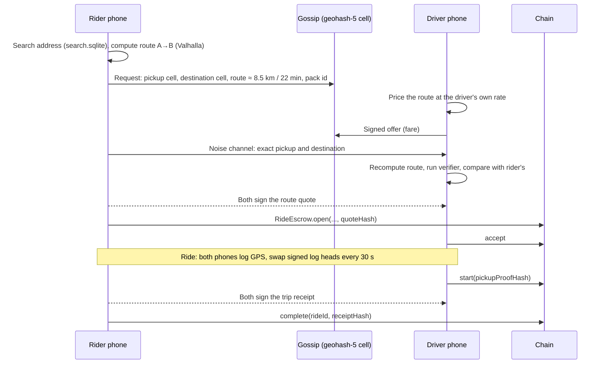

# Maps and routing on the phone

Status: design proposal, not built yet. Decisions marked **Default** stand until the project decides otherwise
(see [Open decisions](#open-decisions)).

KlippelGo computes maps, routes, ETAs and trip distances on the rider's and driver's phones, from OpenStreetMap
data, with open-source libraries only. No routing API, tile server or geocoder ever sees a trip. Every number
that moves money (the quoted route distance and the driven distance) comes with a proof that anyone holding the
public map and the ride's private data can check, and the chain stores only hashes of those proofs.

## The idea in one paragraph

Searching for a route is expensive and hard to make bit-for-bit reproducible across phones. Checking a route
someone hands you is cheap and easy to make exact. So the design splits the two: **Valhalla searches**
(routes, ETAs, map-matching of GPS traces), and a **small deterministic verifier** written in integer-only Rust
checks every result against a map snapshot whose hash governance has published on-chain. Both phones run the
same search, both run the verifier, and both sign the result. A juror, or later a zero-knowledge proof, only
ever needs to re-run the verifier.

## Libraries

All of them are open source, widely used, and run without any third-party service.

| Job | Library | Licence | Why this one |
| --- | --- | --- | --- |
| Map data | [OpenStreetMap](https://www.openstreetmap.org), Brazil extract from [Geofabrik](https://download.geofabrik.de/south-america/brazil.html) | ODbL | The only open, global, editable road map. Brazil's coverage is good in the large cities. |
| Map drawing | [MapLibre Native](https://maplibre.org) (Android and iOS) | BSD-2 | The open fork of Mapbox GL. Renders vector tiles on the GPU and [reads PMTiles files](https://maplibre.org/maplibre-native/android/examples/data/PMTiles/) offline. |
| Vector tiles | [Planetiler](https://github.com/onthegomap/planetiler) building the [Protomaps basemap](https://github.com/protomaps/basemaps) into one [PMTiles](https://github.com/protomaps/PMTiles) file | Apache-2.0, BSD-3 | One file per region, no tile server, fast to build. |
| Routing, ETA, map-matching | [Valhalla](https://github.com/valhalla/valhalla) | MIT | Tiled routing graph designed for offline use, car and motorcycle profiles, and map-matching (Meili) in the same engine. C++, builds for Android and iOS. |
| Turn-by-turn for drivers | [Ferrostar](https://github.com/stadiamaps/ferrostar) | BSD-3 | Navigation core in Rust with Kotlin and Swift UIs, built around Valhalla. We plug in a local route adapter instead of its HTTP one. |
| Address and place search | [SQLite](https://sqlite.org) FTS5 and R*Tree, built from OSM addresses and places | Public domain | Search and reverse geocoding fully offline. Accent folding (`remove_diacritics`) handles Portuguese. |
| Build tools | [osmium-tool](https://osmcode.org/osmium-tool/) to cut regions, Rust [`osmpbf`](https://crates.io/crates/osmpbf) for the proof index | GPL-3.0 (build time only), MIT/Apache-2.0 | Standard OSM tooling. |
| Later, zero-knowledge | [SP1](https://github.com/succinctlabs/sp1) or [RISC Zero](https://github.com/risc0/risc0) | MIT/Apache-2.0 | Both run ordinary Rust programs as provable code, so the verifier crate can be reused unchanged. |

**Alternative router.** [GraphHopper](https://github.com/graphhopper/graphhopper) (Apache-2.0, Java) runs well on
Android but is awkward on iOS. [OSRM](https://github.com/Project-OSRM/osrm-backend) is fast but needs too much
memory for a phone. **Default: Valhalla.**

## Map packs

A **map pack** is everything a phone needs for one region, built from one OSM snapshot.

| File | Built by | Used for |
| --- | --- | --- |
| `basemap.pmtiles` | Planetiler | Drawing the map |
| `style/` (style JSON, glyphs, sprites) | Bundled in the app, versioned with the pack | Drawing the map, no font server |
| `valhalla_tiles.tar` | `valhalla_build_tiles` | Routing, ETA, map-matching |
| `search.sqlite` | Our build script | Address search, reverse geocoding |
| `proof-index/` | Our Rust tool, single-threaded and deterministic | Verifying routes and trips |
| `manifest.json` | Our build script | SHA-256 of every file, OSM snapshot, tool versions, `proofRoot` |

**Regions.** One pack per metro area, starting with the pilot city, so a phone downloads only what it drives in.
A metro pack should land in the low hundreds of megabytes; the prototype will measure it. Drivers near a boundary
download the neighbouring pack too.

**The proof index** is the part every proof rests on. It is a canonical table of the road network: for each OSM
way that cars may use, its node ids, node coordinates as integers (degrees × 10⁷, exactly as OSM stores them),
direction and access flags. Rows are sorted by way id and split into chunks, each chunk is hashed with
keccak-256, and the chunk hashes form a Merkle tree whose root is `proofRoot`. The tree follows OpenZeppelin's
`MerkleProof` layout so a contract can check a chunk if it ever needs to.

**Reproducible build.** The build runs in Docker images pinned by digest, from a Geofabrik extract pinned by its
replication sequence number and SHA-256. The proof index must come out byte-identical for anyone who rebuilds
it. Valhalla's and Planetiler's outputs may not be byte-identical across machines, and that is fine: nothing
that moves money trusts them, only the proof index.

**Publishing a pack on-chain.** A new `MapRegistry` contract, owned by the governor like every other contract,
records each pack:

```
region        "br-sp-sao-paulo"
version       2026.11
osmSnapshot   Geofabrik sequence number + SHA-256 of the .pbf
proofRoot     Merkle root of the proof index
manifestHash  keccak-256 of manifest.json (this is the pack id)
cid           IPFS CID of the pack
activeFrom    timestamp
retiredAfter  timestamp (old packs stay valid for a grace period)
```

Any validator can rebuild the proof index and post an attestation of the root it got. A governance proposal
activates a pack only once a quorum of independent rebuilds (**Default: 3**) report the same `proofRoot`. This
makes the map public and verifiable, like the rest of the protocol's data.

**Distribution.** Packs are content-addressed, so it does not matter who serves them: IPFS, mirrors run by
Instituto Klippel, or another phone over the P2P layer. The app checks `manifestHash` against `MapRegistry`
before using a pack and each file against the manifest. A mirror only learns which metro area a phone asked for,
never where in it. **Default cadence: a new pack monthly**, so OSM fixes reach drivers without churning proofs.

## What happens during a ride



### 1. Route and price, before the ride

1. The rider types an address or drops a pin. Search runs on `search.sqlite`; house numbers are patchy in OSM in
   many Brazilian neighbourhoods, so a pin is always available.
2. The rider's phone asks Valhalla for the route from pickup to destination and gets distance, duration and the
   path.
3. The gossip request that drivers see gains the route's distance and duration, rounded (0.5 km, 1 min), and
   the pack id. It still carries only coarse cells, no addresses. Drivers can now price a known distance instead
   of the rider typing a maximum fare blind.
4. Drivers reply with signed offers, as they do in the current Android app.
5. After the rider picks an offer, the exact points cross the encrypted channel. The driver's phone computes the
   same route on the same pack and runs the verifier on the rider's path. The phones must agree on distance
   within a tolerance (**Default: 2%**, set by governance); if not, the driver's app shows the difference and
   the driver can decline before anything is locked.
6. Both sign the **route quote** and its hash goes into `RideEscrow.open` as `quoteHash`, which the contract
   already takes.

```
RouteQuote {
  packId        manifestHash of the map pack
  pickup        lat, lon as int32 × 10⁷
  dropoff       lat, lon as int32 × 10⁷
  path          the route as a list of (OSM way id, OSM node id) steps
  distanceM     uint32, metres, computed by the verifier
  durationS     uint32, seconds, Valhalla's estimate
  fare          token amount, the accepted offer
  token         stablecoin address
  rider, driver addresses
  expiry        timestamp
}
quoteHash = keccak256(canonical encoding of RouteQuote)
```

The fare stays a free market between rider and driver. What the quote proves is the distance the fare was
agreed for, so the rider sees an honest R$/km and nobody can later argue about which route was priced.

### 2. Trip trace, during the ride

Each phone records its own GNSS fixes every 2 seconds into an append-only log:

```
fix  = (t ms, lat ×10⁷, lon ×10⁷, accuracy cm, speed cm/s, mockFlag)
head = keccak256(previous head, fix)
```

- Every 30 seconds the head is signed with a **trace key**: a hardware key (Secure Enclave or StrongBox) created
  for this ride without a biometric prompt, and certified at ride start by the user's wallet key.
- The two phones swap signed heads over the encrypted channel and countersign each other's. Afterwards each side
  holds the other's signatures over its log, so neither can rewrite its own trace later without being caught,
  and the two logs back each other up.
- The driver's phone uses the live log to show the rider's map and to recompute ETA with Valhalla, all on-device.
- Logs stay on the two phones, encrypted like the rest of their private data.

### 3. Trip receipt, at arrival

At drop-off each phone map-matches its own log with Valhalla's Meili, which returns the driven path, and runs
the verifier on it. Both sign:

```
TripReceipt {
  rideId, quoteHash
  riderTraceHead, driverTraceHead   final countersigned heads
  drivenPath                        (way id, node id) steps
  drivenDistanceM                   computed by the verifier
  startedAt, endedAt                from the pickup proof and the final fix
  fare                              the quoted fare, or a signed amendment's
}
receiptHash = keccak256(canonical encoding of TripReceipt)
```

- **Detours.** A stop or route change the rider asks for mid-trip is a new quote both phones sign, chained to
  the old one. Without one, the fare is the quoted fare (upfront pricing, as riders in Brazil expect).
- **On-chain.** `complete` gains a `receiptHash` argument. On the timeout path the driver submits their own
  receipt hash first, so an unresponsive rider cannot block payment and the driver is on record with evidence.

## The verifier

A new crate, `core/verify`, written in plain Rust with no floating point, no allocation surprises and no I/O,
so it gives the same answer on every phone, every juror's laptop and inside a zkVM.

It checks:

1. **The map.** Every proof-index chunk it reads hashes into the pack's `proofRoot`.
2. **The path.** Each step follows an OSM way that exists in the proof index, consecutive steps share a node,
   one-way and access rules are respected for the vehicle class.
3. **The endpoints.** The path starts within 50 m of `pickup` and ends within 50 m of `dropoff` (governed).
4. **The distance.** It recomputes `distanceM` itself from node coordinates using a fixed-point equirectangular
   formula, accurate to well under 0.1% at city scale. It never trusts the number Valhalla reported.
5. **The trace** (for receipts). Fixes are in time order, every fix lies within its own reported accuracy plus
   a margin of the path, speeds and accelerations are physically possible, the mock-location flag is off, and
   the hash chain and signatures check out.

Valhalla stays untrusted: if it returns a bad path, the verifier rejects it and the app shows an error.
Translating Valhalla's output into `(way id, node id)` steps works from its shape points and way ids; the
prototype will confirm Valhalla's shape points line up exactly with OSM node coordinates.

## Who checks what

| Moment | Checked by | How |
| --- | --- | --- |
| Pack activated | Validators, then governance | Rebuild the proof index, compare `proofRoot` |
| Before locking the fare | Both phones | Same Valhalla search, same verifier, then both sign |
| Arrival | Both phones | Map-match own trace, verifier, both sign the receipt |
| Dispute | Jurors | Download the public pack, receive the ride data from the parties, run the verifier |
| Later | A contract | Check a zero-knowledge proof of the verifier, with no locations revealed |

`DisputeCourt` already takes an evidence hash. With this design the evidence is the quote, the receipt and both
trace logs, and a juror's tool can answer the usual questions mechanically: was the trip taken, how far, did the
driver detour, did it end early. That supports the plan's aim of settling small fares by default rules and
sending only real disagreements to jurors.

## Zero-knowledge, later

Re-running the verifier means a juror sees the ride's locations. A zero-knowledge proof would let a contract
learn "this receipt describes a trip of 8.4 km on pack 2026.11, ending within 50 m of the quoted drop-off"
without seeing where it was. Because the verifier is plain Rust, SP1 or RISC Zero can prove it unchanged.

Not at launch, for two reasons: proving a trace of a few hundred fixes plus the map chunks it touches is likely
too heavy for a mid-range phone today, and handing the inputs to an outside prover would leak the locations the
proof is meant to hide. **Default: ship signed, re-checkable proofs first, keep the verifier zkVM-ready, and
benchmark on-device proving once the verifier exists.**

## Honest limits

- **GPS cannot be proven.** A rooted phone can fake its location. The design raises the cost: two independent
  devices must agree, the trace must fit the road network and physics, mock-location flags and Play Integrity
  or App Attest verdicts are checked by the other phone, and a lying party has signed their lie.
- **Colluding riders and drivers** can fake whole rides to farm reputation or governance weight. Proofs cannot
  stop two people agreeing on a fiction. Each completed ride costs the R$ 1,00 fee, which prices this, and
  governance can weight votes by rides with distinct counterparties.
- **ETAs have no live traffic.** Valhalla uses speeds from OSM road types, so São Paulo rush-hour ETAs will run
  short. Drivers' anonymised trip speeds could later feed a shared, governed speed table; that is a separate
  design.
- **Map quality** is OSM's. Missing streets or wrong one-ways show up as route mismatches. KlippelGo should
  encourage drivers to fix OSM directly, and those fixes arrive with the next monthly pack.
- **App size and build effort.** Valhalla is a large C++ dependency to cross-compile for Android and iOS. The
  prototype measures binary size, pack size, route time and memory on a mid-range Android phone before
  committing.
- **Licences.** OSM data is ODbL: the app shows "© OpenStreetMap contributors" on the map, and packs are
  published openly under ODbL, which suits a project that publishes its packs anyway. All libraries above are
  compatible with the repository's AGPL-3.0.

## Changes to existing code

| Where | Change |
| --- | --- |
| `contracts/` | New `MapRegistry` (governed). `RideEscrow.complete` and the timeout path take a `receiptHash`. |
| `core/` | New `verify` crate. Canonical encodings and hashes for `RouteQuote` and `TripReceipt`. Trace log and key certification. Valhalla binding (C++ via `cxx`). |
| Android app | Replace `MapSurface` and `RouteArt` placeholders with MapLibre. Request carries route distance and duration. Pack download and check screen. |
| New `mappack/` | Docker build for a region pack and the deterministic proof-index tool. |

## Build order

1. **Pilot pack and a real map.** Build the pilot city's pack, show it in the Android app with MapLibre, offline
   address search. No proofs yet.
2. **On-device routing.** Valhalla in the Rust core, route and ETA on the rider's phone, distance in the gossip
   request, driver navigation with Ferrostar.
3. **Route quote proof.** Proof index, verifier, signed quote, `MapRegistry` on the local chain.
4. **Trip proof.** Trace logs with countersigned heads, map-matching, signed receipt, `receiptHash` on-chain.
5. **Dispute tooling.** A juror tool that runs the verifier on revealed evidence, and default rules for small
   fares.
6. **Zero-knowledge study.** Benchmark the verifier in SP1 and RISC Zero on a phone.

## Open decisions

| Decision | Options | Default |
| --- | --- | --- |
| Router | Valhalla, GraphHopper | Valhalla |
| Proof strength at launch | Signed and re-checkable, or zero-knowledge from day one | Signed and re-checkable, zkVM-ready verifier |
| Fare basis | Upfront fare bound to the quoted route, or metered from the trip proof | Upfront, with signed amendments for detours |
| Distance tolerance between phones | Any percentage | 2% |
| Pack update cadence | Weekly, monthly, quarterly | Monthly |
| Rebuild quorum to activate a pack | Any number of validators | 3 |
| Pilot city | One metro area | Not chosen (needed for step 1) |
