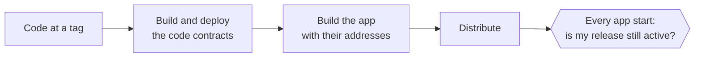
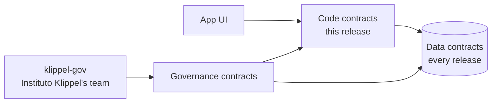

# Releases and data that outlives them

An analysis of how KlippelGo should ship a fix: the app and the contracts it calls change together, while
people's identity, stake, credentials and reputation stay where they are. It compares that model with what the
code and the docs have today, and lists the changes it needs.

**Status.** Built, apart from what "What is not built" lists. It extends
[contracts/docs/deployment.md](../contracts/docs/deployment.md), which designs the pipeline from commit to network
and how a release is published and retired. The sections "What exists today" and "Where state lives today"
describe the code before this design was built, and are kept as the reasons for it. Where the build differs
from the design below, "What was built" says so.

## What was built

| Part | Where | Different from the design below |
| --- | --- | --- |
| Data contracts with writer lists | `DataContract`, `IdentityStore`, `Reputation` (`writers`, `setWriter`) | `Reputation` also refuses a ride recorded twice, one more fixed rule. `MapRegistry` and `FareGuide` are left as they are: their only writers are validators and the governor already |
| The stake vault | `StakeVault` | The unbonding period the guardian sets is capped at 30 days, so it cannot hold stake hostage either |
| `IdentityRegistry` as the release's code | `IdentityRegistry.register` → `IdentityStore.addRoles` | |
| The release registry | `ReleaseRegistry` | Adds `reinstate` (two directors, no delay), so one Segurança member's revoke can be undone as `stop-rides` is by `resume-rides`. `latest` is the highest version published. Versions are packed `major << 32 \| minor << 16 \| patch` |
| Permissions | `TeamDeployer`: `IdentityStore.setWriter`, `publish`, `deprecate` (board, 72 h); `reinstate` (board, 2); `revoke` (Segurança, 1, at once); the `revoke-release-<version>` playbook | The playbook names one release's escrow, so the board stores one with each release, and new `stop-rides`/`resume-rides` for that escrow |
| `klippel-gov release …` | `gov/klippel-gov` | Shows a pending `publish` decoded, its contracts hash against the deployment file, and its APK hashes |
| The app pinned at build | `-Pklippelgo.network`, `/VERSION`, signing from the environment ([apps/android/README.md](../apps/android/README.md)) | A Gradle property, not build flavours, so every script's `assembleDebug` stays the same |
| The app's check | `KlippelGoClient.releaseCheck`, on every full read and before starting a ride ([apps overview](../apps/docs/overview.md)) | Read on each full read (every 30 s and on a change), not only on a registry event |
| Updating | `Updater` | Offered only to a higher version than the app's own. If the highest published release is revoked, no lower one is offered: the fix is a new, higher version |
| The app's own data | `AppData` (schema 1) | |
| Finishing on an earlier release | `previousEscrows` in the deployment file, `KlippelGoClient.leftOnPreviousReleases`, `withdrawFrom` | The app lists unfinished rides there and withdraws owed payments; completing, cancelling or timing out such a ride from the app is not built, so the app holds an update back while a ride of the account is unfinished |
| Gossip | Match topics `/klippelgo/match/<release>/<cell>`, the release being the first eight bytes of the contracts hash | Ride topics keep no release: their name is the quote hash, which names the escrow already, and a ride must go on when one of its two phones updates mid-trip. Presence topics are not used by the app |

**What is not built:** migrating a data contract (read-through); a reproducible APK build and its publication
to a mirror and a store in a release workflow; the release key itself. They are listed in
[deployment.md](../contracts/docs/deployment.md), "What has to be built".

## The model

Two flows, kept apart.

**What a release is.** Code is built once, tagged, and never changes afterwards. The app is built against the
code contracts of the same tag, with their addresses compiled in. A bug is fixed by a new release, never by
changing a released one.

**Who may touch what.** People reach data only through code contracts. Governance decides which code
contracts may write which data, and sets parameters. Data stays from one release to the next, or moves once
to a new data contract when its shape must change.

A release replaces the UI and the code contracts. The data contracts stay, and only the list of code
contracts allowed to write them changes.

## What exists today

Most of the pieces this model needs already exist somewhere in the code. They are just not used as a system.

| Pattern | Where it is today | What it gives the model |
| --- | --- | --- |
| **Code at an address never changes.** No proxy, no owner ([deployment.md](../contracts/docs/deployment.md), "What makes these contracts different to deploy") | Every contract | The "released code does not change" half, on chain. Keep it: it is why a juror or a hash can name a contract |
| **A data contract with a list of writers** | `Reputation.isEscrow`, set by `setEscrow`. Any escrow on the list may record completions and ratings; rides are keyed by escrow and id | The exact shape of a data contract. Generalise it |
| **Wiring by governance** | `PBACGovernor.setModules`, `RideEscrow.setModules`, all `onlySelf` / `onlyGovernor`, run by the board with three approvals and 72 hours | How a release swaps code contracts in |
| **A ride keeps the terms it opened with** | `RideEscrow` copies fee, bonds, tax, court and timeout into the ride at `open` (C5); the court is per ride | Rides under way finish on the release they started on. No migration of rides is ever needed |
| **Retiring a deployment by draining it** | [deployment.md](../contracts/docs/deployment.md), "Old versions": close the door with `setToken`, let rides end, keep governing the old one | How the old code contracts of a release end |
| **A registry that says which version is current** | `MapRegistry.latest[region]`: the app asks the chain for the region's pack and needs no release for a new one | How the app finds the current release |
| **Content checked against a hash on chain, from an untrusted mirror** | Map packs: downloaded from any mirror, checked against the attested root ([maps-and-routing.md](maps-and-routing.md)) | How a new APK can come from anywhere and still be trusted |
| **The app polls governance events already** | `KlippelGoClient.changedSince` reads governance changes to policies, tariff and packs in its log batch every 2 s ([apps scalability](../apps/docs/scalability.md)) | A release can be noticed in that same batch, at no extra RPC cost |
| **Versions in gossip topics** | `/klippelgo/match/1/`, `/klippelgo/ride/1/`, `/klippelgo/presence/1/` in `core/src/gossip.rs`, `core/src/geo.rs` | Where a protocol version goes, though today the `1` does not change and the deployment is not in it |
| **One deployment per app build** | `deployments/local.json` copied into the APK's assets (`apps/android/app/build.gradle.kts`), `Deployment.fromJson`, with `LOCAL_DEFAULT` as the fallback | The "contracts hardcoded" step, for the local network only |

What is missing is everything that ties these together: there is no record on chain of which app release is
current, no check by the app, and the contracts that hold long-lived data also hold code.

## Where state lives today

Each contract is classified below by what it would be in the model. "Both" is the problem: its data can only
move by moving its code, which is why [deployment.md](../contracts/docs/deployment.md) calls replacing
`Reputation`, `IdentityRegistry` or `PBACGovernor` a new deployment.

| Contract | Holds | Lives as long as | Today | In the model |
| --- | --- | --- | --- | --- |
| `PBACGovernor` | Policies, guardian, pointers to registry and reputation | The network | Both, and `immutable` in every contract | Governance. Stays for the network's life; it is the one address every release trusts |
| `TeamCouncil` | Members, roles, permissions, pending actions | The network | Both | Governance. Replaceable today through `proposeGuardian` |
| `IdentityRegistry` | Roles, stake (funds), credentials, blocks, attesters | A person's life on the network | Both | Split: data, and a stake vault (below) |
| `Reputation` | Completed rides, rating sums, which escrows may write | A person's life on the network | Almost data: writers are a list already | Data. Its rating rules move to the code contracts or stay fixed |
| `MapRegistry` | Packs, attestations, latest pack per region, quorum, tolerances | Packs come and go; the registry stays | Both | Data, with the attest and activate rules as fixed code in it |
| `FareGuide` | Tariff, price band, native coin rate | The network | Parameters | Data (parameters) |
| `RideEscrow` | Rides, fares and bonds held, payments owed, caps | Minutes to hours per ride; owed payments until claimed | Both | Code. Its data is short-lived and drains, as today |
| `DisputeCourt` | Disputes, commitments, reveals | One dispute | Both | Code. Each ride keeps its court, so the old one finishes its disputes |
| `FeeVault` | Fees until swept | Until swept | Both, trivial | Code; swept and replaced as today |
| `KlippelGoAccount` | A person's keys and coins | The person | Clones of one fixed implementation, not upgradeable by anyone | The person's own. Not part of a release (below) |
| `AccountFactory`, `BrlPaymaster` | The implementation to clone; the paymaster's deposit | The network | Code | Code, replaced by a release when needed |

## Changes required

### Contracts

**1. Data contracts with writer lists.** Turn the `Reputation.isEscrow` idea into the rule: a data contract
holds state and the smallest checks that must never change (an entry belongs to its account, a counter only
grows), and has `writers[contract]`, set only by the governor. Code contracts call it. Reads are open.

| Data contract | From | Writers |
| --- | --- | --- |
| `IdentityStore` | `IdentityRegistry`'s roles, registration time, credentials, blocks, attesters | The release's registry logic (`register`), the governor (`setBlocked`, `setAttester`), attesters (`attest`, `revoke`) |
| `Reputation` | Itself, with `isEscrow` renamed to the general writer list | Each release's escrow |
| `MapRegistry` | Itself | Validators through its own fixed `attest`; the governor |
| `FareGuide` | Itself | The governor |

**2. Stake goes to a vault whose code never changes.** Stake is people's money, held for as long as they
drive. If it sat in a data contract that any wired-in code could write, a board action could wire in code that
takes it. The vault takes `addStake`, `requestUnstake` and `withdrawStake` exactly as `IdentityRegistry` does
today. There is no slashing today and the vault has none either. It answers `stakeOf` for the policies. Its
code is final. A release that wants slashing deploys a new vault and asks people to move their stake into it.

**3. `RideEscrow` stays a code contract that holds funds.** Rides live for minutes. Moving ride funds into a
shared vault that each release's escrow may spend would trade a short drain for a permanent power over every
fare. Draining the old escrow, as [deployment.md](../contracts/docs/deployment.md) already describes, costs
nothing but waiting. `owed` balances stay claimable on the old escrow by `withdraw`, which needs no policy.

**4. A release registry.** A new governance-owned contract, at an address that never changes and that every
app build has compiled in next to the governor's:

| Field | Meaning |
| --- | --- |
| `version` | `MAJOR.MINOR.PATCH` of the release |
| `contracts` | Hash of the release's code contract addresses (the deployment file's code part), so the app can check its own compiled-in set |
| `apk` | SHA-256 of each published APK (per architecture and universal), so a phone can check a download from any mirror |
| `status` | `Active`, `Deprecated` (still works, the app asks the user to update), `Revoked` (the app refuses new rides) |

It has `publish`, `deprecate` and `revoke` under the board, with a separate fast permission for `revoke`, like
Segurança's `stop-rides`, because a revoke after a vulnerability cannot wait 72 hours. As built, `reinstate`
puts a deprecated or revoked release back, with two directors and no delay. It emits one event per
change, which the app's existing log batch picks up.

**5. Migrating a data contract.** Only when its shape must change. Two ways, and the second is the default:

| | Bulk copy | Read-through |
| --- | --- | --- |
| How | The team writes every entry into the new contract, in batches | The new contract answers from its own state, and falls back to the frozen old one for an account it has not seen; the first write for an account copies that account's state |
| Cost | Gas grows with users, paid by the team. Against pattern 7 of the [contracts overview](../contracts/docs/overview.md) if done in one call | Each account pays for its own copy, once |
| Risk | Long window where the two disagree | The old contract must be frozen first: its writers removed, so it cannot change under the new one |

**6. What stays as it is.** The governor and its `immutable` references, the council, `Governed`, the custom
errors, and "no proxy". The model does not need a proxy anywhere: data contracts keep their address because
their code is small and final, and code contracts change by changing their address.

**7. Accounts.** Each person's `KlippelGoAccount` is a clone that nobody can upgrade, and only executes what its
own keys sign. A release must keep working with every account ever made. A new implementation (a recovery
module, a new signature scheme) goes to new accounts through a new `AccountFactory`. If old accounts ever need
it, the upgrade must be the person's own signed operation, not a governance action, because the account holds
their coins.

### Governance

- New permissions in `TeamDeployer`: `setWriter` on each data contract (board, 72 hours), `publish` and
  `deprecate` on the release registry (board), and `revoke` (Segurança, one member, at once).
- The new calls go into `KNOWN_CALLS` in `gov/klippel-gov`, and a `klippel-gov release …` group shows a
  release's addresses and APK hashes beside the tag, for each director to check before approving.
- **The exit window.** Wiring a new writer into a data contract is the one action that can change what an
  account has. Its delay must stay longer than anything a person needs to react. With stake in its own vault
  this concerns reputation, roles and credentials, not money, so the board's 72 hours are enough.

### App

- **Pinned at build.** The app reads `deployments/<network>.json` per build flavour, not only `local.json`,
  and drops `LOCAL_DEFAULT` in non-local builds. [deployment.md](../contracts/docs/deployment.md) lists this
  already. The build also writes its own version into the app.
- **Checked at every start, and every refresh.** At start, before the first screen that can open a ride, the
  app reads its version's status from the release registry. After that the registry's events ride in the
  log batch `changedSince` already makes every 2 s.

  | Status | The app |
  | --- | --- |
  | `Active` | Works |
  | `Deprecated` | Works, and shows that an update is ready |
  | `Revoked` | Lets a ride under way finish and money be withdrawn; refuses to open, accept or quote a new one; offers the update |
  | Not found, or the chain cannot be reached | Works as today. Refusing to work without the chain would make the RPC a kill switch |

- **Updating fast.** The app downloads the new APK from any mirror, as it does packs, checks its SHA-256
  against the registry, and hands it to Android's installer. Android always asks the person to confirm an
  install that does not come from a store, and needs `REQUEST_INSTALL_PACKAGES` for the app to offer it.
  Through Google Play, in-app updates do the same job without that permission.
- **Its own data.** Keys, scans and caches in `SharedPreferences` and the app's files get a schema version and
  a migration on start, so an update never needs a fresh install.
- **Finishing a ride on the old release.** A ride opened on a release's escrow is settled on that escrow.
  The new release must keep the previous release's code contract addresses, or read them from the registry,
  until the person has no ride and no owed payment left there. [deployment.md](../contracts/docs/deployment.md)
  names this as a gap already.

### Core and gossip

- The release goes into the match topics (`/klippelgo/match/<release>/<cell>`), so phones on two releases
  never match each other through the old escrow. Rides already matched continue on their own ride topic, which
  carries no release: its name is the quote hash, which names the escrow, and a ride must go on if one of its
  phones updates mid-trip. Updated phones join the new topics as they update.
- The quote hash already names the escrow's address and the chain id, so a quote made for one release can never
  open a ride on another. Nothing to change there.

### Build and distribution

- **Reproducible builds.** Anyone can build the tag and get the same APK, signature aside. That is what lets a
  director check the `apk` hash before approving a release, and anyone check it afterwards. The release
  workflow in [deployment.md](../contracts/docs/deployment.md) already builds the contracts twice and
  compares; the APK joins it.
- **A release key.** The APK has to be signed, and Android accepts an update only from the same key. That key
  becomes the one thing besides the council that can put code on phones. It is held like the production
  deployer key: on hardware, used in a ceremony, never in CI. The release APKs are unsigned today
  ([apps/android/README.md](../apps/android/README.md)).
- **Channels.** At least one store (fast installs and updates) and the mirror (for phones without one), both
  serving the same bytes the registry names.

## What "enforced" can mean

The model can make sure an honest person runs the current release. It cannot make a dishonest one do so: a
modified app skips any check it carries. The protection against an old or modified app is on chain, and it is
the one that matters:

| Layer | Stops |
| --- | --- |
| The release registry and the app's check | An honest user on a release with a known bug |
| Gossip topics per release | Phones on two releases matching each other |
| Closing the old escrow's door (`setToken` fee zero, or the release's `revoke` playbook doing the same) | Anyone, with any app, opening a ride on code with a known bug |
| Policies on the new code contracts | Everything the protocol already guards ([contracts security](../contracts/docs/security.md)) |

So a security fix is a release plus a `revoke`, and the `revoke` closes the old code contracts on chain in the
same action: the `revoke-release-<version>` playbook.

## Trade-offs

- **Governance gains power over data.** Today replacing `Reputation` or `IdentityRegistry` is so costly that
  it is not done. In the model, the board can wire in code that writes them. That power already exists in part
  (`setEscrow`, `setModules`), and nothing in the contracts bounds the guardian today (L19 in
  [contracts security](../contracts/docs/security.md)). The model makes it the normal path, so the board's
  delay and approvals carry more weight, and the stake vault is kept out of its reach on purpose.
- **Releases cost an app update for everyone.** Today a parameter change needs no release, and that stays
  true: most fixes should still be parameters.
- **The RPC can lie about the registry** (P3 in [apps security](../apps/docs/security.md)). A lying RPC can
  say a release is revoked and lock a person out of new rides until they switch provider, or say it is active
  when it is not. In the second case the closed escrow still refuses the ride.

## Order of work

Steps 1 to 3 and 5 are built, and step 6 in part (see "What was built"); step 4 is the release process, outside
this repository's code.

1. App: deployment per build flavour, version in the build, data schema version. Contained to the app.
2. Contracts: release registry and its permissions; app checks it at start and in the log batch.
3. Gossip topics carry the release.
4. Release signing key, reproducible APK, mirror and store.
5. Split `IdentityRegistry` into `IdentityStore` and the stake vault; give `Reputation` the general writer
   list. This one needs a full deployment, since `IdentityRegistry` and `Reputation` cannot be replaced in
   place today. Do it before production launch, while there is no one's data to lose.
6. Keeping the previous release's addresses in the app to finish rides and withdraw.

## Open questions

- Whether a release with only an app change, and no contract change, also goes through the registry. The
  recommendation is yes, with the same `contracts` hash: the registry is then the single list of what users
  may run.
- How long `Deprecated` lasts before `Revoked`, by default.
- Which store, if any, at launch, and whether the mirror-only path is acceptable for a first city.
- Whether `MapRegistry`'s fixed rules (quorum, attest) are final enough to make it a data contract as it is,
  or whether they move into a code contract first.
