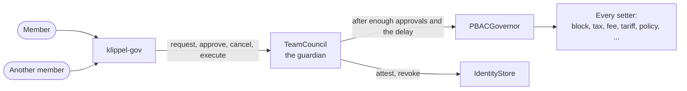

# klippel-gov

The command-line tool Instituto Klippel's team governs KlippelGo with: each member asks the team council for an
action, approves, cancels or executes one, and reads what the council and the protocol hold.

It holds no power of its own. The governor's guardian is the team council
([contracts/docs/security.md](../contracts/docs/security.md), C1), and the council decides whether an action
needs other members' approvals and how long it waits ([docs/governance.md](../docs/governance.md)). The tool
signs as one member, with that member's key, and shows what the council will ask before it sends anything.



## Setting up

Needs [Foundry](https://book.getfoundry.sh/getting-started/installation) (`cast`), `jq` and GNU `date`.

| | Flag | Environment | Default |
| --- | --- | --- | --- |
| Chain node | `--rpc` | `KLIPPEL_GOV_RPC` | `http://127.0.0.1:8545` |
| Contract addresses | `--deployment` | `KLIPPEL_GOV_DEPLOYMENT` | `deployments/local.json` |
| How to sign | | `KLIPPEL_GOV_WALLET` | On the local testnet, seeded account #1 |
| Act as a multisig member, signing nothing | `--safe` | `KLIPPEL_GOV_SAFE` | Not set |
| Where a multisig's transactions are written | | `KLIPPEL_GOV_OUT` | The current folder |
| First block to read the council's events from | | `KLIPPEL_GOV_FROM_BLOCK` | `deployBlock` in the deployment file, or 0 |

`KLIPPEL_GOV_WALLET` is passed to `cast` as written: `--ledger`, `--trezor`, or `--account maria` for a
keystore made with `cast wallet import maria --interactive`. Off the local testnet the tool refuses a raw
private key or mnemonic, because a key on a command line ends up in the shell's history.

The signing account must be a member of the council, in the role the change belongs to: `klippel-gov team`
shows who is in which role and what each role may do.

## Who does what

At launch the council has six roles ([docs/governance.md](../docs/governance.md) has the reasons):

| Role | Actions | Approvals and delay |
| --- | --- | --- |
| Diretoria (board) | Members and roles, the guardian, the contracts wired in and which of them write the data, the fee beneficiary, publishing and deprecating releases, `resume-rides` | Three, 72 hours; suspending a member, or putting a release back, takes two, at once |
| Finanças | Fees, tax, caps, tariff, the native coin's price, fee claims | Two, a day |
| Operações | Policies, timeouts, unbonding, dispute periods, map packs | Two, a day |
| Credenciamento | Approve a licence (two) or revoke one (one) | At once |
| Segurança | Block (one) or unblock (two) an account; `stop-rides`, revoke a release, `revoke-release-<version>` (one) | At once |
| Recuperação | Cancel anything, suspend anyone at once, add directors after 7 days. Protected: nobody else changes it | One: it is a cold multisig |

Each member's key is their own hardware wallet: a shared key makes the approvals on chain say nothing about
who agreed.

## Day to day

```sh
klippel-gov status                    # every setting, the guardian, and whether the deployment is sound
klippel-gov account 0x15d3…6A65       # roles, stake, licence, score, block, team roles, what it may call
klippel-gov team                      # roles, members, permissions
klippel-gov actions                   # the last actions and where each stands
klippel-gov action 7                  # one action: its calls, decoded, and who approved
```

### Asking for a change

```sh
klippel-gov request tax 4                              # 4% of each fare
klippel-gov request tariff perKm=2,20 minimum=9        # only what is named changes
klippel-gov request token BRZ fee=1,50
klippel-gov request cap BRLA 500000                    # the most of a coin the escrow holds at once
klippel-gov request policy RideEscrow.accept minScore=4,6 minStake=150
klippel-gov block 0x15d3…6A65                          # the same as: request block
```

`klippel-gov help` lists every kind of request. Before sending, the tool shows the old and the new value of
each setting, the exact calls, what to think twice about, and which permission the change falls under: its
role, its approvals and its delay. An action that needs one approval and no delay runs at once; any other
prints its number:

```sh
klippel-gov approve 7                 # another member of the role; executes it too when it is ready
klippel-gov execute 7                 # anyone, once it has its approvals and its delay is over
klippel-gov cancel 7                  # a member of the role, or a director, until it runs
```

`klippel-gov action 7` and `approve 7` show what the action calls, read from the council's own event and
checked against the hash the council stored. That catches a node that is out of step, not one that lies on
purpose, since the same node serves both (limit L20): approve through a node you trust. A call the tool does
not know, or a contract that is not in the deployment file, is marked `UNKNOWN`. Calls that move money, rewire
the protocol or change who decides are marked too. Read the calls.

A block makes an account pass no policy: it opens and accepts no ride, judges no dispute and attests no map. It
does not touch what the account is owed: a ride under way still settles, and stake can still leave. It follows
an address, not a person (limit L16): for a driver, revoke the licence as well; a rider can come back under a
new address.

### Verifying a driving licence

Check the driver's documents the way Instituto Klippel does, off chain. Then, as a member of Credenciamento:

```sh
klippel-gov cnh approve 0x15d3…6A65 scans/cnh-4471.pdf --expires 2031-05-20
klippel-gov cnh revoke 0x15d3…6A65
```

The council is the attester, so the credential is the council's and outlives the member who checked it. Only a
hash goes on chain: the hash of the file mixed with a random salt, so nobody can confirm a guess of the
document by hashing it. The tool prints the salt: keep it with the file, because the two together are what
proves later which document was approved. `--expires` should be the licence's own expiry date; the credential
stops counting the day after. A second member approves with `klippel-gov approve <id>`; they run the same
`cnh approve` with `--salt <the salt the first run printed>` if they want to see the same hash come out.

The driver must have registered first. If the driver already holds a valid licence from another attester, the
contract refuses: one attester cannot replace, and so cannot revoke, what another issued. The same licence must
not be approved for a second address: that check is Instituto Klippel's, in its own records, and it is what
makes a block hold for a driver.

### In an emergency

```sh
klippel-gov stop-rides                # Segurança, one member, at once: nobody opens or accepts a ride
klippel-gov resume-rides              # the board, two members: the policies as the playbook stored them
klippel-gov team suspend 0xabc…       # two directors, at once: nothing that key asked or approved counts
klippel-gov playbooks                 # every list of calls written in advance, and who runs it
```

`resume-rides` puts back the `open` and `accept` policies as they were when it was stored (limit L25).

### Releases

A release is the code contracts and the app built at one tag ([docs/releases-and-data.md](../docs/releases-and-data.md)).
The board publishes it once each director has built the tag and compared what the tool shows:

```sh
klippel-gov release                                   # every published release and its status
klippel-gov release 1.2.0                             # once published: its contracts hash, the deployment file's
                                                      # code contracts beside it (and whether they match), its APKs
klippel-gov request release publish 1.2.0 out/*.apk   # the board: the file's code contracts and each APK's sha-256
klippel-gov request release deprecate 1.1.0           # the board: apps on 1.1.0 ask their users to update
klippel-gov run revoke-release-1.1.0                  # Segurança, at once: revoke 1.1.0 and close its escrow
klippel-gov request release reinstate 1.1.0           # two directors: put it back
```

`request release revoke` revokes in the registry only, which stops honest apps; the release's escrow stays
open to any other app (limit L33). Prefer the release's `revoke-release-<version>` playbook, which does both.
It names one release's escrow, so the board stores one for each release it publishes, with new `stop-rides`
and `resume-rides` for that escrow. `run` refuses a name two active playbooks share: run one by its number
then. After a plain `revoke`, the playbook reverts (the release is revoked already): use `stop-rides`.

Before approving a `publish`, `klippel-gov action <id>` shows the version as text, whether its contracts hash
is the one of the deployment file's code contracts, and each APK hash to compare with `sha256sum` of the APKs
you built from the tag.

## The team

The board's actions, each a request like any other:

```sh
klippel-gov team add 0xabc… finance               # read the address aloud with its owner first
klippel-gov team remove 0xabc… finance
klippel-gov team suspend 0xabc… | team unsuspend 0xabc…
klippel-gov team grant operations MapRegistry.retire approvals=2 delay=1d
klippel-gov team set 14 approvals=3 delay=2d      # a permission's approvals and delay, by its number
klippel-gov team revoke-permission 14
klippel-gov team create-role Auditoria
```

A role is its number, its name, or `board`, `finance`, `operations`, `credentialing`, `security`, `recovery`.
The council refuses what would lock the team out (a role left with fewer members than a permission's
approvals, the board without its power to grant or set members, the board's control faster than a day),
anything about Recuperação that is not Recuperação's own action, and anyone approving their own entry into a
role or their own suspension.

## A member that is a multisig

Recuperação is a multisig, and any other member can be. With `--safe <address>` (or `KLIPPEL_GOV_SAFE`) the
tool acts as the multisig. It needs no key. Every check is made for the multisig's address, and instead of
sending, it writes the transaction out:

```sh
klippel-gov --safe 0x5afe…c0de cancel 7
```

```
Acting as 0x5afe…c0de, which reports a threshold of 3 and 4 owners.
...
Nothing was sent. For the multisig 0x5afe…c0de to do this, its owners approve one transaction:
  to     0x3228…6c44
  value  0
  data   0x40e5…
  check  0x9d1e…   (the hash of data: a short value for owners to compare)
  file   ./klippel-gov-137-20261012-184500-40e58ee5-7a3c9e10.json   (in Safe: Apps, Transaction Builder, load this file)
```

One owner loads the file in the Safe app and proposes it; the others approve; the last approval executes it.

- **What each owner checks.** The Safe page shows the transaction's `to` and `data`: they must be the ones the
  tool printed (`check` is the hash of `data`, shorter to read aloud: `cast keccak <data>` gives it for what the
  page shows). A hardware wallet usually shows only the Safe's own transaction hash, so the comparison is made
  on the page.
- **The first line is a typo check, not a guarantee.** The threshold and owners are what the contract says of
  itself, through the node. The tool warns when the threshold is under 2 or the owners are fewer than the
  threshold, and does not look at a Safe's modules or guards, which can let it act with no owner's signature.
  Set the multisig up, and check it, in the Safe app.
- **The files.** Each is created new, readable by you only, and never written over. Point `KLIPPEL_GOV_OUT` at
  a folder only you can write to. Delete it once executed: loaded again it does the same thing again.
- **Options go before the command.** `klippel-gov --safe 0x… cancel 7`. After the command they are refused, as
  is a `KLIPPEL_GOV_SAFE` that is set but empty, so a misplaced or blank multisig address does not turn into a
  transaction sent with a key.

## The rest

- **Node.** Point `--rpc` at a node Instituto Klippel runs or trusts: what the tool shows of an action is what
  the node says (limit L20).
- **Records.** The chain says which addresses requested and approved each action. Who each address belongs to,
  why a licence was approved, the document and its salt are Instituto Klippel's to keep.
- **Fees.** `klippel-gov sweep BRZ` sends a coin's collected fees to the beneficiary. Anyone may.

## What it refuses

| Refused | Why |
| --- | --- |
| A deployment file for another chain, or a governor or council address with no contract | The addresses mean something on one chain only |
| A raw key, mnemonic or password off the local testnet | It would sit in the shell's history |
| Sending without a typed `yes` off the local testnet (unless `--yes`) | A transaction cannot be taken back |
| A change no permission of a role the signer holds covers, or a signer who is suspended | The council would refuse it; the tool says why before sending |
| An amount like `1.000` | One in English, a thousand in Portuguese |
| A tax of 100% or more, a tax with no collector, a zero beneficiary, a map quorum of zero, the governor as its own guardian | The contract refuses the first two and the last; the others burn fees or unguard the maps |
| `propose`, `vote`, `queue`, `register` | There is no voting: governance is the team council |

It refuses an unbonding period over 30 days (the stake vault would), a release version that is published
already, and a release status change its current status does not allow. It warns, and still sends if
confirmed, for a tax collector that is a contract, a new coin on the allow-list (L10), removing an attester,
handing the guardian's seat on, a new member (check the address with its owner), a release that names no APK
or an APK of the latest release, and a revoke that leaves the escrow open.

These checks protect the team from its own mistakes. They protect nobody from an action requested with another
tool: the council accepts any calls a permission covers, which is why members read the calls.

## On the local testnet

```sh
make testnet && make deploy
gov/klippel-gov request tax 4            # runs at once: account #1 is the only member, in every role
make test-gov                            # gov/test.sh: licences, a block, a setting, the playbooks, a second
                                         # member with two approvals, a suspension, a release, a multisig
```

## Changing this tool

It lives with the contracts: a new `onlyGovernor` function gets a line in `KNOWN_CALLS`, a kind of request in
`build_request`, a permission in `contracts/script/TeamDeployer.sol`, and a check in `test.sh`. The security
rules it is held to are those of [contracts/docs/security.md](../contracts/docs/security.md).
