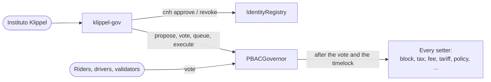

# klippel-gov

The command-line tool Instituto Klippel governs KlippelGo with: it adjusts settings, verifies driving
licences and blocks accounts.

It holds no power of its own. The contracts have no admin key
([contracts/docs/security.md](../contracts/docs/security.md), invariant C1), so the tool does what any account
in the same two positions can do:

| Position | What it can do | Takes effect |
| --- | --- | --- |
| Trusted attester | Approve or revoke a credential: a driving licence (CNH), KYC | At once |
| Registered account | Write a proposal, vote on it, queue it, execute it | Only if the community votes it through, after the timelock |



So blocking an account or changing the tax is never immediate, and never Instituto Klippel's decision alone.
The one thing that is immediate is revoking a licence it approved, which stops a driver from accepting rides.

## Setting up

Needs [Foundry](https://book.getfoundry.sh/getting-started/installation) (`cast`), `jq` and GNU `date`.

| | Flag | Environment | Default |
| --- | --- | --- | --- |
| Chain node | `--rpc` | `KLIPPEL_GOV_RPC` | `http://127.0.0.1:8545` |
| Contract addresses | `--deployment` | `KLIPPEL_GOV_DEPLOYMENT` | `deployments/local.json` |
| How to sign | | `KLIPPEL_GOV_WALLET` | On the local testnet, seeded account #1 |
| Act as a multisig, signing nothing | `--safe` | `KLIPPEL_GOV_SAFE` | Not set |
| Where a multisig's transactions are written | | `KLIPPEL_GOV_OUT` | The current folder |
| First block to read proposals from | | `KLIPPEL_GOV_FROM_BLOCK` | `deployBlock` in the deployment file, or 0 |

`KLIPPEL_GOV_WALLET` is passed to `cast` as written: `--ledger`, `--trezor`, or `--account instituto` for a
keystore made with `cast wallet import instituto --interactive`. Off the local testnet the tool refuses a raw
private key or mnemonic, because a key on a command line ends up in the shell's history.

The account must be registered to write proposals (`klippel-gov register`, once) and must be on the attester
list to approve licences. On a new network the list comes from the deployment
(`ProtocolDeployer.Config.attesters`); later it changes by proposal (`propose attester <address> on`).

## In production: who can use it

The tool has no access control and cannot have one: anyone can run it, or call the contracts some other way.
Who may act is decided by who holds the keys of Instituto Klippel's accounts. Use three, not the one the local
testnet has:

| Account | What its key can do | Keep it as |
| --- | --- | --- |
| Attester | Approve a licence for any address, and revoke the ones it issued. The only power that acts at once | A multisig. See below |
| Proposer | Open proposals. Nothing passes without the community's votes, and any registered account can do the same | The same multisig, or a hardware wallet |
| Fee beneficiary | Spend the R$ 1,00 per ride that `sweep` sends it | A multisig or cold wallet that never signs with this tool |

### The attester is a multisig

Make the attester a multisig contract (a [Safe](https://safe.global), say 2 of 3) whose owners are the staff
who verify licences, each with a hardware wallet. Then:

- no one person approves or revokes a licence alone;
- staff join and leave by changing the multisig's owners, which needs no governance vote and leaves every
  driver's credential as it is;
- a stolen key is one owner to replace, not an attester to remove, as long as the threshold is 2 or more.

One attester account per staff member looks simpler and is worse: adding or removing one takes a vote and a
timelock, and removing one voids every credential it issued (`hasCredential` asks that the issuer still be
trusted), so the drivers that person approved lose their licence the day they leave.

With `--safe <address>` (or `KLIPPEL_GOV_SAFE`) the tool acts as the multisig. It needs no key. Every check is
made for the multisig's address, and instead of sending, it writes the transaction out:

```sh
export KLIPPEL_GOV_SAFE=0x5afe…c0de
klippel-gov register                                  # once
klippel-gov cnh approve 0x15d3…6A65 scans/cnh-4471.pdf --expires 2031-05-20
```

```
Acting as 0x5afe…c0de, which reports a threshold of 2 and 3 owners.
Approve the CNH of 0x15d3…6A65, as 0x5afe…c0de
  ...
Nothing was sent. For the multisig 0x5afe…c0de to do this, its owners approve one transaction:
  to     0xb185…760E
  value  0
  data   0x4b0c…
  check  0x9d1e…   (the hash of data: a short value for owners to compare)
  file   ./klippel-gov-137-20261012-184500-4b0c1f2e-7a3c9e10.json   (in Safe: Apps, Transaction Builder, load this file)
```

One owner loads the file in the Safe app and proposes it; the others approve; the last approval executes it.

- **What each owner checks.** The Safe page shows the transaction's `to` and `data`: they must be the ones the
  tool printed (`check` is the hash of `data`, shorter to read aloud: `cast keccak <data>` gives it for what the page shows). A hardware wallet usually shows only
  the Safe's own transaction hash, so the comparison is made on the page. An owner who wants to be sure runs
  the same command: for a licence, with `--salt <the salt the first run printed>`, because the salt is random
  and a different one gives different `data` for the same document.
- **The first line is a typo check, not a guarantee.** The threshold and owners are what the contract says of
  itself, through the node. The tool warns when the threshold is under 2 or the owners are fewer than the
  threshold, and does not look at a Safe's modules or guards, which can let it act with no owner's signature.
  Set the multisig up, and check it, in the Safe app.
- **The files.** Each is created new, readable by you only, and never written over. Point `KLIPPEL_GOV_OUT` at
  a folder only you can write to. A file holds nothing secret (not the document, not the salt), but it does
  say what is about to be approved or revoked. Delete it once executed: loaded again it does the same thing
  again, for instance re-issuing a licence revoked since.
- **Options go before the command.** `klippel-gov --safe 0x… cnh revoke 0x…`. After the command they are
  refused, as is a `KLIPPEL_GOV_SAFE` that is set but empty, so a misplaced or blank multisig address does not
  turn into a transaction sent with a key.

The multisig gets onto the attester list like any attester: named in the deployment
(`ProtocolDeployer.Config.attesters`), or by `propose attester <multisig> on`. Proposing, voting, queueing and
executing work the same way with `--safe`; after the owners execute a proposal's transaction,
`klippel-gov proposals` shows its number.

### The rest

- **Node.** Point `--rpc` at a node Instituto Klippel runs or trusts: what the tool shows of a proposal is
  what the node says (limit L20).
- **Records.** The chain says the multisig approved a licence, and the multisig's own history says which owners
  signed. Why it was approved, the document and its salt are Instituto Klippel's to keep.
- **If the multisig itself is lost** (enough owner keys stolen to meet its threshold), the remedy is a proposal
  removing it from the attester list. It is slow, and every driver it approved needs a new approval from its
  replacement.

## Day to day

```sh
klippel-gov status                    # every setting, and whether the deployment is sound
klippel-gov account 0x15d3…6A65       # roles, stake, licence, score, block, what it may call
```

### Verifying a driving licence

Check the driver's documents the way Instituto Klippel does, off chain. Then:

```sh
klippel-gov cnh approve 0x15d3…6A65 scans/cnh-4471.pdf --expires 2031-05-20
klippel-gov cnh revoke 0x15d3…6A65
```

Only a hash goes on chain. It is the hash of the file mixed with a random salt, so nobody can confirm a guess
of the document by hashing it. The tool prints the salt: keep it with the file, because the two together are
what proves later which document was approved. `--expires` should be the licence's own expiry date; the
credential stops counting the day after.

The driver must have registered first. If the driver already holds a valid licence from another attester, the
contract refuses: one attester cannot replace, and so cannot revoke, what another issued. The same licence must not be approved for a second address: that check
is Instituto Klippel's, in its own records, and it is what makes a block hold for a driver.

### Changing a setting or blocking an account

```sh
klippel-gov propose tax 4                              # 4% of each fare
klippel-gov propose tariff perKm=2,20 minimum=9        # only what is named changes
klippel-gov propose token BRZ fee=1,50
klippel-gov propose policy RideEscrow.accept minScore=4,6 minStake=150
klippel-gov propose block 0x15d3…6A65 --description "Repeated no-shows, case 2026-118"
klippel-gov proposals
klippel-gov vote 7 for
klippel-gov queue 7                                    # once the vote passed
klippel-gov execute 7                                  # once the timelock is over
```

`klippel-gov help` lists every kind of proposal. Before sending, the tool shows the old and the new value of
each setting, the exact calls, and what to think twice about. A proposal's description is public and
permanent: it must name no person and no document. A case number from Instituto Klippel's own records is
enough.

A block makes an account pass no policy: it opens and accepts no ride, judges no dispute, attests no map and
writes no proposal. It does not touch what the account is owed: a ride under way still settles, and stake can
still leave. It follows an address, not a person (limit L16): for a driver, revoke the licence as well, which
is immediate; a rider can come back under a new address.

### Voting on someone else's proposal

`klippel-gov proposal 7` and `klippel-gov vote 7 …` show what the proposal calls, decoded from the chain,
before what its proposer says about it. The description is shown last and cut to 60 characters, with every
control and formatting character removed, so it cannot redraw or hide the lines above it. It is still the
proposer's words: whatever it claims, in whatever layout, nothing under "its proposer describes it as" comes
from the tool. The calls are checked against the hash the governor
stored; that catches a node that is out of step, not one that lies on purpose, since the same node serves both
(limit L20). Vote through a node you trust. A call the tool does not know,
or a contract that is not in the deployment file, is marked `UNKNOWN`. Calls that move money, rewire the
protocol or change who decides are marked too. Read the calls, not the description.

## What it refuses

| Refused | Why |
| --- | --- |
| A deployment file for another chain, or a governor address with no contract | The addresses mean something on one chain only |
| A raw key, mnemonic or password off the local testnet | It would sit in the shell's history |
| Sending without a typed `yes` off the local testnet (unless `--yes`) | A transaction cannot be taken back |
| An amount like `1.000` | One in English, a thousand in Portuguese |
| `voting stakeUnit=0`, `voting votingPeriod=0`, disabling the policy on `propose` | Each ends governance for good (limit L19). `propose call` is raw and does not check this |
| A voting period as long as the unbonding period, either way round | Stake could vote twice (limit L6) |
| A tax of 100% or more, a tax with no collector, a zero beneficiary, a map quorum of zero | The contract refuses the first two; the others burn fees or unguard the maps |

It warns, and still sends if confirmed, for a tax collector that is a contract (L13), a new coin on the
allow-list (L10), removing an attester, a timelock of zero, and any change to voting or to who may propose.

These checks protect Instituto Klippel from its own mistakes. They protect nobody from a proposal written
with another tool: the contracts accept any call, which is why voters read the calls.

## On the local testnet

```sh
make testnet && make deploy
gov/klippel-gov propose tax 4            # "Proposal 3 is open for votes"
make pass-proposal ID=3                  # the three seeded validators vote, the clock skips, it executes
make test-gov                            # gov/test.sh: a licence, a block and a setting, end to end
```

`testnet/pass-proposal.sh` moves the chain's clock, which only anvil allows. On a real network the vote and
the timelock take the time they take.

## Changing this tool

It lives with the contracts: a new `onlyGovernor` function gets a line in `KNOWN_CALLS`, a kind of proposal
in `build_proposal`, and a check in `test.sh`. The security rules it is held to are those of
[contracts/docs/security.md](../contracts/docs/security.md).
