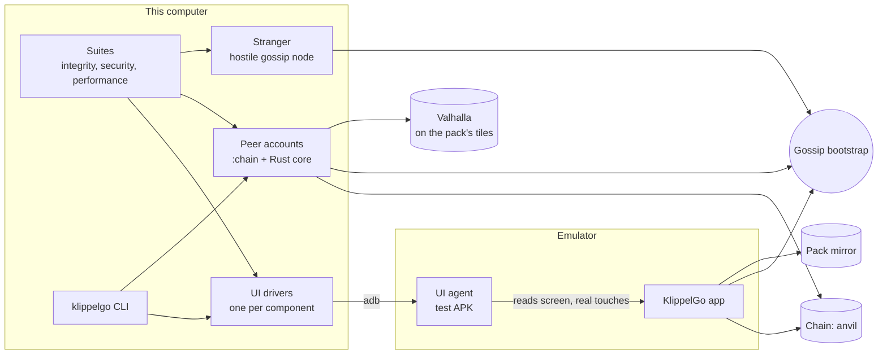

# End-to-end tests

These tests use KlippelGo the way a person does: they open the real app on an Android emulator, read its
screen and touch it, against a real chain, the real gossip network, a real map pack and a real router. Nothing
is mocked. The one thing that is not the app is the other people in a ride, who are *peer accounts*: seeded
test accounts driven by the app's own client code, with no screen.

```sh
make e2e                # bring everything up, then run all three suites
make e2e-integrity      # or one of them: e2e-integrity, e2e-security, e2e-performance
make e2e-three-phones   # three copies of the app in one ride: a rider and two drivers
make e2e-down           # stop what the tests started
```

Add `HEADLESS=0` to any of them to watch: the emulators then show their windows.

The first run builds the map pack if it is missing (about 15 minutes, with Docker) and boots an emulator. After
that a full run takes about a quarter of an hour, most of it waiting for blocks.

## What runs



| Piece | Where | What it is |
| --- | --- | --- |
| Stack | [`stack.sh`](stack.sh) | Brings up whatever is missing: chain, contracts, map pack, gossip, mirror, router, emulator, app |
| UI agent | [`apps/android/app/src/androidTest`](../apps/android/app/src/androidTest/kotlin/org/klippelgo/app/agent/UiAgent.kt) | Runs on the phone, in the test APK only. Reads the screen as a screen reader would and injects real touches |
| Tags | [`Tags.kt`](../apps/android/app/src/main/kotlin/org/klippelgo/app/ui/tags/Tags.kt) | The name of every piece of UI. The app and the harness compile the same file |
| UI drivers | [`harness/drivers/`](harness/drivers) | One class per UI component: what a person can read on it and do with it |
| Peers | [`harness/Peer.kt`](harness/Peer.kt) | Another rider or driver: its own key, gossip node and view of the chain |
| Stranger | [`harness/Stranger.kt`](harness/Stranger.kt) | A gossip node that follows no rules: it records the cell and sends forged messages |
| CLI | [`klippelgo`](klippelgo) | Every driver and every peer as commands, for a person or an agent |

## The chain: started here, or one that exists

`stack.sh up` uses the chain node at `KLIPPELGO_RPC` if one answers, and starts `testnet/anvil.sh` if none
does. It deploys only when the contracts are not there, and it never resets anything: a chain with history is
the normal case, and every test starts by ending the rides the test accounts left under way.

```sh
tests/stack.sh up                                   # local: start what is missing
KLIPPELGO_RPC=http://10.0.0.7:8545 tests/stack.sh up    # a chain that already exists
```

It must be a local testnet (anvil, chain id 31337). The tests sign with anvil's public keys, mint mock reais
and move the chain's clock to pass a governance vote. The script, the tests and the CLI all refuse any other chain. The app looks
for the gossip node and the pack mirror on the chain node's host, so with a remote chain they must be there.

| Variable | Default | |
| --- | --- | --- |
| `KLIPPELGO_RPC` | `http://127.0.0.1:8545` | Chain node |
| `KLIPPELGO_DEPLOYMENT` | `deployments/local.json` | Contract addresses. The app is built with this file |
| `KLIPPELGO_PACK` | `mappack/build/br-pr-cascavel/pack` | The built map pack |
| `KLIPPELGO_VALHALLA` | `http://127.0.0.1:8002` | Router for the peers' routes |
| `KLIPPELGO_PHONE` | `emulator-5570` | adb serial. Set it to use an emulator already running. Anything that is not an emulator is refused unless `KLIPPELGO_ALLOW_DEVICE=1`: the tests wipe the app's data |
| `HEADLESS` | `1` | `0` shows the emulators' windows. An emulator already running the other way is restarted |
| `PHONES` | `1` | `3` starts three emulators (`emulator-5570`, `-5572`, `-5574`), for the tests with three apps. About 12 GB of free RAM |

## The suites

Each folder is one kind of question. A test is named for what it shows, and reads top to bottom as the story
of one person using the app.

| Folder | Question | Budget |
| --- | --- | --- |
| [`integrity/`](integrity) | Does it do what it says? A ride from search to payment on each side, cancelling, declining, onboarding, what the app keeps when closed, and that every amount on screen is the amount on chain | Pass or fail |
| [`security/`](security) | Does it hold when someone cheats? Each test names the invariant of [apps/docs/security.md](../apps/docs/security.md) it holds the app to, and shows an honest message getting through, so it cannot pass with the app deaf | Pass or fail |
| [`performance/`](performance) | How long does a person wait? Start-up, the map pack, search, routing, each step of a match, and a driver's phone under 150 open requests | Each figure has a ceiling |

Performance figures are printed as they are taken and kept in `tests/.run/report/performance.json`, the last
fifty runs of each, so a drift shows before it breaks a budget. The budgets are for an emulator on a
developer's computer with two-second blocks: they catch a step getting several times slower, not a regression
of a few percent.

When a test fails, the screen at that moment is saved to `tests/.run/report/<Test>.<method>.png`, one picture
per phone.

### Three apps in one ride

[`integrity/ThreePhonesTest.kt`](integrity/ThreePhonesTest.kt) has no peer account at all: a rider and two
drivers, each a copy of the real app on its own emulator.

| Test | What happens |
| --- | --- |
| A ride from request to payment, with a second driver looking on | Both drivers see the request; one quotes, is chosen, checks the route, accepts, shares their position, starts; the rider pays and both rate. The other driver sees the request go and their balance does not move |
| Both drivers offer, and the rider takes the cheaper one | Each driver quotes a different fare; the rider sees both, cheapest first; one driver re-quotes and the rider's screen follows; the rider locks the cheaper one, and the driver not picked gets no ride and no route |

```sh
make e2e-three-phones               # PHONES=3 tests/run.sh integrity --tests '*ThreePhones*'
HEADLESS=0 make e2e-three-phones    # the same, with the three windows on screen
```

They are skipped, not failed, when fewer than three phones are up, so `make e2e` on one emulator stays green;
`PHONES=3 make e2e` runs everything. The rider and the first driver go through the app's onboarding. The second
driver is the second seeded driver account (#9), which the create-account screen cannot pick, so that phone is
started the way `scripts/two-phones.sh` starts one: with the role and the account in the launch (limit P2 in
[apps/docs/security.md](../apps/docs/security.md)).

To drive one of the other phones from the CLI: `KLIPPELGO_PHONE=emulator-5572 tests/klippelgo screen`.

## Writing a test

```kotlin
class RiderRideTest : Scenario() {
    @Test
    fun `a rider who cancels before the driver answers gets everything back`() {
        val driver = peer(DevAccount.DRIVER)        // another person, on the real network
        freshRider()                                // install-day app, onboarded by hand, map downloaded
        app.whereTo.ask()                           // UI drivers: what a person does
        app.ask.search("Avenida Brasil")
        app.ask.pick(0)
        app.ask.submit()
        val offer = driver.offer(driver.awaitRequest(appRider))
        app.offers.pick(driver.address)
        app.confirm.lock()
        ...
        assertEquals(RideStatus.Cancelled, chain.ride(id).status)   // and what the chain says
    }
}
```

Rules:

1. **Go through a driver.** A test never names a tag or a coordinate. If the UI has a piece with no driver,
   add the tag in `Tags.kt`, put it on the composable, and add the function to the component's driver.
2. **One driver per component**, in the file named like the app's (`Rider.kt`, `Driver.kt`, `Screens.kt`,
   `Components.kt`). A function is one thing a person reads or does. Every public function is a CLI command.
3. **Assert on both sides.** What the screen shows, and what the chain or the peer saw.
4. **No sleeps for things that happen.** Wait for the thing (`phone.await`, `waitUntil`). A fixed wait is only
   for showing that something does *not* happen.
5. **Never assume a fresh chain.** Compare balances before and after; find rides by what identifies them.
6. **A security test sends the bad message and then a good one.** Without the second half it proves nothing.
7. **The app is account #3 as a rider and #4 as a driver** (`DevAccount.RIDER`, `DRIVER`), as when a person
   picks the role on the create-account screen. Peers use the other seeded accounts.

Tags that say a state carry it in the name (`on-the-way.status.Accepted`, `driver-ride.chosen.route.checked`),
so tests do not depend on the app's language.

## The CLI

`tests/klippelgo` is the same harness as commands. It is how an agent, or a person at a terminal, plays a user.

```sh
tests/stack.sh up
tests/klippelgo launch fresh                       # the app as on install day
tests/klippelgo screen                             # which screen, and every named piece on it, as JSON
tests/klippelgo ui                                 # every component and what can be done with it
tests/klippelgo ui welcome start
tests/klippelgo ui create-account fill Ana rider
tests/klippelgo ui create-account submit
tests/klippelgo ui funding skip
tests/klippelgo ui map-notice download
tests/klippelgo ui where-to ask
tests/klippelgo ui ask search "Avenida Brasil"
tests/klippelgo ui ask pick 0
tests/klippelgo ui ask submit

tests/klippelgo peers start                        # the other people, kept alive in the background
tests/klippelgo peer driver offer 0x3c44…93bc      # a peer driver quotes the app's request
tests/klippelgo ui offers offers
tests/klippelgo ui offers pick 0x90f7…b906
tests/klippelgo ui confirm amounts
tests/klippelgo ui confirm lock
tests/klippelgo peer driver last-ride-as-driver
tests/klippelgo peer driver accept 42
tests/klippelgo chain ride 42
```

`klippelgo drive` moves a driver's emulator along the route it is on: to the pickup until the ride starts,
then along the ride, in ten equal steps, one a second (`--steps`, `--every`, `--phone`, and `pickup` or `ride`
to pick the stretch). Along the ride the rider's emulator moves with the car (`--rider` names it when several are
signed in as that rider). With no `--phone` it finds the running emulator whose app is in driver mode, so it works
on the emulators of `make android-two-phones` as they are: `make android-drive`.

`klippelgo help` lists everything. Peers are `rider`, `driver`, `rider2`, `driver2`; play the other side with
an account the app is not using. `tap`, `read`, `type`, `wait` and `gone` take a raw tag, for what no driver
covers yet; `shot <file.png>` takes a picture.

## What these tests do not cover

- **iOS.** The drivers are written against tags, not Android, so an iOS agent can serve the same suites.
- **A public testnet.** See "The chain" above.
- **Known limits** in [apps/docs/security.md](../apps/docs/security.md) (P1 to P16) are not tested as if they
  were closed. `RevealedRouteTest` says which one it stops short of.
- **The UI agent is test equipment.** It can read the screen and touch it, so the test APK goes on test
  emulators only. It answers only adb's shell user and root, and it is never part of the app's own APK.
